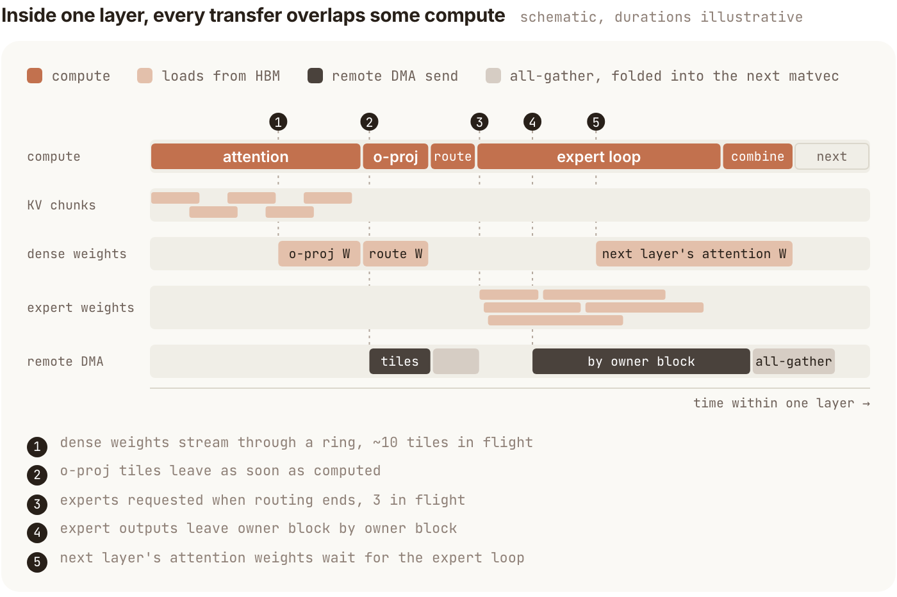

This PyTorch engineering report connects three serving problems for an 816B MoE: interruptions in low-concurrency decode/verify, retention of long-session state, and prefill fairness under higher load. Its value extends beyond one operator because the dominant bottleneck changes with concurrency and context.

Original: [Optimizing Muse Spark Open on TPU v7 with SGLang-TorchTPU](https://pytorch.org/blog/optimizing-muse-spark-open-on-tpu-v7-with-sglang-torchtpu/)  
Haolin Fu, Xiaoyu Zhang, Junyan Xu, Wangyuan Zhang, Haoguang Cai, RadixArk Team · 2026-11-10

## Keep all 62 verify layers in one data stream

The deployment uses one four-chip TPU v7 host. Each chip exposes two devices, giving eight-way tensor parallelism. Muse Spark Open has 62 MoE layers, routing each token to eight of 256 experts. Forty-six layers use a 2,048-token sliding window, while 16 attend over the full context.

At small batch, computation per weight is limited, making sustained HBM streaming critical. The native path already uses fused kernels, but layer-level kernel and collective boundaries repeatedly stop the stream. The new path runs one Pallas program per device over all 62 layers and the final norm, keeping dense weights, dynamically selected expert weights and cross-device partial sums in flight.

<a class="note-image-link" href="/assets/images/tech/muse-spark-tpu/official-5.png" target="_blank" rel="noopener" aria-label="Weight, KV and cross-device transfer pipelines inside one layer · View original image ↗">View original image ↗</a>

*Reading the diagram: computation is above, with DMA streams moving data ahead of or alongside it. Durations are schematic, not measured speedups.*

Dense weights use a cross-layer prefetch ring. Expert fetches begin immediately after routing. Next-layer attention refills wait until the expert loop, avoiding competition with immediately needed expert weights. Finished o-proj tiles are DMAed to their owner while later tiles compute. Embedding, drafting, KV writes, the LM head and sampling remain outside the megakernel; the whole service is not a single kernel call.

With actual DFlash2 acceptance on GSM8K, single-request output-token time falls from 3.78 to 1.95 ms, about 1.94 times faster; two concurrent requests improve by about 1.85 times. Both paths use DFlash2, so its separate speculative-decoding gain should not be multiplied into this comparison. Verify time within 1.5–1.7 times the weight-read floor is a local execution metric, not complete request latency.

## Remove dependencies rather than only hiding them

Collective folding begins projection as peer slices arrive instead of waiting for a complete all-gather. Per-row normalization scalars can be applied after multiplication, exposing overlap. This changes some bf16 rounding positions and is not bit-identical.

Attention uses the model’s QK normalization and fixed gain to derive an absolute score bound of 43.8, safely below FP32 exponential overflow. Checking that bound at construction allows removal of online softmax’s running maximum and rescaling dependency. KV chunks then pipeline independently. The authors report up to 3.9-times improvement in an attention microbenchmark and 18% faster serving decode for two requests at 500K context. **The exact model-specific bound is essential; arbitrary attention cannot discard its maximum.**

The expert loop exposes another mechanism. Few-row and heavy-row branches shared one body, so heavy accumulators caused spills even on the common light path. Separating the loops reduces that register burden while keeping outputs bit-identical. Different optimizations in the article therefore have different numerical-equivalence properties.

## Lower precision needs a matching physical layout

Each device holds two 64-wide KV heads per layer. Padding in the token-major layout makes both bf16 and FP8 consume 512 bytes per token. A sequence-on-lane arrangement reduces FP8 to 256 bytes. Moving the draft model’s window-only KV from a full-context allocation into the sliding-window pool also increases cached-token capacity by 38%. Nominal bit width does not guarantee capacity savings.

Host-DRAM HiCache retains prefixes evicted from HBM during tool pauses. Session-aware protection applies to the host tier while HBM retains ordinary LRU. A main agent waiting for children should not be mistaken for dead state; losing even its sliding-window tail can prevent reuse of the associated full-attention prefix. This complements the digest’s KV-storage lifecycle findings without constituting a replication of that study.

## High throughput also needs prefill fairness

Cold prompts run in 4,096-token chunks. Previously one long prompt could monopolize consecutive chunks. The revised scheduler reserves at least 1,024 tokens per batch for it and lets waiting turns use the rest. In an AgentX comparison, median end-to-end latency falls 58% and p90 falls 33%, with throughput within 5%. This is a scheduling result, not a megakernel-only gain.

AgentX reconstructs request lengths, prefix sharing, tool pauses and subagent structure from 393 opt-in Claude Code sessions, substituting synthetic tokens. This report uses its 1M-context version. The curve’s 433 and 95 output tokens/s/request describe different interactivity points. Corresponding throughput from 6,101 to 25,906 tokens/s/chip **counts input and output tokens**, so it is not exclusively generation throughput.

The report provides concrete implementations and comparisons, but synthetic AgentX content does not test semantic task correctness, and some kernel comparisons use an earlier checkpoint. Collective folding and sequence parallelism change rounding or reduction order; the article mentions accuracy checks without a complete task-level results table. The transferable lesson is to separate low-concurrency data streaming, session capacity and high-load queueing rather than combine every improvement into one universal multiplier.
