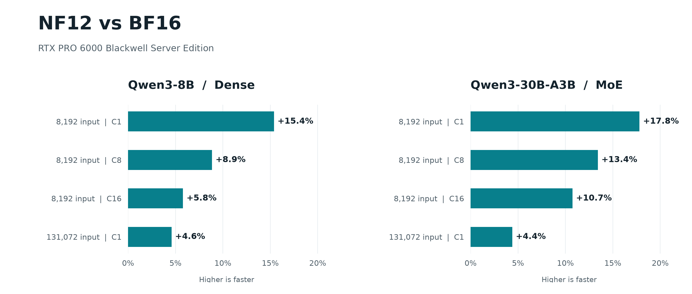

Reducing BF16 weights by roughly a quarter while retaining every original value is nf12's main attraction. Fusing decoding into GPU matrix operations can turn saved traffic into speed. Yet the project's cross-GPU results also show regressions on some high-concurrency B200 and H200 configurations, despite gains on RTX PRO 6000. The important relationship is between the storage format, execution path and serving workload.

Primary source: [nf12](https://github.com/dphnAI/nf12), dphnAI; repository created 2026-11-06. The implementation is based on Together AI's NyoomFloat12 (Liberman, Fang, Zhang, Dao, Fu), but uses its own bit and tiled memory layouts. The formats are not compatible.

## How a 12-bit primary representation recovers BF16

BF16 contains a sign, an eight-bit exponent and a seven-bit mantissa. nf12 chooses an exponent base B per matrix, covering 16 consecutive exponent values. In-window values retain their original low byte; the sign and remaining exponent-offset bits go into metadata. Eight values occupy a fixed 12-byte primary group, versus 16 bytes in BF16.

**Fixed length describes the primary representation, not an unconditional total of exactly 12 bits per weight.** If any value falls outside the window, or a group's encoding would equal the reserved sentinel, the whole group escapes. An auxiliary table stores its eight original BF16 values, and the primary group stores an index. The encoder chooses B to minimize escaped groups. Special values follow the same rules. Recovery therefore reconstructs original bits rather than rounding to a coarser precision, while matrices with many exceptional exponents can require more auxiliary storage.

This determines what is being saved: weight storage, not KV-cache space or generated tokens. The README reports Qwen3-30B-A3B loaded weights falling from 56.88 GiB to 42.80 GiB. Those are measurements for that model; a running server still needs workspace, activations and KV memory.

## Making the layout directly consumable by matrix instructions

The [format and API specification](https://github.com/dphnAI/nf12/blob/master/docs/SPEC.md) organizes weights into 16×16 atoms and 16×64 super-atoms. A decoded group maps directly to a matrix instruction's register fragment, while memory planes support coalesced warp reads. The small-batch path can load compressed weights, decode and compute together, avoiding a full BF16 write to device memory followed by another read.

Fusion is not always preferable. With many tokens, a fused kernel may decode the same weight tile again for every token tile. The specification therefore includes architecture- and shape-dependent decode-then-GEMM routes: reconstruct row slices in workspace and invoke BF16 GEMM. Extra temporary storage and traffic may be worthwhile when they avoid repeated decoding. Routing depends on shape and architecture rather than weight contents and requires no host synchronization.

MoE adds routing work. Each expert has its own exponent base and escape table. Assignments are stably sorted by expert, followed by gate/up projection, activation, down projection and weighted combination. Expert weights can be sliced by bytes, but assignment organization and combination still cost time. Compressing the data type does not remove those system operations.

## Where the losslessness contract ends

The specification requires bit-exact encode/decode round trips for every BF16 input, including negative zero, subnormals, infinities and NaN payloads. Linear operations accumulate in FP32 and write BF16. Under a matched kernel configuration, results should equal the uncompressed bf16t twin with the same layout. Comparisons against cuBLAS or another serving path can differ because of accumulation order and kernel selection.

The [proposed vLLM integration, PR #66221](https://github.com/vllm-project/vllm/pull/66221), provides a concrete example. On WikiText-2 raw, the author reports mean KL of 0.000822 nats/token and 98.24% top-1 agreement for Qwen3-8B; Qwen3-30B-A3B reports 0.002667 and 99.22%. Lossless weights do not automatically produce identical token outputs. These measurements also do not replace task-level quality evaluation. The PR remains open and unmerged.

## Why serving results point in both directions

The README's serving benchmark uses HTTP generation with 128 input and 256 output tokens, concurrency 1/8/32, and 68 server runs alternating BF16 and NF12. Across three models and the three concurrency settings, RTX PRO 6000 Blackwell throughput ratios range from 1.06× to 1.27×. In the same table, B200 at concurrency 32 reaches only 0.81× for Qwen3-8B and 0.78× for Granite 1B MoE. H200 reaches 0.93× for Qwen3-30B-A3B at concurrency 32. H200 Granite timings were unstable, so the authors omit a pooled speedup.

These results expose a trade-off between bandwidth savings, decoding overhead and compute utilization. The README's MoE tests use a benchmark-only adapter, while BF16 uses native backends, including FlashInfer TRT-LLM on B200. These are comparisons of complete execution paths. A regression on one GPU does not by itself isolate a format defect, and favorable hardware results cannot be generalized to every GPU.

<a class="note-image-link" href="/assets/images/tech/nf12/benchmark.png" target="_blank" rel="noopener" aria-label="nf12 throughput improvements over BF16 on RTX PRO 6000 · View original image ↗">View original image ↗</a>

*The PR's RTX PRO 6000 tests show larger gains at shorter inputs and lower concurrency. At 131,072 input tokens, single-request gains fall to roughly 4–5%. These are separate experiments from the README's 128/256-token configuration.*

In the PR, Qwen3-30B-A3B with an 8,192-token input rises from 127.05 to 149.69 tok/s at concurrency 1, and from 614.10 to 680.09 at concurrency 16. Reported weight memory is 56.87→43.00 GiB; it should not be merged with the README's 42.80 GiB figure as one measurement. The project also lists single-token MoE kernel improvements, but their baseline is the previous composed NF12 path, **not BF16**. Kernel gains and serving gains require separate interpretation.

## Which deployments deserve a closer look

nf12 targets NVIDIA SM80 and newer, requiring weight dimension N to be divisible by 16 and K by 64. The clearest opportunity is a deployment constrained by weight capacity or bandwidth that needs to retain BF16 weights. “NF12 only” entries describe runs under specified memory caps where BF16 was not attempted. They are capacity clues, not calculable speedup ratios.

For inference operations, three questions remain separate: whether weight round trips are exact, whether output differences in the chosen execution path are acceptable, and whether actual concurrency and context lengths run faster. nf12 supplies a concrete lossless representation and execution strategy, including unfavorable configurations. Its value is making compression-versus-compute trade-offs inspectable under specific engineering conditions.
