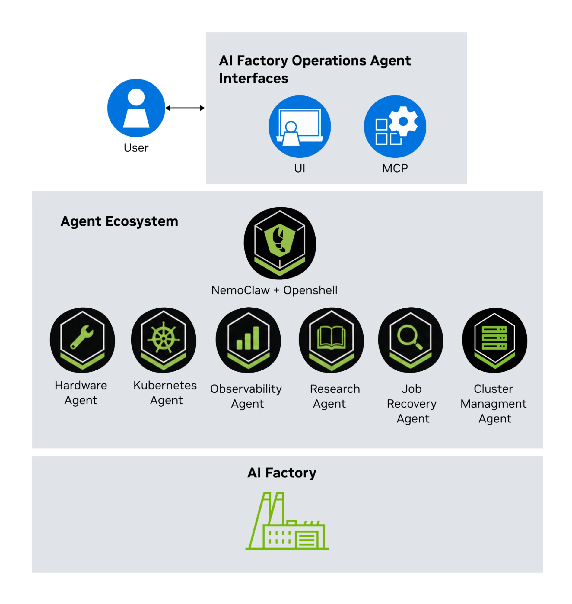

Kavya G Y (Enterprise Product Manager, NVIDIA) & Rohan Adwankar (Agentic Systems & Observability for AI Infrastructure, NVIDIA) · Originally published 2026-11-04 · [NVIDIA Technical Blog Primary Post](https://developer.nvidia.com/blog/how-nvidia-uses-ai-agents-to-streamline-ai-factory-operations/) · [Developer Example Card](https://build.nvidia.com/nvidia/operate-ai-factories-with-agents/examplecard) · [Open-Source GitHub Orchestrator](https://github.com/NVIDIA/AI-Factory-Operations-Agent)

When a large-scale training run drops in goodput or fails outright, the root cause rarely sits inside a single dashboard. Site reliability engineers (SREs) routinely pivot across compute telemetry, networking signals, device hardware logs, storage health, and Kubernetes scheduling state before spotting what actually broke. Published November 4, 2026, NVIDIA's engineering walkthrough of the **AI Factory Operations Agent** documents how the company streamlines internal **NVIDIA DGX SuperPOD** operations across **DGX H100, DGX B200, and DGX GB300** production clusters—combining **NemoClaw** orchestration, **OpenClaw** plugins, focused **Model Context Protocol (MCP)** servers, **NVIDIA OpenShell** runtime sandboxing, and read-only Kubernetes RBAC enforced at the tool boundary.

> **Evidence & Scope Boundary**: Rewritten strictly from frozen captures of NVIDIA's November 4, 2026 primary post and its same-day companion robotics/manufacturing post ([FOX Blueprint](https://developer.nvidia.com/blog/how-nvidia-factory-operations-blueprint-coordinates-ai-agents-to-investigate-production-issues/)). Three boundaries must be kept upfront: **First**, this GPU-cluster operations post presents architecture and production experience **without publishing any controlled studies, baseline MTTR deltas, RCA accuracy percentages, or SRE agreement numbers** (those metrics are explicitly described as ongoing internal measurement work); **Second**, the embedded walkthrough (`Video 1`) is explicitly labeled as an **incident injected into an NVIDIA DGX cluster for internal demonstration**, not an observational production evaluation; and **Third**, the open-source orchestration repo is **experimental** (while NVIDIA-built cluster domain agents require account-manager request), and the Siemens planning metrics (`up to 20%` cost savings, `up to 40%` shorter time to market) cited in the same-day **FOX** manufacturing post **must never** be extrapolated to GPU-cluster AIOps.

## Architecture & Cross-Layer Telemetry Correlation: NemoClaw, Six Domain Agents, and Control-Plane Isolation

Monolithic diagnostic agents tend to degrade quickly once handed dozens of cluster APIs, log stores, and runbooks simultaneously: overlapping responsibilities inject noise, and loose tool descriptions trigger misrouted queries. NVIDIA's AI Factory Operations Agent responds by splitting **user entrypoints, central orchestration, focused MCP tool servers, and local inference compute** into distinct control-plane layers.

<figure class="note-figure">
  <a class="note-image-link" href="/assets/images/tech/nvidia-ai-agents-ai-factory-operations/architecture.webp" target="_blank" rel="noopener" aria-label="View original NVIDIA Figure 1: AI Factory Operations Agent architecture">
    
    <span class="note-image-action">View original image ↗</span>
  </a>
  <figcaption>Preserved original figure (Source: NVIDIA Technical Blog Figure 1): User queries enter via UI and MCP interfaces into the NemoClaw and OpenShell ecosystem coordinating six domain-specific agents across the AI Factory (note that image metadata in the source HTML notes NVIDIA Nemotron 3 models powering inference).</figcaption>
</figure>

Deployed via **Helm** as a **Kubernetes control-plane application**, the stack packages the **built-in web UI, OpenClaw gateway, MCP tool servers, inference endpoint, and NVIDIA OpenShell runtime** as Kubernetes services. Three architectural choices anchor how investigations run:

1. **Dual Interfaces with Audit Tracking**: SREs query any agent in natural language through the built-in chat UI—switching between active investigations and viewing dynamically generated charts—or integrate existing coding-agent interfaces via API. Every action and tool invocation is tracked for auditability.
2. **NemoClaw Routing over OpenClaw & Focused MCP Servers**: At the center, the **NemoClaw** blueprint receives SRE requests and routes work to the relevant domain agent. Agents reach cluster infrastructure through **OpenClaw plugins** and **MCP servers**, each exposing a narrow set of approved operational tools so new monitoring backends or roles can be added without modifying existing agents or granting blanket permissions.
3. **Control-Plane Compute & Data-Sovereignty Isolation**: To satisfy on-premises data-sovereignty requirements, agent inference runs on locally served **NVIDIA Nemotron** open models (referenced as *NVIDIA Nemotron 3 models* in Figure 1's HTML `alt` metadata and *locally served NVIDIA Nemotron open models* in body text). For large AI factories, NVIDIA recommends a **dedicated GPU-accelerated control plane** isolated from production training GPUs: internally, NVIDIA runs model inference on dedicated GPU capacity and runs runtime services in the existing control-plane **CPU Kubernetes admin space**, so production clusters emit telemetry without sacrificing training FLOPs or risking workload disruption. Smaller installations can choose local **RTX PRO Workstation**, **DGX Spark**, or external/cloud endpoints based on capacity and data-residency trade-offs.

<figure class="note-figure">
  <a class="note-image-link" href="/assets/images/tech/nvidia-ai-agents-ai-factory-operations/ai-factory-multiagent-ops-en.svg" target="_blank" rel="noopener" aria-label="Click to zoom: NVIDIA AI Factory control-plane isolation and cross-layer telemetry topology">
    
    <span class="note-image-action">Click to zoom ↗</span>
  </a>
  <figcaption>Assistant diagram (not an original figure): Synthesizing the Helm-deployed control plane, isolated inference capacity, and cross-layer telemetry domains across DGX H100, B200, and GB300 clusters from the Nov 4, 2026 primary text.</figcaption>
</figure>

Inside the ecosystem, NVIDIA divides internal data-center diagnostics across **six specialist agents** plus **cross-cutting MCP tools** (`web search`, `code execution`, `Grafana dashboards`, and custom adapters for site schedulers or cluster managers):

- **Job Recovery Agent**: Detects training job failures and **goodput degradation**, correlates evidence across **scheduler, application, hardware, and network** layers, and recommends recovery actions once root cause is confirmed.
- **Hardware Agent**: Triages device-level faults—**PCIe errors, ECC errors, GPU issues, NVMe failures, and thermal anomalies**—down to the failing component.
- **Observability Agent**: Queries historical **Prometheus** telemetry and integrated **Grafana Loki** logs to dynamically build and display dashboards inside the web UI.
- **Research Agent**: Searches preloaded **NVIDIA Mission Control** manuals, **DGX SuperPOD** reference architectures and deployment guides, plus operator-uploaded site runbooks.
- **Kubernetes Agent**: Supplies **read-only operational awareness** across pods, services, deployments, GPU resources, node status, and scheduling state.
- **Cluster Management Agent**: Interfaces with **NVIDIA Base Command Manager** APIs via diagnostic MCP tools for advisory cluster management and troubleshooting.

One specification gap should be flagged candidly from the primary source: while NVIDIA emphasizes cross-layer correlation across **compute, network, hardware, and scheduling** signals, the blog does **not** publish low-level wire protocols, specific interconnect counter sources (for example, it does not detail NVLink or switch-fabric telemetry schemas), MCP tool definitions, or inter-agent handoff payloads. Adopting teams must inspect the experimental open-source codebase or engage NVIDIA directly to verify exact connector schemas.

## Tool Boundaries & Human-in-the-Loop Guardrails: OpenShell Sandboxes, Credential Isolation, and Read-Only RBAC

Asking an LLM in its system prompt to *"behave read-only"* offers negligible protection against prompt injection, malformed arguments, or tool misuse. The strongest technical contribution in NVIDIA's write-up is enforcing least privilege **on the actual execution and credential path** rather than inside prompt text.

| Component / Guardrail Primitive | Evidence Domain & Exposed Interface | Authority Boundary & Risk Mitigated | Primary Disclosure & Verification Status |
| :--- | :--- | :--- | :--- |
| **Job Recovery Agent** | Scheduler, application, hardware, and network layers for job/goodput drops | **Advisory only** despite its name; recommends steps post-RCA without autonomous cluster writes | Qualitative production role; no recovery precision or MTTR numbers published |
| **Hardware Agent** | Device-level PCIe, ECC, GPU, NVMe, and thermal anomaly triage | Confines component hardware triage to one owner, preventing noisy overlap | NVIDIA-developed domain agent (requested separately via account manager) |
| **Observability Agent** | Historical Prometheus telemetry, Grafana Loki logs, and live web UI charts | Read-only querying and dynamic chart rendering; no workload mutation path | Explicitly supports in-UI dashboard generation |
| **Research Agent** | Preloaded Mission Control manuals, SuperPOD guides, and custom site runbooks | Grounds operational recommendations in versioned reference docs and local SOPs | Retrieval backend implementation details not specified |
| **Kubernetes Agent + `run_kubectl`** | Pods, services, deployments, GPU allocations, node status, and scheduling state | Server-side pinned `kubectl` binary bound to registered read-only ServiceAccount RBAC | **Verified on runtime path via `auth can-i`**: `get pods`/`configmaps` yes; `secrets` & pod writes no |
| **Cluster Management Agent** | Diagnostic MCP integration with NVIDIA Base Command Manager APIs | Explicitly scoped as **advisory** cluster management and troubleshooting | API write-path gating beyond advisory scope is not detailed |
| **NVIDIA OpenShell Runtime** | Per-session K8s sandbox (workspace, selected skills, command policy, kernel limits) | **Receives neither `kubectl` nor Kubernetes credentials**; enforces multi-tenant isolation | Core security boundary; same isolation pattern reused in companion FOX blueprint |

Three concrete enforcement mechanisms appear along the runtime path:

1. **Per-Session Kubernetes Sandbox Isolation**: For shell execution, **NVIDIA OpenShell** spins up a **per-session Kubernetes sandbox** instead of executing commands inside the main gateway pod. The sandbox receives only the agent workspace, selected skills, and an explicit **command policy**; its lifecycle does not alter existing control-plane services or production workloads.
2. **Server-Side Credential Separation via `run_kubectl`**: Kubernetes inspection flows exclusively through the server-side **`run_kubectl`** tool, which runs a **pinned `kubectl` binary** against **registered read-only credentials**. Crucially, **OpenShell receives neither `kubectl` nor Kubernetes credentials**. From a systems-security perspective (assistant engineering analysis grounded in the source architecture), stripping credentials from the agent's shell sandbox eliminates an entire class of prompt-injection failures: even if untrusted log payloads hijack shell behavior inside the sandbox, there is no local `kubeconfig`, token, or binary capable of bypassing server-side RBAC.
3. **Access-Path RBAC Verification & Multi-Tenant Scoping**: Kubernetes Service Accounts and RBAC define what `run_kubectl` may inspect. Because NVIDIA executes permission checks along the exact runtime access path, the logged `kubectl auth can-i` output serves as verifiable access-path evidence:

```bash
(agent) $ kubectl auth can-i get pods
yes
(agent) $ kubectl auth can-i get configmaps
yes
(agent) $ kubectl auth can-i get secrets
no
(agent) $ kubectl auth can-i create pods
no
(agent) $ kubectl auth can-i update pods
no
```

In **multi-tenant AI factories**, agents, MCP tools, sandboxes, and Kubernetes permissions are scoped down to each tenant's **namespaces, jobs, and nodes**—allowing tenant SREs optional dedicated domain agents and dedicated inference hardware while keeping **central operations** able to view the broader cluster. OpenShell enforces those boundaries inside isolated per-tenant sandboxes with **kernel-level restrictions**.

<figure class="note-figure">
  <a class="note-image-link" href="/assets/images/tech/nvidia-ai-agents-ai-factory-operations/factory-hitl-remediation-gates-en.svg" target="_blank" rel="noopener" aria-label="Click to zoom: Tool-boundary isolation, read-only RBAC, and HITL remediation gate">
    
    <span class="note-image-action">Click to zoom ↗</span>
  </a>
  <figcaption>Assistant diagram (not an original figure): Tracing OpenShell credential isolation, server-side run_kubectl RBAC proof, the mandatory HITL review gate, and evidence separation from the companion FOX blueprint.</figcaption>
</figure>

Hardware and RBAC enforcement is paired with **human-in-the-loop (HITL) governance** in the workflow itself. NVIDIA's production lessons explicitly connect **Read-only first** (*accurate investigation builds SRE trust before automation*) with **Transparent reasoning** (*SREs need to see tool calls, evidence, and conclusions before taking action*). Even when the **Job Recovery Agent** correlates scheduler, hardware, and network signals into a root-cause hypothesis, it outputs an inspectable recommendation—leaving causal verification and production remediation firmly behind human review.

## Honest Audit of Qualitative Claims: Unquantified Benchmarks and Contrast with the Companion FOX Blueprint

Reading an architecture post critically means separating **implemented control primitives** from **unmeasured performance claims**. Auditing the frozen November 4, 2026 text highlights four clear evidence boundaries:

- **Internal production footprint without fleet or workload sizing**: The post states that NVIDIA runs the framework internally across **DGX H100, B200, and GB300** clusters and reduces manual SRE effort, yet omits cluster sizes, GPU counts, ticket volumes, and before/after **MTTR or MTTD** baselines.
- **RCA accuracy and SRE agreement remain ongoing internal metrics**: NVIDIA notes it *"continues to refine the framework by measuring root cause analysis (RCA) accuracy, tracking SRE agreement, and expanding the agent ecosystem"*, publishing **zero** accuracy percentages, confusion matrices, or inter-SRE agreement rates.
- **Injected-fault demonstration rather than natural production study**: `Video 1` is candidly labeled as an incident *"injected into an NVIDIA DGX cluster for internal demonstration"*, showing workflow mechanics rather than uncontrolled incident-resolution statistics.
- **Two-tier release split**: While the **orchestration framework** on GitHub and `build.nvidia.com` is released as **experimental open source software** (subject to breaking API/config changes), **NVIDIA-developed cluster operations domain agents** are not open-sourced in the same package and must be requested via an NVIDIA account manager.

Comparing this post side by side with NVIDIA's **same-day companion blog**—[How NVIDIA Factory Operations Blueprint Coordinates AI Agents to Investigate Production Issues](https://developer.nvidia.com/blog/how-nvidia-factory-operations-blueprint-coordinates-ai-agents-to-investigate-production-issues/) (**FOX**, by Samuel Ochoa and Carlos Garcia-Sierra, Nov 4, 2026)—clarifies both NVIDIA's shared agentic substrate and the boundary where metrics must stay strictly separated:

| Audit Item / Source Claim | Exact Primary Scope & Conditions | Missing Baseline or Unspecified Detail | Engineering Interpretation Boundary |
| :--- | :--- | :--- | :--- |
| **DGX H100 / B200 / GB300 internal use** | This post (2026-11-04): Internal SuperPOD operations across three DGX generations | Node counts, query volume, time span, and incident mix are omitted | Confirms internal operational use, not a transferable fleet-wide ROI benchmark |
| **RCA accuracy & SRE agreement** | This post (2026-11-04): Explicitly named as ongoing internal refinement measurements | Zero accuracy %, precision/recall, false-positive suppression, or MTTR deltas | Cannot cite any % speed-up or automated RCA win rate from this source |
| **Video 1 troubleshooting clip** | This post (2026-11-04): Internal demo using an incident **injected** into a DGX cluster | Fault count, difficulty spectrum, and end-to-end latency omitted | Validates UI/evidence walkthrough under synthetic fault injection, not long-tail field reliability |
| **Experimental OSS vs. NVIDIA agents** | This post (2026-11-04): GitHub orchestrator is experimental OSS; NVIDIA domain agents via account request | Exact MCP schemas, network telemetry connectors, and closed-agent access terms omitted | External adopters gain the NemoClaw/OpenShell/RBAC pattern, not turnkey NVIDIA domain packs |
| **Same-day FOX Blueprint & Siemens figures** | Companion post (2026-11-04): **FOX** uses NemoClaw + OpenShell + Nemotron for **PCB/SMT assembly**; cites Siemens downtime report (USD 253 million/yr) & Erlangen planning (up to 20% cost, 40% TTM) | Planning numbers come from Siemens manufacturing simulation/virtual AOI prep; SMT example itself reports no controlled RCA % | Shares the **NemoClaw + OpenShell + HITL** pattern (FOX also mandates early operator approval & PDF evidence), but **Siemens 20%/40% figures never apply to GPU cluster AIOps** |

Viewed together, both November 4 posts converge on a pragmatic architectural stance: whether diagnosing GPU training drops on a DGX SuperPOD or tracing PCB reflow anomalies on an SMT line (where FOX binds records by board identifier, processing time window, and versioned manuals into an operator-reviewed PDF report), NVIDIA does **not** present autonomous self-healing as solved. Instead, both architectures focus on **converging multi-system evidence behind strict sandbox policies and human approval gates**.

## Engineering Takeaways & Pre-Deployment Checklist: Turning Five Lessons into Measurable Controls

The primary post distills five production lessons—**Clear agent boundaries**, **Read-only first**, **Cross-layer correlation**, **Precise MCP tools**, and **Transparent reasoning**. For infrastructure teams building or evaluating multi-agent AIOps platforms, translating those qualitative lessons into verifiable deployment gates yields four immediate practices (assistant engineering synthesis grounded in the primary design):

1. **Enforce read-only access in credentials and binaries, not prompts**: Mirror the `OpenShell (no kubectl, no cluster creds)` + `server-side run_kubectl (pinned binary, read-only ServiceAccount)` split. Run automated `auth can-i` checks in CI/CD verifying denial on `secrets`, pod mutations, and node actions, alongside namespace/node RBAC checks for multi-tenant clusters.
2. **Audit MCP tool boundaries before adding more agents**: Overlapping sub-agent ownership generates conflicting hypotheses and noisy routing. Keep each MCP server narrow, document crisp parameter contracts, and monitor **wrong-tool selection rate** as a core quality metric before expanding the agent roster.
3. **Isolate control-plane inference capacity from production GPUs**: Incident storms spike LLM inference demand exactly when production clusters are most fragile. Allocate dedicated control-plane inference hardware (or isolated RTX PRO / DGX Spark capacity for smaller sites) and separate CPU admin namespaces so diagnostics never contend with training workloads.
4. **Instrument the missing empirical baseline locally before relaxing HITL gates**: Because NVIDIA's post leaves RCA accuracy and MTTR improvements unquantified, teams adopting this pattern should log **tool-routing accuracy**, **spurious cross-layer correlation rate** (co-occurring signals mistaken for root causes), **SRE agreement with surfaced hypotheses**, and **time-to-first-evidence (TTFE) / MTTR deltas** over a pre-agent historical baseline before allowing even pre-approved, reversible mitigations.

---

### Primary Sources Verified

- Primary Cluster Operations Post: Kavya G Y & Rohan Adwankar, *[How NVIDIA Uses AI Agents to Streamline AI Factory Operations](https://developer.nvidia.com/blog/how-nvidia-uses-ai-agents-to-streamline-ai-factory-operations/)*, NVIDIA Technical Blog, 2026-11-04.
- Official Example & Repository: *[AI Factory Operations Agent Developer Example](https://build.nvidia.com/nvidia/operate-ai-factories-with-agents/examplecard)* (NVIDIA Build) and *[NVIDIA/AI-Factory-Operations-Agent](https://github.com/NVIDIA/AI-Factory-Operations-Agent)* (GitHub, experimental open-source orchestration).
- Referenced Stack Components: *[NVIDIA NemoClaw Blueprint](https://build.nvidia.com/nvidia/nemoclaw-for-openclaw/nemoclawcard)*, *[NVIDIA OpenShell](https://www.nvidia.com/en-in/ai/openshell/)* (plus [OpenShell Docs Overview](https://docs.nvidia.com/openshell/latest/about/overview)), *[NVIDIA Nemotron Open Models](https://www.nvidia.com/en-us/ai-data-science/foundation-models/nemotron/)*, *[NVIDIA DGX SuperPOD](https://www.nvidia.com/en-us/data-center/dgx-superpod/)*, *[NVIDIA Mission Control](https://www.nvidia.com/en-us/data-center/mission-control/)*, *[NVIDIA Base Command Manager](https://www.nvidia.com/en-us/data-center/base-command-manager/)*, *[RTX PRO Workstation](https://www.nvidia.com/en-us/products/workstations/)*, and *[DGX Spark](https://www.nvidia.com/en-us/products/workstations/dgx-spark/)*.
- Same-Day Companion Manufacturing Post (Contrast Scope): Samuel Ochoa & Carlos Garcia-Sierra, *[How NVIDIA Factory Operations Blueprint Coordinates AI Agents to Investigate Production Issues](https://developer.nvidia.com/blog/how-nvidia-factory-operations-blueprint-coordinates-ai-agents-to-investigate-production-issues/)*, NVIDIA Technical Blog, 2026-11-04 (referencing [NVIDIA Agent Toolkit Docs](https://docs.nvidia.com/nemo/agent-toolkit/latest/index.html)).

> **AI-Assisted Curation & Archival Note**: Rewritten and expanded by the assistant from frozen captures of the November 4, 2026 NVIDIA Technical Blog posts above (`authoring_source: assistant`, `translation_source: assistant`), paired with the Chinese edition ([中文笔记](/tech/zh/nvidia-ai-agents-ai-factory-operations/)). Original metadata (`id`, `date: '2026-11-05'`, `permalink`, `published_at`) and canonical tags (`observability`, `systems-reliability`, `multi-agent`) are preserved verbatim. Original diagram `architecture.webp` remains untouched alongside two new assistant-authored `v3-blue` diagrams (`ai-factory-multiagent-ops-en.svg`, `factory-hitl-remediation-gates-en.svg`); zero unverified links, MTTR reductions, or RCA benchmarks have been fabricated.
