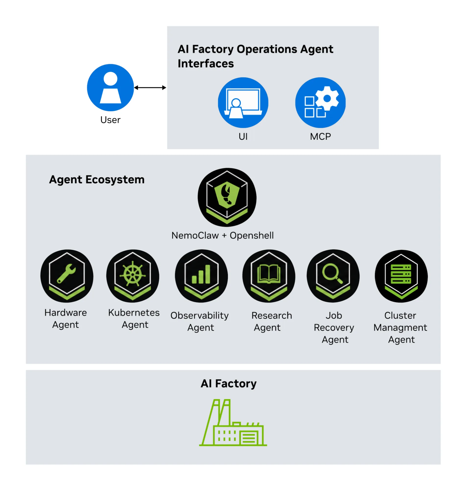

Original: [How NVIDIA Uses AI Agents to Streamline AI Factory Operations](https://developer.nvidia.com/blog/how-nvidia-uses-ai-agents-to-streamline-ai-factory-operations/) 
Kavya G Y, Rohan Adwankar · 2026-11-04

## One investigation across several infrastructure layers

A training slowdown can involve scheduling, networking, GPUs, storage, and application behavior. NVIDIA’s AI Factory Operations Agent assigns these evidence domains to specialists behind one conversational interface. The article reports internal production use across DGX H100, B200, and GB300 clusters. It describes investigation and advisory operations, without publishing an MTTR reduction or measured RCA accuracy.

A NemoClaw runtime receives SRE queries and routes work to domain agents. OpenClaw plugins and MCP servers expose focused operational tools; locally served Nemotron models support on-premises deployment. New integrations need not give every agent access to every infrastructure interface.

<a class="note-image-link" href="/assets/images/tech/nvidia-ai-agents-ai-factory-operations/architecture.webp" target="_blank" rel="noopener" aria-label="User interfaces, specialist agents, and the GPU cluster in NVIDIA’s operations framework · View original image ↗">View original image ↗</a>

*UI and MCP interfaces lead into a specialist-agent ecosystem. The cluster supplies the operational evidence each role investigates.*

## Separate responsibility from authority

The Job Recovery Agent investigates failed jobs and goodput degradation across scheduling, application, hardware, and networking evidence, recommending recovery steps after root-cause confirmation. Hardware, Observability, Research, Kubernetes, and Cluster Management agents provide component diagnostics, telemetry queries, documentation retrieval, read-only resource views, and diagnostic management interfaces.

A role called “Recovery” does not itself imply production write authority. The article emphasizes read-only investigation and SRE review of tool calls, evidence, and conclusions before action. Cross-layer correlation also does not automatically prove causality: RCA accuracy and SRE agreement remain ongoing measurement directions.

## Enforcement lives at the tool boundary

The framework runs as a Kubernetes control-plane application. Helm deploys the UI, gateway, MCP servers, inference endpoint, and OpenShell runtime. Shell execution occurs in a per-session Kubernetes sandbox rather than the main gateway pod. The sandbox receives the workspace, selected skills, and command policy.

Kubernetes inspection uses the server-side run_kubectl tool with a pinned binary and registered read-only credentials. OpenShell receives neither kubectl nor Kubernetes credentials. Service accounts and RBAC define inspectable resources. The demonstrated checks allow reading pods and configmaps but deny reading secrets and creating or updating pods. These are permissions on the actual access path, beyond a prompt asking the model to behave read-only.

For multi-tenant deployments, agents, tools, sandboxes, and Kubernetes permissions are scoped to the tenant’s namespaces, jobs, and nodes, while central operations retain broader visibility. OpenShell supplies sandbox and kernel-level restrictions. The useful architectural question is therefore where each role can obtain evidence and exercise authority, rather than how many agents exist.

## Isolate the control plane’s resource demand

For larger installations, the article recommends a dedicated GPU-accelerated control plane so investigation does not consume training GPUs. Internal deployments use dedicated inference capacity and existing CPU Kubernetes administration space for runtime services. Other local or cloud endpoints change the data-residency trade-off.

The strongest lessons are concrete: avoid overlapping ownership, start read-only, correlate across layers, define precise MCP tools, and expose the investigation evidence. There is no controlled incident-recovery comparison; the video is explicitly an injected-incident demonstration. The open-source orchestration framework remains experimental, and access to NVIDIA-developed domain agents is separate. This is a useful reference for access boundaries and deployment structure, rather than a quantified general promise of faster recovery.
