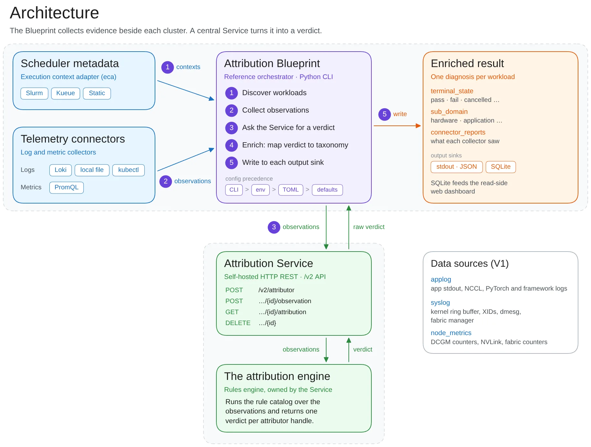

A GPU or interconnect fault can make several ranks report NCCL failures. The final exception identifies where execution stopped, which may differ from where the failure began. Treating those errors independently can turn one cause into several incidents or blame a downstream symptom.

NVIDIA Attribution analyzes one workload attempt at a time. It scopes execution by time and nodes, then correlates application logs, system logs, metrics, and scheduler state through deterministic rules. The [Diagnose Distributed AI Workload Failures with NVIDIA Attribution](https://developer.nvidia.com/blog/diagnose-distributed-ai-workload-failures-with-nvidia-attribution/), published on 2026-11-02, is by Gargi Prasad, Jason Sewall, Aaron Blakeman, Ajay Hotchandani, and Ashwin Poojary.

## Scope the incident before interpreting logs

ExecutionContext establishes the workload through scheduler identifiers or an explicit execution window and node allocation. Blueprint collectors produce Observation records from application logs, GPU drivers, Fabric Manager, scheduler history, and node or network metrics. This scope is the basis for correlation: unrelated events from other jobs should not automatically explain this failure.

The Service accepts normalized observations. Its engine extracts GPU XIDs, NCCL failures, scheduler transitions, and metric conditions, then applies rules to their timing and interactions. Output includes terminal_state, sub_domain, affected nodes, symptoms, and collector coverage or errors. Separating workload outcome from attributed domain gives downstream systems explicit fields to consume and preserves a place to represent missing evidence.

<a class="note-image-link" href="/assets/images/tech/nvidia-attribution/architecture.png" target="_blank" rel="noopener" aria-label="NVIDIA Attribution workload context, collectors, rule service, and output architecture · View original image ↗">View original image ↗</a>

*Scheduler metadata and telemetry enter the Blueprint from the left. It calls the Service and rules engine below, then writes attribution and collector reports to the right. Cluster integration and diagnosis logic can evolve separately.*

## How one NVLink event explains several NCCL failures

The synthetic worked example contains NCCL errors on three nodes and XID 149 in node-02's system log. Extraction turns logs into typed events with source provenance. Multiple candidate symptoms remain at this stage; an XID number alone does not immediately determine the final diagnosis.

During EARLY filtering, HandleXidBurstEvents decodes the XID burst's error words into an NVLink signal-integrity issue, leaving the three NCCL events unchanged. Events then become per-node symptoms, undergo scrubbing, and are aggregated across the job. During FINAL refinement, Xid149AndNvlinkFiltering retains the signal-integrity symptom and demotes other node symptoms. Gb200PriorityRootCause further reduces the active symptom set before outcome mapping produces a hardware-failure attribution.

Crucially, demotion preserves the NCCL reports as interesting evidence with their original sources. An operator can inspect why they were treated as downstream effects. When several causes fit, sub_domain can be ambiguous. Deterministic execution makes encoded reasoning reproducible; it does not guarantee correctness under arbitrary telemetry gaps.

## Service and Blueprint responsibilities

The Service is a self-hosted HTTP wrapper around the attribution engine, receiving normalized observations and returning a verdict. The Python reference Blueprint discovers workloads, resolves context, invokes collectors, calls attribution, enriches results, and writes outputs. Blueprints can run near cluster data sources, with either dedicated or shared Services.

Connectors support Slurm, Kueue, and static execution contexts; logs and metrics can come from Loki, local files, Kubernetes pod logs, and PromQL. Outputs include stdout and SQLite, with the latter feeding a read-only dashboard. This boundary allows different schedulers and telemetry backends to reuse diagnosis logic, while still requiring local integration and rules for additional failure patterns.

Rule extension has an auditable delivery path. The article demonstrates an extractor for invalid Pyxis arguments with inline test cases. At startup, the Service loads its bundled catalog and evaluates those cases. Rule changes ship with the Service rather than being uploaded dynamically through its HTTP API. Rule versions, collection completeness, and original evidence can therefore accompany operational diagnosis.

## What the evidence establishes

NVIDIA reports years of production use, analyzing millions of workloads weekly across hundreds of thousands of GPUs. These are deployment-scale claims, not a public accuracy benchmark. An RDMA-cluster example describes correlating port errors, connection resets, and scheduler events to target specific host and switch ports, without a standardized misattribution rate or detection-latency result.

The most transferable contribution is workload scoping, staged rules, preservation of downstream evidence, and structured output. Attribution can supply traceable input to recovery systems; restart, isolation, and repair decisions still depend on recovery policy. The [project and rule catalog](https://github.com/dsx-ai-factory/attribution) are useful next reading for comparing supported failure patterns with locally available telemetry.
