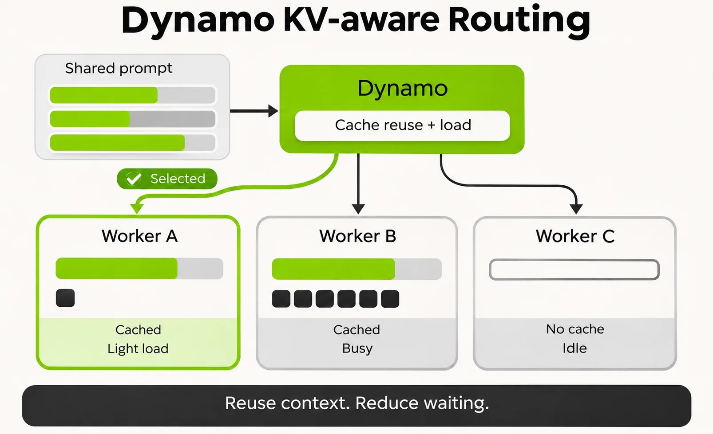

An RL update needs a set of acceptable samples. A faster worker can still leave its peers idle or generate trajectories from stale weights. NVIDIA distinguishes the training framework, which owns rewards, environments and acceptance, from the inference engine, which generates tokens and loads weights, and Dynamo, which places requests and restores capacity.

Amr Elmeleegy, Harry Kim, Kyle Kranen · 2026-11-19 · [Reducing Rollout Bottlenecks in Reinforcement Learning with NVIDIA Dynamo](https://developer.nvidia.com/blog/reducing-rollout-bottlenecks-in-reinforcement-learning-with-nvidia-dynamo/)

## Balance prefix hits against queue time

Multiple solutions to one task share a prompt. Sending a request to a worker holding that prefix can save prefill, yet directing the entire group there can create a queue. Dynamo considers both reuse and load. A hit matters if it saves more time than the queue adds and helps the training step collect its required samples. Late trajectories have disproportionate impact when the trainer waits for a group.

<a class="note-image-link" href="/assets/images/tech/nvidia-dynamo-rl-rollout-2026-11-19/figure.png" target="_blank" rel="noopener" aria-label="Workers are selected using both shared-prompt cache reuse and current load.">View original ↗</a>

*Workers are selected using both shared-prompt cache reuse and current load.*

## A weight delta needs a matching base

ModelExpress can copy weights from a compatible worker’s GPU through NIXL, avoiding repeated remote-storage loads. It can also send compressed changes that a worker applies to the matching base version. A replacement can load a checkpoint and subsequent deltas to catch up. The RL framework coordinates version changes, cache handling and sample readiness. Faster transport contributes usable capacity only once those conditions hold.

## Recovering a node and recovering a trajectory

After worker loss, Dynamo places new requests on eligible workers and admits a replacement once ready. Supported configurations can drain a worker or migrate eligible in-flight requests. Interrupted samples remain the training framework’s responsibility while healthy workers continue generating. CoreWeave reports up to 15× faster weight updates. H Company reports up to 20% lower average step time and up to 5% fewer GPU-hours. The former times distribution, the latter includes other training stages; the figures describe separate deployments.
