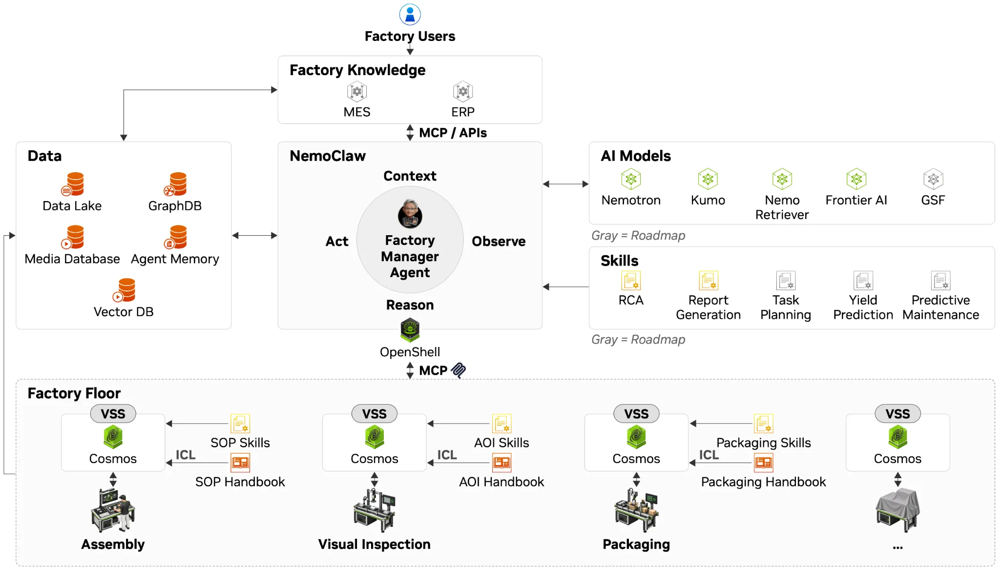

Original: [How NVIDIA Factory Operations Blueprint Coordinates AI Agents to Investigate Production Issues](https://developer.nvidia.com/blog/how-nvidia-factory-operations-blueprint-coordinates-ai-agents-to-investigate-production-issues/) 
Samuel Ochoa, Carlos Garcia-Sierra · 2026-11-04

## Defects cross station boundaries

A solder defect detected late in PCB production may originate in printing, placement, or reflow. NVIDIA’s Factory Operations Blueprint (FOX) uses a persistent Factory Manager Agent to coordinate secondary inspection, rework transport, and root-cause investigation. This is a manufacturing workflow, distinct from the company’s GPU-cluster operations framework.

The SMT assembly line is a reference example. Adapters, MCP, and APIs connect existing MES, ERP, and equipment databases. The LLM interprets tasks, NemoClaw manages tools and delegation, and OpenShell enforces file, command, and network access policies. Developers still supply completion criteria, factory-specific inspection rules, and review requirements.

<a class="note-image-link" href="/assets/images/tech/nvidia-factory-operations-blueprint-agents/architecture.webp" target="_blank" rel="noopener" aria-label="FOX architecture connecting factory knowledge, specialist models, and equipment · View original image ↗">View original image ↗</a>

*The central agent connects knowledge, models, and equipment interfaces. Gray elements are explicitly marked as roadmap items rather than delivered capabilities.*

## One board identifier ties the evidence together

After an AOI alert, the manager retrieves the board identifier, affected component, and image. The identifier connects station records; adapters must also preserve timestamps, units, and source references. The engineering problem is not simply interpreting an image, but establishing that records describe the same board, processing interval, and measurement units.

The Visual Inspection Agent uses Cosmos with reference examples and approved criteria. Acceptable variation, confirmed defects, and inconclusive assessments take different paths: continued production under policy, handling, or human review. Uncertainty is therefore part of the workflow input.

For a confirmed defect, the Fleet Management Agent coordinates transport to rework. The article demonstrates transport in an Isaac Sim/ROS 2 digital twin; physical robot and AMR integrations remain factory-specific. Permissions, capabilities, and completion are checked, with operator approval recommended for initial handling deployments. Repair and retesting remain part of the operational process.

## Investigate the relevant processing window

The RCA Agent joins inspection findings, placement history, electrical tests, and machine measurements using the board identifier. A functional-test failure can trigger investigation even without a visible AOI defect. For suspected solder problems, reflow entry and exit times select the oven measurements that Kumo Anomaly analyzes.

An anomaly alone is not a cause. The agent compares other runs, inspection results, and manuals, returning source records, suspect measurements, a likely cause, and corrective recommendations for review. Elasticsearch provides evidence, versioned manuals, and prior investigations. Historical findings guide the search; current records and procedures support the conclusion. This explicit connection between object, time window, and evidence version transfers well to AIOps.

## Keep the evidence scopes separate

The article also cites Siemens production-planning and virtual-preparation examples with up to 20% cost savings and up to 40% shorter time to market. Those are not measured outcomes of the SMT defect-investigation reference example and do not establish its RCA accuracy or downtime savings.

On-premises deployment can use DGX Station, but every model and service endpoint must remain inside the factory network for data to stay local. Developers remain responsible for equipment integration, identifier mappings, output validation, and access checks; the blueprint currently offers early access.

The substantive contribution is a set of inspectable handoffs: visual inspection returns evidence and uncertainty, transport returns completion status, and RCA returns a traceable report. It is not controlled evidence that autonomous manufacturing recovery is solved. Read the handoff contracts and developer responsibilities before interpreting the architecture as deployment maturity.
