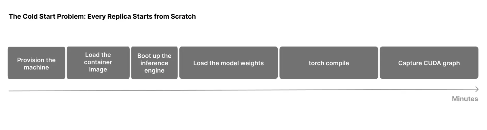

Receiving GPUs during scale-out does not make a replica ready. Weight loading, compilation, autotuning and CUDA graph capture can take minutes. NVIDIA Snapshot saves initialized CPU and GPU state so another compatible replica can resume from that point. Its reusable asset is engine initialization; its value depends on captured state, storage performance and compatibility.

Original: [Start and Restore GPU Workloads in Seconds with NVIDIA Snapshot](https://developer.nvidia.com/blog/start-and-restore-gpu-workloads-in-seconds-with-nvidia-snapshot/)  
Ron Kahn, Dan Feigin, Oz Bar-Shalom, Ekin Karabulut, Schwinn Saereesitthipitak · 2026-11-10

## Which initialization work is skipped

Cold start includes more than copying weights into HBM. Workers start, libraries load and communication is established. The engine repacks tensors, profiles memory, allocates KV and buffers, compiles kernels and captures graphs. Saving fully initialized CPU/GPU memory can skip several categories of repeated work together.

<a class="note-image-link" href="/assets/images/tech/nvidia-snapshot/official-1.webp" target="_blank" rel="noopener" aria-label="Cold-start phases from machine provisioning to CUDA graph capture · View original image ↗">View original image ↗</a>

*Reading the timeline: provisioning and image preparation remain separate costs. Snapshot principally reuses the later process, weight, compilation and graph-capture state.*

Kubernetes custom resources express the workflow. `PodSnapshot` captures a named running Pod; `SnapshotJob` starts from a template and captures it after readiness. A new Pod selects the artifact with `nvidia.com/restore-from`. The workload needs a small handshake to pause before capture and continue after restoration. This is not unmodified migration of every arbitrary container.

Within one node, multi-GPU workloads can be captured as one cross-rank artifact, including TP, data/expert parallelism and decode context parallelism. Restoration requires compatible runtime conditions, explicitly the same GPU model and driver. Portability means moving between compatible nodes rather than arbitrary devices or drivers.

## From stored artifact to serving

Restoration has four stages: the node agent locates the artifact and prepares resources; CRIU reconstructs CPU process state; CUDA restoration returns device state to GPU memory; and wake/remap adapts and resumes the process. Artifacts can exceed weight size and approach or exceed 1 TB across eight GPUs. Parameter bytes alone therefore underestimate storage and bandwidth needs.

The benchmark explicitly **releases KV cache before every capture**. KV is absent from the artifact. These results concern initialized engine replicas, not preservation of an ongoing user generation, sampling position or external tool state. Progress never included in the artifact cannot be reconstructed from it.

## What the measurements establish

Tests use B200 GPUs, driver 615.71.09 and VAST NFS with vLLM 0.31.0, SGLang 0.5.21 and TensorRT LLM 1.3.0. Matched configurations compare process cold start with restoration. Reported restore times span 3.6–42.7 seconds, approximately 8–36 times faster. For large eight-GPU MoE configurations, CUDA-state restoration takes roughly 18–29 seconds and CRIU takes 4.2–10.8 seconds. Moving state remains the dominant large-artifact cost.

Checkpoint creation takes 15 seconds to 5.5 minutes. In every tested configuration, creation plus one restoration is shorter than a cold start. That depends on the initialization being avoided and is not a guarantee for every lightweight model. Reusing a prebuilt artifact across replicas provides the larger amortization opportunity.

## Replica restoration is one part of readiness

Both measurements exclude image pulls and container-runtime setup; infrastructure provisioning is also outside the comparison. Treating the numbers as complete time from a scaling decision to serving traffic would omit resource supply, scheduling, networking and image costs. Model, engine or driver changes also require artifact compatibility and lifecycle management.

Firepool addresses an adjacent problem: reusing execution environments ready to accept jobs. Snapshot reuses model-engine initialization. The article does not demonstrate seamless composition of the two. The operational lesson is to specify the restored object, excluded phases and artifact bandwidth before deciding which part of recovery becomes faster.
