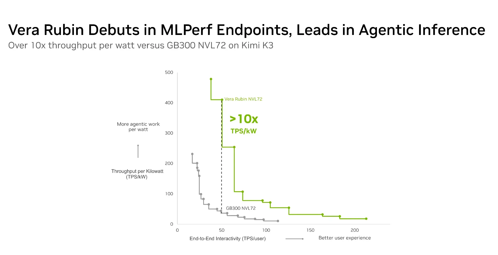

A server can generate more tokens by admitting more concurrent requests while making each user wait longer. NVIDIA publishes the operating points behind its MLPerf Endpoints v1.0 comparison of Vera Rubin and GB300. The interpretation depends on whether responsiveness, concurrency or power is held fixed.

## Repeated prefixes and growing histories put different demands on an endpoint

Coding trajectories append tool results over many turns. Enterprise tasks can share instructions, tool definitions and business rules. The serving stack has to process new inputs promptly and sustain a useful generation rate for each active user. The benchmark runs these workflows through an API, checking tool calls and workflow intent against references during performance runs. A separate SWE-bench Verified evaluation checks end-to-end task solving. The benchmark thus constrains behavior during timing and examines task quality separately. Reporting system throughput alongside average end-to-end interactivity reveals how scaling affects the user.

## A shared responsiveness floor allows different operating points

For Kimi K3, both platforms must deliver at least 50 tokens per second per user. Each then contributes its best measured throughput per provisioned kilowatt above that floor. The selected Vera Rubin run used 32 accelerators at concurrency 1,024, producing 41,414.2 tokens/s at 100.89 kW. The GB300 run used 48 accelerators at concurrency 48, producing 2,210.4 tokens/s at 60 kW. That gives roughly 410 versus 37 tokens/s/kW, the basis of the more-than-tenfold comparison. Their actual interactivity values were 50.4 and 56.2 tokens/s/user.

Holding concurrency at 1,024 asks a different question. GB300 then delivered 16.8 tokens/s/user against Vera Rubin’s 50.4, about a threefold difference. The article’s staircase plot uses measured points without interpolating between configurations. Provisioned power is the denominator. The plot does not measure electricity consumed per completed task.

<a class="note-image-link" href="/assets/images/tech/nvidia-vera-rubin-nvl72-mlperf-endpoints-v1-0/nvidia-vera-rubin-nvl72-mlperf-endpoints-v1-0.png" target="_blank" rel="noopener" aria-label="Each step represents a measured operating point. Choose an interactivity floor along the horizontal axis to read the available throughput per kilowatt. View original image ↗">View original image ↗</a>

*Each step represents a measured operating point. Choose an interactivity floor along the horizontal axis to read the available throughput per kilowatt.*

## Serving software and kernels both contribute

Prefix caching and state reuse avoid recomputing repeated conversation history. Dynamo routing must weigh opportunities for reuse against worker load. Separately configuring prefill and decode also changes how synchronization affects the two stages. HBM4 supplies memory bandwidth, while sixth-generation NVLink supports inter-GPU transfers. DeepSeek’s MegaMoE kernel exploits locality, and Qwen proposes multiple tokens before verifying them with Tensor Cores. Because these hardware and software changes appear together, the endpoint comparison does not isolate a single component’s contribution.

Across three models NVIDIA reports roughly 5–10 times the throughput per kilowatt at model-specific interactivity floors and 3–5 times the interactivity at matched concurrency. DeepSeek and Qwen used floors of 280 and 410 tokens/s/user respectively, compared with 50 for Kimi. At publication the GB300 results had been verified by MLCommons and Vera Rubin’s submissions were provisional. The comparisons describe the measured model configurations and operating points.

Zhihan Jiang, Lisa Luh · 2026-11-16 · [NVIDIA Vera Rubin NVL72 Leads Agentic Inference Performance on MLPerf Endpoints v1.0](https://developer.nvidia.com/blog/nvidia-vera-rubin-nvl72-leads-agentic-inference-performance-on-mlperf-endpoints-v1-0/)
