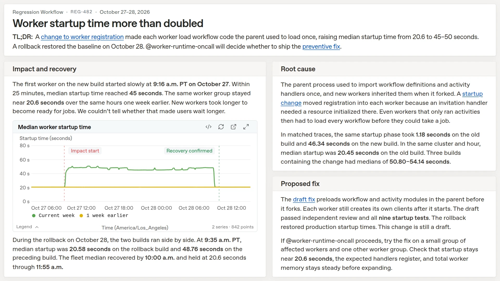

During a ChatGPT image-download incident, an investigating agent identified failures in the file-location service. A separate session noticed that the service had already recovered while image requests continued to fail. The proposed cause could explain the onset but not the duration. OpenAI’s Performance Factory gives such counterevidence a dedicated review step and keeps the task until recovery is checked after deployment.

## Keeping a task alive through review and deployment

The team first captured its investigation practice in perf-forensics: establish onset, affected requests and relevant changes. Automating diagnosis still left engineers carrying evidence between alerts, Slack, code review and dashboards. The factory persists findings outside individual sessions. Workflow configuration defines legal transitions, instructions and human decision points. A dispatcher starts a session when a step is ready. Tasks waiting for a review or deployment subscribe to events, allowing another session to resume from the recorded evidence.

<a class="note-image-link" href="/assets/images/tech/openai-performance-factory/figure.png" target="_blank" rel="noopener" aria-label="A worker-startup regression report preserves the metric timeline, impact and proposed fix together.">View original ↗</a>

*A worker-startup regression report preserves the metric timeline, impact and proposed fix together.*

## Separating slower requests from a different request mix

A threshold can fire hours after a regression begins. Investigators establish the onset and compare request cohorts. A higher aggregate median may reflect more requests from an inherently slow group. Where comparable requests actually slowed, the investigator checks when a rollout reached them and tests the explanation against logs, traces and profiles. A separate reviewer examines unexposed requests and recovery after rollback. In the image case, the mismatch between the two recovery timelines reopened the investigation.

## Verifying the proposed repair in production

After review, an agent proposes a code change. Engineers inspect time series, flame graphs and traces before deciding whether to merge. A cache can reduce work while introducing stale data, a tradeoff requiring service-specific judgment. Deployment wakes another session to compare performance with the previous baseline. No improvement sends the task back to investigation. When the original regression has recovered but a residual slowdown remains, a separate task tracks it. Merging a patch alone cannot distinguish those outcomes.

## Backtesting a revised investigation skill

After changing a prompt or model, a fresh session starts from the original alert and its work is compared with the historical resolution. Old incidents are awkward test fixtures: metrics and traces expire, while a later writeup may give away the answer. Backtests restrict data access, withhold previous investigation notes, writeups and prior runs, and inspect transcripts for accidental spoilers. Handoff summaries are evaluated on saved task snapshots. A separate grader asks whether an unfamiliar engineer can understand the impact, inspect the key charts and justify the next step. The two tests use evidence with different lifetimes and reveal different regressions.

## Reading the counts with their denominators

Over a little more than three months the workflow tracked more than 1,700 investigations and established causes for over 600 cases. In a separate manual review of 100 suggested root causes, 70% were judged accurate. The remainder needed refinement or stronger causal evidence. Those figures cannot establish an autonomous repair rate. The team also inspects recurring tool failures and permission gaps, and uses saved tasks to grade handoff summaries. The transferable practice is to evaluate onset, causal attribution and post-deployment recovery separately.

Okay Zed, Cyrus Forbes · 2026-11-19 · [How OpenAI’s Performance Factory keeps ChatGPT fast](https://openai.com/index/how-openai-performance-factory-keeps-chatgpt-fast/)
