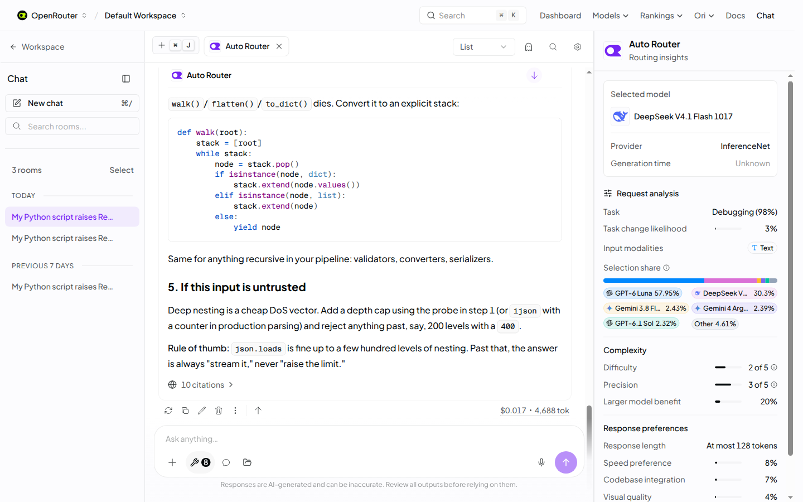

[Introducing the New Auto and Auto Code Routers](https://openrouter.ai/blog/announcements/auto-and-auto-code-routers/)  
Brian Thomas / OpenRouter · 2026-11-06

Choosing a cheaper or stronger model on every turn can overlook the cost of losing an existing input cache. OpenRouter’s new Auto and Auto Code routers explicitly include cache state, select reasoning effort as well as the model, and carry signals from one turn into the next.

<a class="note-image-link" href="/assets/images/tech/openrouter-auto-router-next-gen/official.png" target="_blank" rel="noopener" aria-label="OpenRouter routing panel showing model choice and request analysis · View original image ↗">View original image ↗</a>

*The right panel exposes the selected model and request analysis for one decision; the displayed shares are not a cross-workload performance guarantee.*

## Two stages of routing

The system first filters candidates using guardrails, zero-data-retention requirements, capabilities, provider restrictions, and allowed model lists. A fast decision model rates eleven request properties in one call, including task type, task changes, difficulty, speed needs, vision, and codebase knowledge.

Policy combines those features with prices, cache status, and benchmark performance to select a model and reasoning effort. Provider routing then chooses who serves that model using health, latency, price, and prompt-cache location. Separating model choice from serving location helps distinguish capability failures from provider-level problems.

Auto Code shares the engine but favors a stronger coding tier and gives more weight to speed, pass rate, cost per solved task, and clear failures. The article does not disclose the complete weights or training recipe; the eleven features are a mechanism description, not a reproducible algorithm.

## Preserving state before switching

A new model must rebuild the input cache. The policy prefers changing reasoning effort when sufficient and switches when expected benefit justifies the cache loss. The authors report retaining the same model for nearly nine of ten agent turns during beta.

Repeated errors and tests continuing to fail after edits increase the likelihood of switching. Those difficulty signals and cache state inform the next turn, making routing a stateful control problem rather than independent request classification.

Failure does not reveal its own cause. This issue’s failure-prediction paper distinguishes hard tasks, weak models, and unlucky runs. OpenRouter’s production policy is not one of that paper’s tested predictors, so its negative findings cannot be transferred directly. Both nevertheless make intervention outcomes more informative than an oracle that chooses successful models after the fact.

## What the evidence establishes

The reported live-test routing p90 falls from 1.96 seconds to 0.65 seconds. This measures the routing step, not a threefold speedup of the whole agent task. Beta aggregates also report fourfold fewer invalid tool calls and half as many cut-off agentic responses versus the previous router. The announcement does not provide task-level samples and uncertainty sufficient to recompute those claims independently.

A routing-insights panel and API metadata expose request analysis and the selected model. They aid diagnosis without proving optimality. Routing shares can change with catalog updates, prices, and traffic, so a screenshot’s distribution is not a persistent guarantee.

## Where the policy is useful

The announcement acknowledges that no router beats the best single model everywhere on the cost–quality curve. Routing is most relevant for varied tasks and cost control when maintaining model choices manually is undesirable. A validated model for a fixed workload may remain preferable.

The concrete AgentOps lesson is to include cache state and switching cost in routing evaluation. Per-request list prices omit prefix rebuilding, extra turns after failures, and provider-level service differences.
