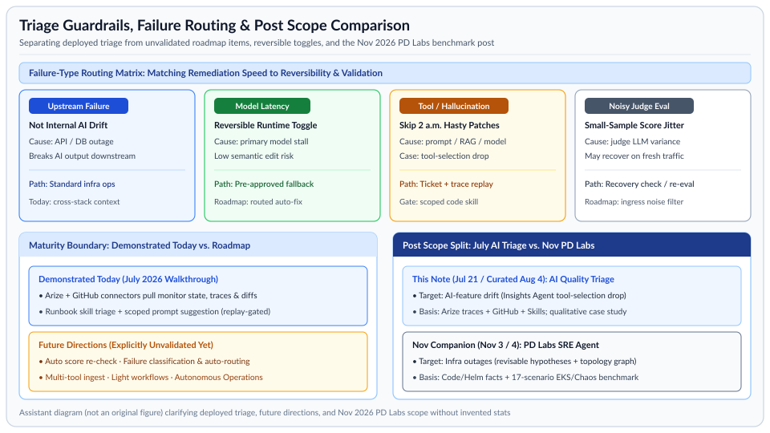

PagerDuty Engineering (Irena Grabovitch-Zuyev, Antonio Correia, Everaldo Aguiar, Murilo Venturin, Derek Barnes) · Originally published 2026-07-21 (8 min read) · [Primary Engineering Blog](https://www.pagerduty.com/eng/pagerduty-for-ai-how-the-sre-agent-triages-ai-incidents/) · [2025-08-13 Prequel: PagerDuty + Arize End-to-End AI Agent Observability](https://www.pagerduty.com/eng/pagerduty-arize-building-end-to-end-observability-for-ai-agents-in-production/)

An AI agent that drifts off course rarely turns an infrastructure dashboard red. While PagerDuty's August 2025 prequel with Arize focused on **detection**—instrumenting production traces and firing alerts when traditional APM misses silent quality failures—this July 21, 2026 engineering post addresses **what happens after an AI incident fires**: how PagerDuty's SRE Agent performs **first-pass triage** without treating every probabilistic score dip as an emergency outage or a solved problem in autonomous self-healing.

> **Evidence & cross-article scope**: Rewritten from PagerDuty Engineering's July 21, 2026 post (curated August 4, 2026). The primary text presents an **architectural workflow and qualitative walkthrough on PagerDuty's internal Insights Agent** alongside two demo clips; it reports **zero controlled studies, zero MTTR deltas, zero noise-reduction rates, and zero triage accuracy benchmarks**. Automatic judge-score re-checks, failure-type routing, multi-tool ingestion, and Autonomous Operations are explicitly framed as future directions rather than validated capabilities. This note should also be distinguished from the November 4 PD Labs post ([companion Nov 4 note](/tech/en/2026-11-04-pagerduty-pd-labs-sre-agent/)): **this July/August note covers how the SRE Agent triages AI-feature quality drift** (LLM-judge alerts, Arize traces, GitHub connectors, runbook skills, and replay-gated prompt suggestions), whereas **the November note covers PD Labs' architecture and empirical evaluation of the SRE Agent for general infrastructure/service incidents** (revisable investigation hypotheses in SRE Workbench, cross-repo code/Helm/Terraform topology graphs, and a 17-scenario EKS + Chaos Mesh benchmark).

## Reframing Alert Semantics: "Might Be Broken" Drift vs. Upstream Outages

PagerDuty opens with a shift in alert semantics: monitors backed by **LLM-as-a-judge evaluations** do not mean *"something is broken"*; they mean **something might be broken** according to the judge LLM—and those scores can be noisy on small samples.

That probabilistic shift changes what a responder can reasonably do at 2 a.m. Unlike a broken release that can be rolled back in fifteen minutes, a drop in a relevance metric typically points to prompt adjustments, retrieval tuning, a model swap, or re-calibrating the eval judge itself. Even more critically, the primary post highlights an **attribution split**: a low-relevance alert does not always indicate internal AI degradation. An **upstream service failure** can corrupt the agent's responses and trigger quality monitors even though the agent's own prompts and model weights never regressed. By consolidating signals across the observability stack inside PagerDuty, responders can separate true AI output-quality drift from conventional application or dependency outages.

To help on-call engineers rather than wake them indiscriminately, PagerDuty aligns platform primitives with the SRE Agent around three triage outcomes:

1. **Escalation classification**: Predict whether the alert represents a real issue requiring immediate human escalation.
2. **Pre-approved remediation**: Execute bounded, pre-approved mitigation workflows only where safe.
3. **Follow-up ticketing**: File actionable tickets with ranked next steps for the AI-feature engineering team so non-urgent quality work moves to business hours.

## Inside the First-Pass Triage Loop: Connectors, Runbook Skills, and the Insights Agent Case

The foundational integration step connects the SRE Agent to AI observability platforms that record every user interaction as an end-to-end **trace**—capturing LLM calls, tool calls, retrievals, and outputs for each request.

<figure class="note-figure">
  <a class="note-image-link" href="/assets/images/tech/pagerduty-ai-incident-triage/triage-loop-architecture-en.svg" target="_blank" rel="noopener">
    
    View original diagram ↗
  </a>
  <figcaption>Assistant diagram (not an original figure): Organizing PagerDuty Engineering's July 21, 2026 first-pass AI incident triage loop, connector inputs, and replay boundary.</figcaption>
</figure>

The article walks through an internal incident on PagerDuty's **Insights Agent**, an operational chat assistant answering questions such as "how many SEV-1s did we have last week?" via backend analytics tools and monitored in Arize. When its **tool-selection performance breaches a configured threshold**, Arize fires a PagerDuty incident and the responder engages the SRE Agent on the incident page.

Crucially, the SRE Agent does not improvise investigation steps purely from generic prompting. External telemetry and repository access flow through [SRE Agent Connectors](https://support.pagerduty.com/main/docs/connectors-tools-and-skills), while the team encodes its human runbook into an explicit **PagerDuty skill** authored with [`create-pagerduty-skill`](https://github.com/PagerDuty/claude-code-plugins/blob/main/commands/create-pagerduty-skill.md). That skill walks the agent through four deterministic triage steps:

1. **Check monitor recovery**: Query live Arize monitor state to see whether the breach already cleared on subsequent traffic.
2. **Filter offending traces**: Pull the failing traces inside the Arize project rather than reading raw alert payloads alone.
3. **Summarize eval explanations**: Inspect LLM-judge evaluation explanations across failing traces to identify recurring behavioral patterns.
4. **Check recent code changes**: Query GitHub via the code connector for commits or config edits that might correlate with the degradation.

In the first embedded walkthrough clip ([`sre-agent-triage-rundown.mp4`](https://cdn.pagerduty.com/wp-content/uploads/2026/07/sre-agent-triage-rundown.mp4)), the SRE Agent diagnoses a **genuine but minor** tool-selection degradation and recommends **closing the active incident** alongside follow-up tasks to refine tool calling.

In the second walkthrough clip ([`sre-agent-code-suggestions.mp4`](https://cdn.pagerduty.com/wp-content/uploads/2026/07/sre-agent-code-suggestions.mp4)), the responder asks the SRE Agent to pinpoint exact edits via the **GitHub code connector**. Here, a **customized code-suggestion skill** restricts proposed changes to team-defined boundaries, leading the agent to propose targeted **system-prompt adjustments** grounded in the failing traces. PagerDuty explicitly treats these suggestions as an **additional engineering data point—not an auto-deployed fix**—requiring replay against failing traces and regression testing under its agent self-improvement workflow (referenced to the LLMday talk [*Teaching AI Systems to Fix Their Own Failures*](https://www.youtube.com/watch?v=12e0pSOBBQk&t=1s)).

| Architectural Primitive | Role in the Insights Agent Triage Flow | Operational Boundary & Failure Mode Guarded |
| :--- | :--- | :--- |
| **PagerDuty Signal Unification** | Combines Arize AI-quality alerts with traditional app and infra signals in one incident plane | Prevents responders from tuning prompts when an upstream service outage breaks AI output |
| **Arize Observability Connector** | Fetches live monitor recovery state, full execution traces, and LLM-judge eval explanations | Grounds triage in full call sequences rather than a bare threshold-breach summary |
| **GitHub Code & Docs Connector** | Surfaces recent commits, system prompts, and tool schemas tied to the affected agent | Supplies repository context while isolating inspection from arbitrary repo writes |
| **Runbook-Encoded Skill** | Encodes human SOP steps via `create-pagerduty-skill` (recovery check, traces, patterns, commits) | Stops ad-hoc LLM guessing and ensures transient self-recovered dips are checked first |
| **Scoped Code-Suggestion Skill** | Confines edit recommendations inside team-defined boundaries (e.g., system prompt tweaks) | Prevents a triage agent from proposing sweeping, unreviewed application refactors |
| **Trace Replay & Regression Gate** | Replays proposed prompt changes against failing traces plus regression suites pre-merge | Catches silent regressions on healthy queries before any prompt edit reaches production |

## Guardrails and Roadmap: Four Gates Between Assisted Triage and Autonomous Operations

After detailing today's human-assisted first-pass workflow, the post outlines its next-stage roadmap under *What this unlocks next*. Separating demonstrated practice from unvalidated roadmap items is essential so teams do not mistake stated engineering goals for shipped guarantees.

<figure class="note-figure">
  <a class="note-image-link" href="/assets/images/tech/pagerduty-ai-incident-triage/evidence-guardrail-boundaries-en.svg" target="_blank" rel="noopener">
    
    View original diagram ↗
  </a>
  <figcaption>Assistant diagram (not an original figure): Mapping failure-type routing, demonstrated vs. future roadmap boundaries, and scope contrast with the Nov 2026 PD Labs post.</figcaption>
</figure>

The primary authors outline four next steps toward greater automation—all explicitly presented as upcoming work rather than evaluated results:

1. **Smarter incoming signal (automatic score re-check)**: Because small-sample LLM-as-a-judge evaluations are noisy, PagerDuty plans to automatically re-check the score upon alert trigger so genuine regressions still page while transient noise is suppressed on ingress.
2. **Failure-type classification and routing**: Incidents are to be categorized by failure mode—explicitly citing **hallucinations, tool-call errors, and model latency**—because each maps to a distinct remediation workflow.
3. **Reversible fallback for latency vs. business-hours semantic fixes**: As a concrete example of classified routing, a **model latency** incident can trigger a **temporary switch to a pre-approved fallback model**, keeping asynchronous prompt or code updates inside normal business hours.
4. **Observability-agnostic ingestion and light workflows**: Connectors are expanding beyond Arize to other AI observability platforms, alongside a **lighter incident-workflow pattern** that injects failure-pattern context directly into incidents without requiring the full SRE Agent interaction—progressing toward **Autonomous Operations** across customer stacks.

From an engineering trade-off perspective (assistant analysis derived from the primary architecture, not an empirical claim by PagerDuty), the split between **automated fallback-model switching for latency** and **replay-gated prompt changes for tool-call drift** reflects **reversibility and blast radius**. Switching traffic to a pre-approved fallback model is a bounded runtime toggle whose baseline quality is known and reversible in seconds, whereas editing a system prompt to fix a subset of tool-selection traces risks subtle behavior shifts across unrelated user intents. Similarly, automatic ingress re-checks of noisy LLM-judge scores trade **alert latency and extra judge-LLM cost** for lower 2 a.m. page fatigue—a trade-off teams must calibrate carefully so real fast-onset regressions are not delayed.

Comparing this July 21 post side-by-side with PD Labs' November 3 post clarifies how PagerDuty divides AI-feature triage from general SRE investigation:

| Comparison Axis | This Note (Jul 21 / Curated Aug 4): AI Incident Triage | Companion Note (Nov 3 / Curated Nov 4): PD Labs SRE Agent |
| :--- | :--- | :--- |
| **Target Failure Domain** | **AI-feature quality drift** flagged by LLM-judge monitors (Insights Agent tool-selection drop) | **General infra & microservice outages** where the alerting node need not be the failing node |
| **Context & Structural Primitives** | Arize monitor state, request traces (LLM/tool/retrieval/output), eval explanations & GitHub diffs | Static source, Helm & Terraform topology graphs + shared SRE Workbench timeline |
| **Investigation & Workflow Pattern** | Connectors + `create-pagerduty-skill` 4-step SOP + bounded code-suggestion skill | Deep Investigation retaining revisable multi-hypotheses, direct/circumstantial evidence & disproofs |
| **Change Verification Discipline** | Prompt tweaks constrained to team boundaries, gated by trace replay & regression testing | 17-scenario private EKS + Chaos Mesh live-fault & replay benchmark scored by 3 LLM judges |
| **Evidence & Validation Status** | **Qualitative walkthrough & architecture**; zero controlled studies, MTTR deltas, or noise metrics | **Vendor-built empirical benchmark**; reports ~20-point diagnosis gain post-refactor, noting replay & human-input limits |

## Engineering Takeaways and Evidence Limits: What On-Call Teams Can Adopt Today

Even for teams outside the PagerDuty or Arize stack, four practical controls transfer directly from this architecture:

1. **Co-locate AI evals with traditional service health before paging or editing prompts**: Before an on-call responder reads an LLM-judge relevance drop, surface upstream API, database, and model-gateway health in the same incident timeline so infra failures never trigger pointless prompt tuning.
2. **Separate read-only diagnostic skills from scoped edit-suggestion skills**: Encoding standard triage steps (check live recovery first, cluster eval explanations, inspect recent commits) reduces ad-hoc LLM diagnosis gaps, while confining edit suggestions to explicit team boundaries prevents unreviewed refactoring proposals.
3. **Gate automation by reversibility rather than uniform confidence**: Reserve pre-approved automated mitigation for reversible runtime switches such as fallback model routing during latency spikes; route semantic prompt, retrieval, and eval-calibration work to daytime engineering workflows backed by trace replay.
4. **Instrument the missing empirical metrics locally**: Because the July 21 post provides no controlled study showing how much on-call noise fell or whether ingress score re-checks ever suppressed real silent degradations, adopting teams should track **judge-score variance across sample windows** and **post-closure recurrence rates** whenever an AI incident is triaged as minor and closed.

---

> **Provenance & editorial note**: Rewritten and expanded by the assistant from the frozen HTML of PagerDuty Engineering's July 21, 2026 article (`authoring_source: assistant`, `translation_source: assistant`), paired with the Chinese edition ([中文笔记](/tech/zh/pagerduty-ai-incident-triage/)) and preserving original `id`, `date: '2026-08-04'`, `permalink`, `published_at`, and canonical tags (`agent-reliability`, `observability`, `systems-reliability`). Both `v3-blue` diagrams (`triage-loop-architecture-en.svg`, `evidence-guardrail-boundaries-en.svg`) are assistant-authored visualizations summarizing the primary workflow and contrasting it with the Nov 2026 PD Labs post, claiming zero empirical benchmarks beyond what the source reports.
