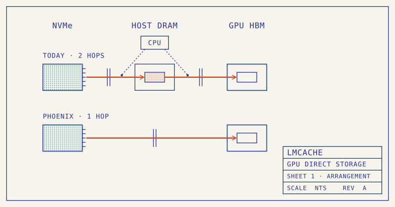
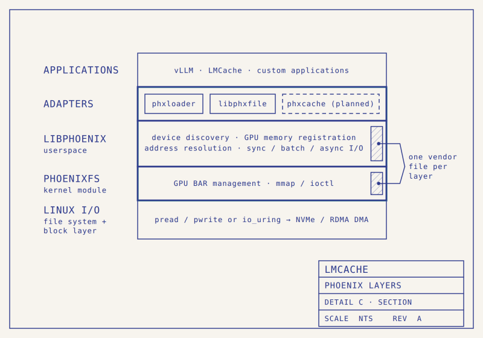

Long agent sessions repeatedly submit large prefixes, turning KV caching into a storage problem: retain enough state, then return it to the GPU before the next turn waits too long. This joint LMCache/xPU-IO article changes the SSD-to-GPU path. Its contribution is an explanation of why fast disks can still leave GPUs waiting, and how direct I/O interacts with cache management and scheduling.

Original: [LMCache & xPU-IO: LMCache Meets GPU Direct Storage](https://blog.lmcache.ai/en/2026/11/09/lmcache-xpu-io-lmcache-meets-gpu-direct-storage/)  
Shi Qiu · 2026-11-09

## Two transfers consume the caching benefit

A conventional file backend reads NVMe data into a host bounce buffer and then copies it to the GPU. The CPU participates in submission, synchronization and completion handling, while host memory carries the data. In the article’s four-drive PCIe 4.0 RAID 0 example, the drives deliver 25 GB/s but LMCache’s retrieve path reaches the GPU at 10.2 GB/s, about 40% of that rate. Disk bandwidth is therefore not cache-restoration bandwidth.

A separate fs_native replay analyzes 20,230 requests with roughly 68K-token mean prompts. In its displayed 54-request sample, mean TTFT is 1,101 ms, including about 600 ms for SSD-to-GPU loading and 313 ms for prefill. This illustrates loading dominating new computation. It is not the same complete configuration as the later concurrency comparison, so their denominators should not be combined.

<a class="note-image-link" href="/assets/images/tech/phoenix-gds/official-1.png" target="_blank" rel="noopener" aria-label="Two-hop host-bounce path and Phoenix direct path · View original image ↗">View original image ↗</a>

*Reading the figure: the upper path passes through host DRAM; the lower path goes directly from NVMe to HBM. The arrows describe data movement, not elimination of CPU control.*

## Direct access still requires explicit ordering

Phoenix uses Linux ZONE_DEVICE to represent GPU memory with `struct page` entries. Mapped addresses become valid I/O destinations through the standard filesystem, block layer and NVMe driver, avoiding a host-memory bounce. Applications can retain POSIX reads and io_uring. Vendor-specific work is concentrated in peer-memory mapping, device discovery and copy primitives, with a thin adapter insulating LMCache from internal changes.

LMCache’s GDS L1 uses an NVMe slab file in place of pinned DRAM. A process-wide `GDSContext` receives KV descriptors and drives DMA between the GPU and slab. A small accelerator staging buffer is drained into the prefix cache by a D2D kernel. **Direct storage removes the host bounce; it does not eliminate all staging or device-local copies.**

Ordering is also a correctness requirement. Phoenix wraps host-issued DMA with the runtime’s `LaunchHostFunc` on the caller’s stream. A gather completes before a following write, and a read completes before later kernels consume its data. The CPU still performs control work. Bypassing the CPU here describes the data path, not a fully GPU-initiated submission mechanism.

<a class="note-image-link" href="/assets/images/tech/phoenix-gds/official-4.png" target="_blank" rel="noopener" aria-label="Phoenix adapters, vendor layers and the Linux I/O stack · View original image ↗">View original image ↗</a>

*Reading the figure: follow adapters through libphoenix and phoenixfs to native Linux I/O. Vendor code is concentrated in the middle two layers.*

## Capacity and transfer speed jointly explain the result

The end-to-end comparison uses one node with eight H20 GPUs, 96 GB HBM each, four RAID 0 drives, TP=8 and a 256K context limit. It replays 11,596 production requests, averaging about 70K tokens and generating roughly 3.5 TB of KV. Configurations are 1 TB DRAM-only; 400 GB DRAM plus 25 TB SSD; and Phoenix with 25 TB SSD. DRAM-only evicts with LRU and recomputes on a miss.

Under a **five-second average TTFT target**, Phoenix supports 37 concurrent requests, versus 13 for DRAM+SSD and seven for DRAM-only. At the highest tested concurrency, its TTFT is 2.2 times lower than the tiered path and 5.6 times lower than DRAM-only. At low concurrency, all three are near 1.1 seconds. The benefit appears when capacity pressure and restoration bandwidth become limiting.

This does not mean an SSD read is 5.6 times faster than a DRAM read. Insufficient DRAM capacity causes recomputation, while the tiered backend retains the host bounce. Phoenix both retains a larger working set and shortens retrieval. Faster loads also fit more readily behind the preceding batch’s computation, allowing existing overlap scheduling to hide them. The article does not provide a full same-capacity DRAM comparison or separate cross-vendor end-to-end results.

## Deployment boundaries determine portability

Phoenix requires a kernel module and compatible peer-memory mappings. Reported validated devices include NVIDIA, MetaX and AMD MI308X, but interface portability does not guarantee identical performance. Common local and parallel filesystems are supported; FUSE is an explicit current exception. Full-BAR and on-demand staging mappings also affect coexistence with existing RDMA stacks.

The operational advance is joint design of KV capacity and restoration bandwidth. Compare recomputation, reads, installation and queueing at the target working set, and distinguish mean from tail TTFT: the five-second threshold is an average, not a p95 SLO. This complements the KV-storage study in the digest: lifecycle information determines what to retain, while direct I/O determines whether retained state can return in time.
