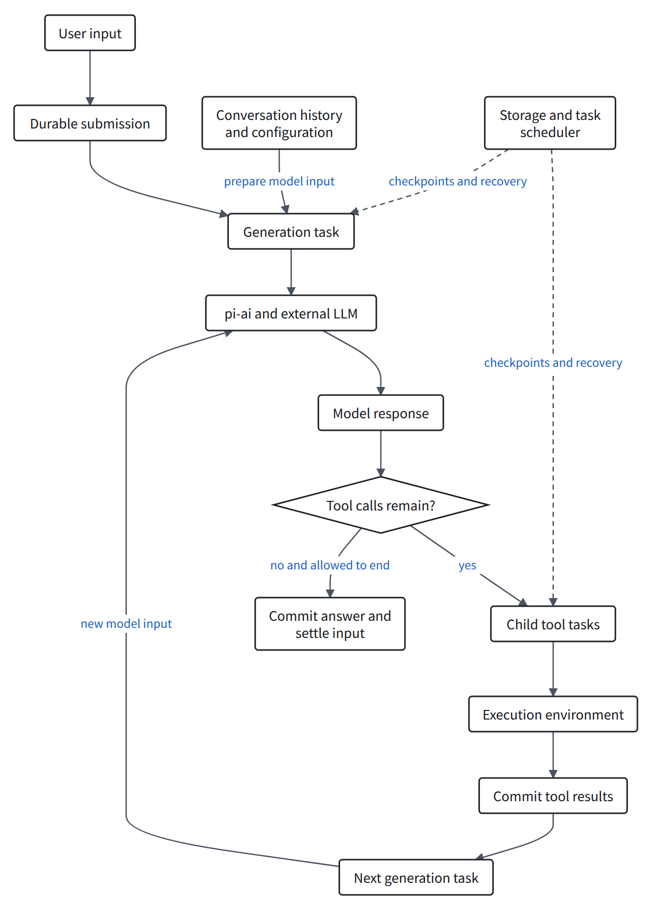
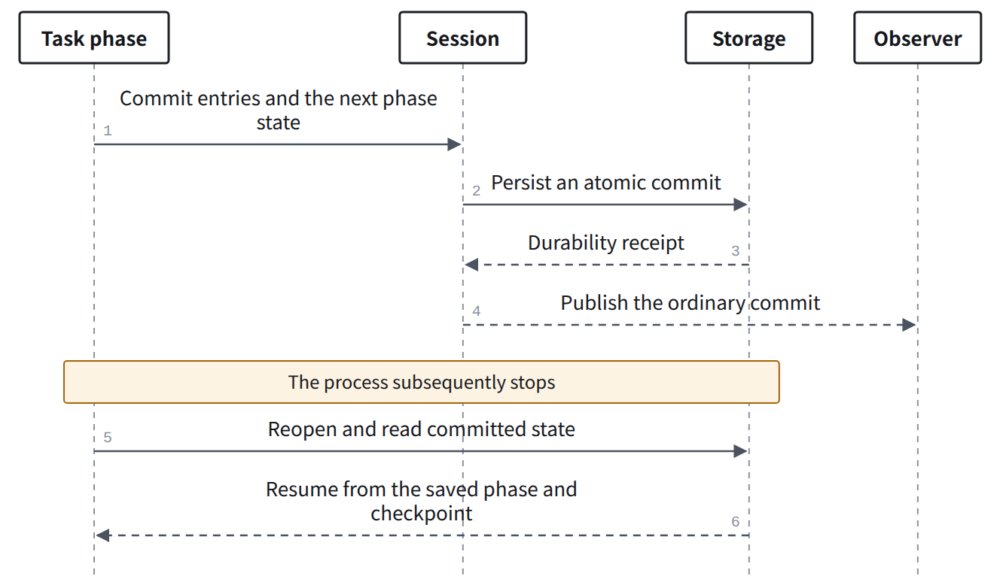
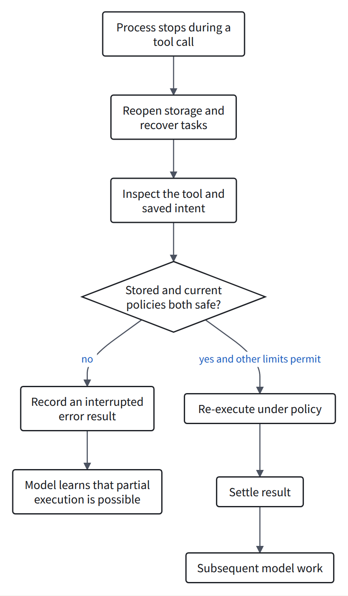

> Prepared with AI assistance from pinned documentation and selected source code. Recovery experiments were not run.

**Pi Durable represents model generation and tool calls as durable tasks.** After a process restart, committed state determines what can continue; recovery involves more than reloading chat history.

This review examines the experimental `@earendil-works/pi-durable` package independently. Its recovery contracts should not be assumed to apply to the ordinary Pi CLI.

<h2 id="section-a">Architecture: from an in-memory loop to task state machines</h2>

<figure>
<a class="note-image-link" href="/assets/images/tech/pi-durable-runtime/en-01.png" target="_blank" rel="noopener" aria-label="Pi Durable organizes input, generation, and tool calls as durable tasks, continuing inference after results are committed.">Enlarge diagram ↗</a>
<figcaption>Pi Durable organizes input, generation, and tool calls as durable tasks, continuing inference after results are committed. Explanatory diagram based on pinned documentation and code.</figcaption>
</figure>
The diagram omits end hooks, additional inputs, and error branches.

| Object | Meaning |
|---|---|
| Submission | An admitted input whose completion or failure can be awaited |
| Entry | An immutable message or result record |
| Document | Structured state updated through commits |
| Task | Work organized into states and checkpoints |
| Generation | Calls the model and coordinates its child tool tasks |
| Tool task | One tool call and its result handling |

The main loop still connects the LLM, tools, and results, but its progression includes durable task state. The implementation builds on pi-ai and Chord.

Source: [pinned specification](https://github.com/earendil-works/pi/blob/3c9a86bb08398a425f95a81ba4339aa76151f5a1/packages/durable/docs/spec.md).

<h2 id="section-b">Model input: stored history and model-visible context differ</h2>

Input is first admitted as a Submission and then becomes a conversation entry. Generation uses the conversation's model, instructions, tools, and effective context.

Resubmitting the same `requestId` can find the original Submission rather than admit a duplicate. This does not guarantee exactly-once effects for every external tool.

| Data | Storage and use |
|---|---|
| Conversation entries | Retained after commit and used to construct model context |
| Model and extension selections | Names and configuration are stored; implementations are resolved at runtime |
| Compaction summary | A summary entry is added; older entries remain stored |
| Reset | Changes where the model's visible history begins without deleting older records |
| Tool results | Become available to later generation after the corresponding tasks settle |

**Stored information is not necessarily sent to the model.** Reset, compaction, and request construction still determine visibility.

Source: [concepts, input, and compaction](https://github.com/earendil-works/pi/blob/3c9a86bb08398a425f95a81ba4339aa76151f5a1/packages/durable/README.md).

<h2 id="section-c">Recovery resumes a phase, not an arbitrary line of code</h2>

Tasks have phases and checkpoints. When a process stops inside a phase, recovery re-enters that phase from its beginning.

<figure>
<a class="note-image-link" href="/assets/images/tech/pi-durable-runtime/en-02.png" target="_blank" rel="noopener" aria-label="Ordinary commits are stored before publication; recovery re-enters saved phases rather than arbitrary code locations.">Enlarge diagram ↗</a>
<figcaption>Ordinary commits are stored before publication; recovery re-enters saved phases rather than arbitrary code locations. Explanatory diagram based on pinned documentation and code.</figcaption>
</figure>
This is the ordinary commit path. Specified deferred document updates may become visible in memory before persistence; a crash can lose the unsaved portion.

**The transaction does not include arbitrary external effects.** Sending mail, writing to a remote system, or starting a process is not automatically atomic with local task state.

Analysis: recovery boundaries become clearer, but tool authors still need to handle repetition between checkpoints.

Source: [commit invariants and deferred exceptions](https://github.com/earendil-works/pi/blob/3c9a86bb08398a425f95a81ba4339aa76151f5a1/packages/durable/docs/spec.md).

<h2 id="section-d">The key design: may an interrupted tool be replayed?</h2>

Tool intent is committed before execution. Recovery uses saved state rather than automatically retrying every interrupted call.

<figure>
<a class="note-image-link" href="/assets/images/tech/pi-durable-runtime/en-03.png" target="_blank" rel="noopener" aria-label="An interrupted tool enters the replay path only when both its stored policy and current declaration permit safe replay.">Enlarge diagram ↗</a>
<figcaption>An interrupted tool enters the replay path only when both its stored policy and current declaration permit safe replay. Explanatory diagram based on pinned documentation and code.</figcaption>
</figure>
The implementation checks both the stored replay policy and the current tool declaration. Merely changing the new declaration to safe does not authorize replay of an old unsafe call.

| Property | Is it obtained automatically? |
|---|---|
| Distinguishing replay-safe and replay-unsafe tools | An explicit mechanism exists |
| Avoiding blind replay of unsafe tools by default | A corresponding recovery path exists |
| Correctly declaring a tool safe | Requires independent validation |
| Exactly-once external effects, such as payments or email | Not automatically guaranteed |

**`replay: "safe"` is a contract, not automatic idempotence.** External effects require idempotency keys or another independently checkable mechanism.

Public tests cover stored/current policy combinations, partial output, interruption, and replay. This review inspected their code but did not run them.

Sources: [tool-task implementation](https://github.com/earendil-works/pi/blob/3c9a86bb08398a425f95a81ba4339aa76151f5a1/packages/durable/src/harness/tool.ts), [recovery tests](https://github.com/earendil-works/pi/blob/3c9a86bb08398a425f95a81ba4339aa76151f5a1/packages/durable/test/harness-tools-recovery.test.ts).

<h2 id="section-e">Model requests and cancellation have distinct states</h2>

A crash during a model request counts as a failed attempt. Partial answers are retained as aborted records, and subsequent processing follows the retry budget.

If a provider is already generating a deferred response, recovery continues polling it instead of creating another request.

| Mechanism | Reliability role | Remaining concern |
|---|---|---|
| Retry budget and backoff | Avoid immediate repeated failure | Cost and duplicate adoption of partial responses |
| restartLimit | Bound repeated interruptions of one task | Configuration can disable the limit |
| Persisted waiting state | Wait for time or children without an active phase | The host must wake the scheduler correctly |
| Task ownership | Associate parent work and child tasks | Background boundaries change cancellation propagation |
| Cancelling a wait | Stop the caller from waiting | This does not cancel the underlying work |

Code that ignores cancellation can still delay shutdown. Controlled termination requires cooperation from executing tasks.

Sources: [generation task](https://github.com/earendil-works/pi/blob/3c9a86bb08398a425f95a81ba4339aa76151f5a1/packages/durable/src/harness/generation.ts), [recovery, waiting, and cancellation](https://github.com/earendil-works/pi/blob/3c9a86bb08398a425f95a81ba4339aa76151f5a1/packages/durable/README.md).

<h2 id="section-f">Extensions and RSI: new code must understand old state</h2>

Extensions can supply tools, prompt sections, hooks, wrappers, and task definitions. Conversations store extension names; the host provides registry implementations.

A prepared model request fixes its model, prompt, and offered tools. Tool phases resolve current configuration, so updates can affect calls the model already proposed.

| RSI change | Additional validation |
|---|---|
| Tool implementation | Can new code interpret old execution intent? |
| Replay policy | Are unsafe effects incorrectly declared safe? |
| Task phases | Do existing checkpoints need migration? |
| Removed extension | Are unfinished tasks blocked by missing definitions? |
| End hooks | Can repeated continuation escape a local budget? |

`maxTurns` bounds the tool rounds of a run, but continue and onYield continuation may restart counting. The host must bound total work.

**Analysis**: RSI validation must assess task outcomes and compatibility when new code takes over existing state.

Sources: [task and extension contracts](https://github.com/earendil-works/pi/blob/3c9a86bb08398a425f95a81ba4339aa76151f5a1/packages/durable/docs/spec.md), [configuration and limits](https://github.com/earendil-works/pi/blob/3c9a86bb08398a425f95a81ba4339aa76151f5a1/packages/durable/README.md).

<h2 id="section-g">Which conditions qualify the durability guarantee?</h2>

| Condition | Boundary |
|---|---|
| MemoryStorage | Memory only; no cross-process recovery guarantee |
| SQLite with default WAL/NORMAL | Documentation distinguishes process crashes from power or host failures |
| JSONL | fsync affects persistence; writable opening also performs repair |
| Write ownership | Documentation requires one writer process; no general cross-process write lock |
| Deferred updates | Visible state can lead storage; unsaved changes can be lost |
| Storage failure | The Harness fails and closes rather than pretending commits succeeded |

Durability is not a switch that prevents every loss. Storage, host lifecycle, and tool contracts must be validated together.

The ordinary Pi coding-agent dependency list does not establish adoption of this recovery runtime. This review treats it as a separate package.

Sources: [storage and error rules](https://github.com/earendil-works/pi/blob/3c9a86bb08398a425f95a81ba4339aa76151f5a1/packages/durable/README.md), [commit specification](https://github.com/earendil-works/pi/blob/3c9a86bb08398a425f95a81ba4339aa76151f5a1/packages/durable/docs/spec.md), [CLI dependencies](https://github.com/earendil-works/pi/blob/3c9a86bb08398a425f95a81ba4339aa76151f5a1/packages/coding-agent/package.json).

<h2 id="section-h">Relationship to Sentry and HarnessFix</h2>

| System | Main concern | Research role |
|---|---|---|
| Sentry | Detect behavioral failures and provide targeted recovery guidance | A baseline for behavioral recovery and experience learning |
| HarnessFix | Diagnose harness flaws from traces and generate patches | Direct prior work on implementation repair |
| Pi Durable | Organize recoverable execution through commits, task states, and replay policies | A concrete system for reliability contracts and fault injection |

These operate at different layers and cannot be ranked directly by task scores.

### Suggested experiments, not yet executed
1. Stop the process before and after committing tool intent.
2. Crash after an external effect but before committing its result.
3. Cross-test stored and new replay-safe declarations.
4. Change extension versions, directories, or task definitions before recovery.
5. Inject storage failures, model-stream interruptions, and cancellation separately.
6. Compare visibility under ordinary and deferred commits.

Measure duplicate effects, incorrect replay, permanent blocking, lost constraints, and recovery cost. Resuming work does not establish exactly-once external effects.

Scope: commit `3c9a86bb08398a425f95a81ba4339aa76151f5a1`; the README, specification, relevant tool/generation implementation, and recovery tests were inspected. The API is experimental. No recovery experiment was installed or run.

[Sentry close reading](/digest/en/paper-sentry-close-reading/) · [HarnessFix close reading](/digest/en/paper-harnessfix-close-reading/)
