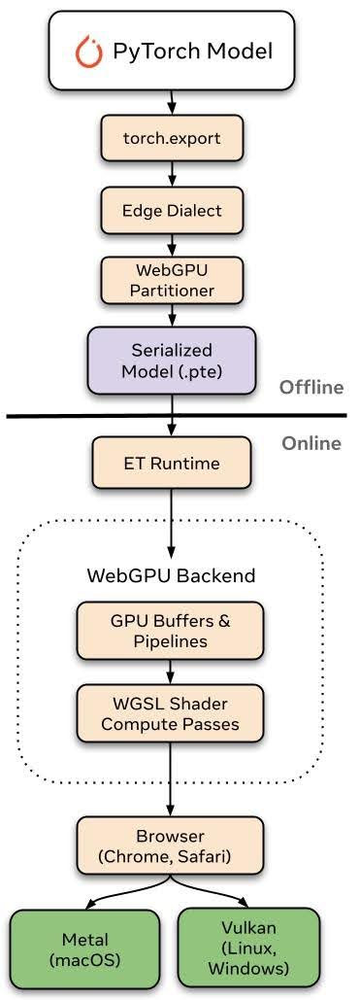

[ExecuTorch WebGPU: PyTorch Models on the GPU, in the Browser](https://pytorch.org/blog/executorch-webgpu-pytorch-models-on-the-gpu-in-the-browser/)  
Julian Ng-Thow-Hing, Siddartha Pothapragada, Stephen Jia, Digant Desai, Bilgin Cagatay · 2026-11-10

Deploying a PyTorch model in a browser often requires conversion into another framework's format. ExecuTorch's WebGPU backend provides a path within the same toolchain: export a `.pte` artifact and execute GPU work through the browser runtime. Its contribution is the deployment path and operator coverage rather than WebGPU itself.

## Split export from execution

Models pass through torch.export and WebGPUPartitioner. The dynamic C++ runtime compiles to WebAssembly with Emscripten, while emdawnwebgpu bridges calls to the browser's WebGPU API. The backend manages GPU buffers, command buffers, and WGSL compute-shader dispatch.

<a class="note-image-link" href="/assets/images/tech/pytorch-executorch-webgpu/backend.jpg" target="_blank" rel="noopener" aria-label="Offline export produces a .pte artifact; online execution uses ExecuTorch to manage GPU buffers and dispatch WGSL shaders.">View original image ↗</a>

*Offline export produces a .pte artifact; online execution uses ExecuTorch to manage GPU buffers and dispatch WGSL shaders.*

Dynamic shapes use maximum-size allocations, per-dispatch workgroup recalculation, and specialized kernel selection. This retains flexibility but still requires memory sizing for the target device. A common artifact and platform shader translation do not establish equal performance or complete support on every browser, driver, and GPU.

## The speed comparison uses two small models on one machine

The authors compare WebGPU with ExecuTorch's own multithreaded Wasm/XNNPACK CPU path in Chrome on an Apple M1 Pro, using quantized Llama 3.2 1B and Qwen3-0.6B. Contexts span 128–8K tokens, input IDs match, and each point is the median of five wall-clock measurements after three warmups.

Prefill improves 4–7 times and decode 2–10 times. Numerical configurations differ: WebGPU uses 4-bit groupwise weights with group size 64 and FP32 activations; CPU uses 4-bit weights with dynamic 8-bit activations. This is a practical backend comparison, not a pure hardware-only intervention or a multiplier established for all phones.

## Local execution broadens deployment, within coverage limits

Reported model validation includes small LLMs, SmolVLM, segmentation, depth estimation, Whisper, and on-device adaptation examples. Inputs need not leave the device for this local inference path, and browser distribution reduces installation friction and server-side inference demand.

The backend remains early in development, with operator, dtype, and model coverage still expanding. For cloud-edge systems, the notable change is a shared export and delivery artifact. It is not a privacy guarantee for arbitrary surrounding applications, whose own data handling remains separate, and the measured speedups retain their stated model and hardware scope.
