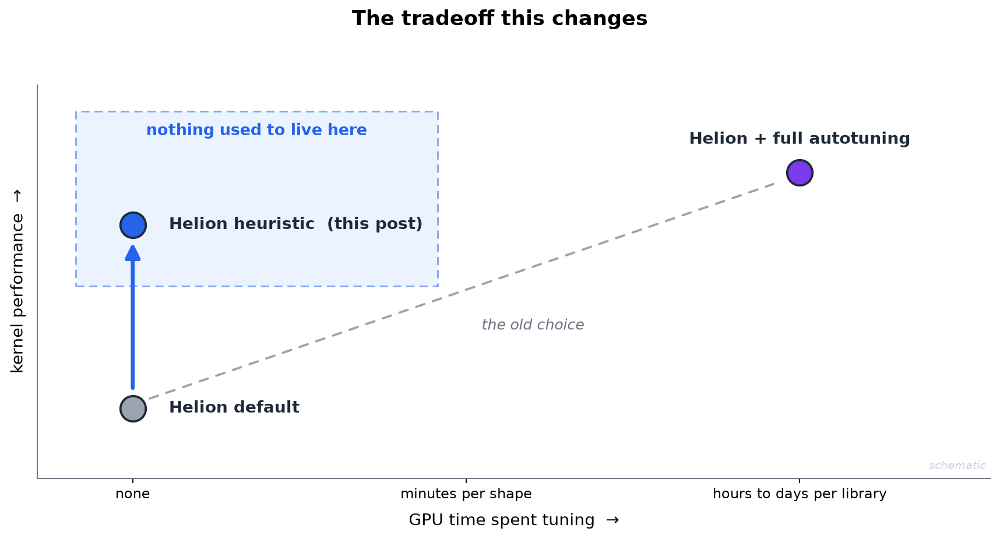

Caleb Min Sup Kim, Ethan Che, Jongsok Choi, Jason Ansel · 2026-11-12  
Original: [Fast by Default: Compile-Time Heuristics for Helion Kernels](https://pytorch.org/blog/fast-by-default-compile-time-heuristics-for-helion-kernels/)

Kernel development includes searching configurations for each shape. The Helion article cites a paged-attention kernel whose 72 shapes took about ten hours in quick tuning mode and twenty-five at full effort. New compile-time heuristics inspect structure and resource demand to emit a useful configuration without compiling and timing a population of candidates.

This matters for serving workloads with evolving shapes. A fixed deployment can amortize tuning, while rapid iteration and long-tail shapes often depend on defaults. The work introduces another performance–waiting-time trade-off, rather than claiming static rules always outperform search.

## From operations to live-resource budgets

Helion scans device IR: any matmul selects the matmul heuristic; reductions without matmul select reduction rules; remaining kernels use pointwise rules. Classification follows operations, not whether a kernel is a conventional GEMM. Unknown compile-time extents currently prevent the heuristics from firing and retain the old default.

Shared liveness analysis identifies last uses and estimates the registers, shared memory and, on Blackwell, tensor memory simultaneously needed by a CTA at a candidate tile size. The first exhausted resource limits residency. A CTA using sixty percent of an SM's tensor memory cannot coexist with another such CTA even when other resources are plentiful.

These estimates predict where Triton will place values and which intermediates disappear through fusion. They are not exact assembler reports. Nevertheless, they connect block size, warps and pipeline stages through a common resource model.

## Choosing interacting knobs

For matmul, a grid too small to fill the GPU motivates smaller tiles and more CTAs. Additional stages hide loads but can consume shared memory and reduce residency. More warps spread register demand while also affecting which MMA instructions Triton emits. The heuristic combines dynamic matmul work and resource estimates before a conservative feasibility check.

Multiple matmuls can disagree about shared block-size knobs and the kernel's single warp count. Helion prioritizes dots with loop-carried accumulators, followed by dynamic work and output area, giving footprint-dominating operations precedence.

Reduction rules balance sufficient warps, CTA residency and coalesced access. If analysis proves a row is read twice, as in computing and applying an RMSNorm scale, persistent reduction can justify some additional register pressure by avoiding a second memory trip. Block and warp choices are iterated until stable.

<a class="note-image-link" href="/assets/images/tech/pytorch-helion-compile-time-heuristics/figure.png" target="_blank" rel="noopener" aria-label="Conceptual trade-off between old defaults, heuristics and full tuning · View original image ↗">View original image ↗</a>

*The horizontal axis is GPU tuning time and the vertical axis is kernel performance; this is a schematic, not a measured curve.*

## What the measurements establish

Across nine linear-attention variants and 96 kernel–shape cells on H100, the authors report 1.18× handwritten FLA Triton performance for forward and 1.12× including backward. Fully tuned forward reaches 1.26×. Shapes span batch 1–8, 8–96 heads, sequences 1,024–16,384 and head dimensions 64–256. Structural information recovers substantial search benefits here, without establishing an 18% improvement for every attention kernel.

Across six production vLLM reduction kernels and 153 cells, the heuristic reaches 1.27× handwritten CUDA/C++, versus 1.31× with full tuning. These are operator comparisons, not end-to-end serving throughput. General matmul comparisons against torch.compile also include differences in fusion; jagged HSTU regresses relative to a fortuitously good old default.

Heuristics can supply approximately 5–20 candidate variations to seed tuning. In 38 kernels with one shape each, the median number of candidates required to get within 25% of the best found falls from 103.5 to 2.5. Completing the search only falls from 521.5 to 420.5, and final winners are nearly identical. The large early reduction in candidate count must not be presented as an equivalent reduction in full tuning time.

## A stronger starting point with explicit fallback paths

The reported analysis overhead is tens of milliseconds, negligible beside Triton compilation noise; actual kernel compilation remains necessary. H100 and B200 on the Triton backend have the heuristics enabled by default. Evaluation and tuned constants concentrate on NVIDIA, with unknown extents, untouched knobs and resource-prediction errors limiting coverage.

Promising extensions include compiling once to correct estimates from real resource reports, and handling runtime shapes more usefully. For Ops4LLM, the practical contribution is treating startup delay and runtime performance as a joint objective: obtain a strong initial configuration, then decide whether stable, frequently used shapes justify full search.
