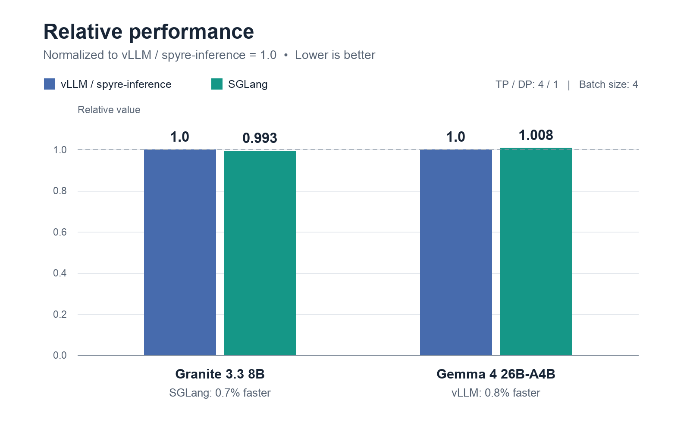

Gal Bloch, Itay Etelis, Raghu Ganti, Mudhakar Srivatsa, Alex Nails · 2026-11-12  
Original: [Integrating SGLang into Spyre in Under a Week with AI](https://pytorch.org/blog/integrating-sglang-into-spyre-in-under-a-week-with-ai/)

Two engineers, less than a week and roughly 1,500 plugin lines are the headline results. The more useful explanation is that Spyre already had a working compiler and PyTorch operators. Coding agents mainly connected them to explicit SGLang extension points. This shows how module boundaries constrain a migration task, rather than proving an agent can build an accelerator stack from scratch in a week.

## Existing implementations constrain adaptation

torch-spyre already registers a PyTorch device and integrates with torch.compile. The existing vLLM Spyre backend supplies attention bucketing, shape handling and PyTorch KV-allocation examples. Coding tools therefore have concrete hardware behavior to reference, while SGLang's platform registration, attention backend, KV pool and operator dispatch define the target contracts.

Four small patches accompany the initial integration: two expose execution paths without CUDA-specific dependencies, and two register the Spyre device and non-Triton attention backend. They address compatibility and device identification while retaining the serving scheduler.

## What could be reused unchanged

The attention base class provides surrounding logic, leaving the inner scaled dot-product attention to override. This explains about two-thirds of the line-count difference from the roughly 3,500-line vLLM plugin. Buffer creation in the device-agnostic KV pool needs one override, though allocation paths relying on Triton still require PyTorch replacements. Existing Spyre implementations supply RMSNorm, SiLU, GeLU, rotary embeddings and linear operations.

RadixCache resolves prefix sharing in the scheduler before accelerator execution, requiring no Spyre-specific change. That does not establish support for every attention optimization: the article still places future Triton support and RadixAttention on that backend on the roadmap.

## Two different performance baselines

<a class="note-image-link" href="/assets/images/tech/pytorch-sglang-ibm-spyre-ai/figure.png" target="_blank" rel="noopener" aria-label="Normalized SGLang and vLLM performance on Spyre · View original image ↗">View original image ↗</a>

*TP/DP is 4/1 with batch four. vLLM is normalized to one; lower is better, and both differences are below one percent.*

The authors report roughly 3.6× throughput versus the reference PyTorch inference implementation using torch-spyre. Against vLLM, results are approximately equal on Granite 3.3 8B and Gemma 4 26B A4B. The figure uses TP/DP 4/1 and batch four, with normalized values 0.993 and 1.008 against vLLM at one; lower is better. **The 3.6× figure is not a gain over vLLM.**

Evidence supports reusing a mature serving framework to outperform a reference path and approach another mature backend. Development time and code size do not isolate AI's productivity effect: there is no no-AI development control or comprehensive model/workload evaluation.

## The transferable lesson is task boundaries

This approach requires working compiler/runtime support, reference operators and clear extension interfaces. Shape management still uses buckets; dynamic shapes and Triton are future directions. The valuable lesson is to reduce porting to bounded interface adaptation, giving coding agents concrete implementations to follow and humans identifiable boundaries for checking numerical and execution semantics, rather than promising a universal one-week integration.
