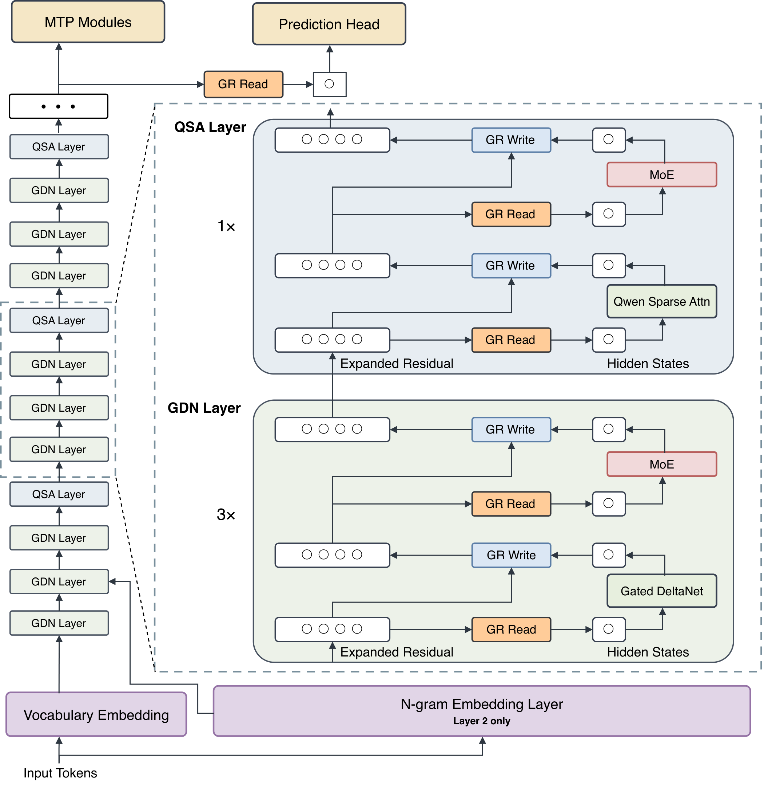

Long tasks incur two kinds of cost: the history processed at each inference step and the number of steps taken to finish. The Qwen4-Max release describes its architecture and reports task-level bills, giving a way to examine these costs separately. The model supports native vision and a million-token context window. Its reported task costs come from the team’s own evaluation.

## Two representations of history

Three Gated DeltaNet layers accompany each Qwen Sparse Attention layer. The former compress history into fixed-size state. The latter uses a lightweight indexer to select relevant micro-blocks and applies attention to selected context. The design combines a continuously updated representation with a route back to specific passages. The release describes that computation but gives no serving-memory curve across concurrency levels and input lengths.

Two other changes affect how to read the parameter counts. Four parallel residual branches have dynamic read and write gates, and the second layer looks up local token patterns through an N-gram embedding. The team lists a 2.4-trillion-parameter backbone, 71 billion parameters activated per token, and an additional 328 billion N-gram embedding parameters. These describe capacity, sparse activation and lookup capacity. Their sum would not represent active computation per token.

<a class="note-image-link" href="/assets/images/tech/qwen4-max/architecture.png" target="_blank" rel="noopener" aria-label="The backbone combines sparse attention, gated residual paths and local pattern embeddings. View original image ↗">View original image ↗</a>

*The backbone combines sparse attention, gated residual paths and local pattern embeddings.*

## Token savings depend on the workload and effort setting

Relative to Qwen3.8-Max, the team reports about 24% fewer tokens at Xhigh effort and 35% fewer at High on Work360. On Terminal-Bench 4.0, the corresponding reductions were about 48% and 49%. The near-halving figure therefore describes the terminal workload. Cost estimates for agents producing finished deliverables depend on both task mix and reasoning setting.

Work360 organizes professional scenarios across 26 top-level domains, 182 subdomains and 721 specializations. On this internal evaluation the score rose from the predecessor’s 47.74 to 52.69. Fewer tokens thus accompanied a higher score on the selected work. The averages do not identify the behavior responsible for the savings, such as shorter answers, fewer failed attempts or less reasoning after tool calls.

## A task bill also reflects a change in prices

Average Work360 task cost fell from $4.43 to $1.67, about 62%. This comparison includes new API prices, particularly the reduction for cached input. At launch, input, output and implicitly cached input were priced at $1.50, $4.50 and $0.075 per million tokens respectively. For a workflow that repeatedly sends shared prefixes, cache hits change the bill even if output length stays fixed.

Interpreting that result in deployment requires task outcomes, counts for each type of token and the corresponding prices in the same record. Those quantities distinguish shorter trajectories from cheaper repeated input. The release supplies the architecture and workload-level comparisons, but does not measure each component’s isolated contribution to the cost change.

Qwen Team · 2026-11-16 · [Qwen4-Max: Your New Teammate Has Arrived](https://qwen.ai/blog?id=qwen4-max)
