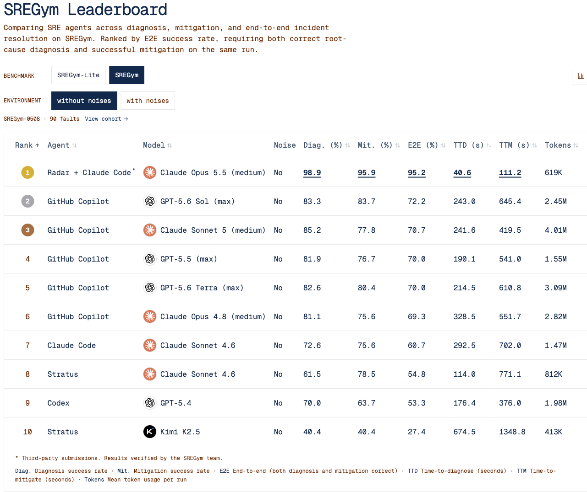

Autonomous operations may need better context as much as a shell-capable model. A fault can produce symptoms across many workloads while the causal configuration lives in another namespace. Radar's SREGym study removes kubectl and kubeconfig from the agent and permits cluster reads and changes only through Radar MCP, then evaluates end-to-end diagnosis and repair.

Original: [Radar Is #1 on SREGym: 95% of Live Kubernetes Faults Fixed](https://radarhq.io/blog/sregym-leaderboard) · Nadav Erell · 2026-11-05

## Restrict the cluster entry point and test the full chain

The submission combines Claude Code, Claude Opus 5.5 at medium effort, and Radar v1.19.0. Radar starts fresh for every run, with SREGym's unmodified grader. SREGym-0508 contains ninety live Kubernetes faults, attempted three times each for 270 runs. The authors report no dropped runs or additional retries.

The container has neither kubectl nor kubeconfig, so every cluster read and repair is a named MCP operation. An upstream filtering proxy aligns Radar's visibility with that of a kubectl agent. This constrains bypasses, but performance still belongs to the model, harness, prompt, tools, and supplied context together. A leaderboard alone cannot isolate Radar's contribution.

## The DNS example: connect application symptoms to another namespace

One scenario corrupts CoreDNS so internal service names stop resolving. Multiple services in the online shop fail; their namespace contains many errors, all downstream symptoms of DNS failure.

The agent first calls issues for the shop. Radar returns those symptoms while flagging kube-system/coredns as suspicious and pointing to an NXDOMAIN override. The agent checks recent changes, reads CoreDNS, submits a diagnosis, patches the bad configuration, restarts CoreDNS, and tests name resolution inside a shop Pod. The example submits diagnosis at twenty-one seconds and repair at thirty-eight seconds; all three attempts for that fault pass.

The mechanism combines resource relationships, changes, and suspicious configuration to narrow the search, rather than simply returning more raw logs. Verification returns to the affected workload instead of treating a successful configuration write as recovery. One trajectory explains operation, without establishing the same acceleration for every fault.

## What 270 runs establish

The reported full-suite rates are 98.9% diagnosis, 95.9% fix, and 95.2% joint success. Mean diagnosis time is 40.6 seconds, fix time 111.2 seconds, with about 619K tokens and reported agent cost of $0.41 per run. The 95.2% denominator is runs, rather than an integer subset of ninety unique problems.

<a class="note-image-link" href="/assets/images/tech/radar-sregym-leaderboard/radar.png" target="_blank" rel="noopener" aria-label="The article’s leaderboard image records models, diagnosis, repair, and joint outcomes; model conditions differ across entries. · View original image ↗">View original image ↗</a>

*The article’s leaderboard image records models, diagnosis, repair, and joint outcomes; model conditions differ across entries.*

Tool usage adds behavioral evidence: issues appears in all 270 runs, get_changes in 231, patch_resource in 219, and get_resource in 218. There are 248 uses of wait_for and eighty-two runs using exec_pod. This supports a broad pattern of structured investigation, targeted edits, and verification. Twenty tools are used overall, so a single summarization endpoint cannot explain the result.

## Why the score does not isolate a tool effect

The next full-suite entry scores 72.2% end to end but uses a different model and harness. The authors acknowledge that no other full-board entry runs Opus 5.5. Lite offers a closer same-model, same-effort comparison, but has only seventeen faults and still is not a controlled tool-only substitution. Earlier diagnosis-only tests cannot substitute for a control on this repair pipeline.

Thus 95.2% establishes high completion for a tool-restricted system, without proving that Radar independently adds twenty-three points. The public static leaderboard page also displays the entry and values but does not provide enough per-run detail for independent recomputation. Tool-use statistics and trajectory times here remain attributed to the authors.

## Remaining failures and production authority

Thirteen of 270 runs fail end to end, mostly with correct diagnoses but unsuccessful fixes. Misses concentrate in application-internal evidence, Kafka problems, or node/kubelet faults, with some taking three to ten minutes. Structured Kubernetes resources do not eliminate application and host blind spots; the noisy board has not been tested.

Radar retains Kubernetes RBAC, omits Secret values from structured reads, and requires a preview and confirmation token for deletion. MCP clients can also require confirmation before writes. exec_pod is disabled by default. Named calls improve auditability, while target scope, write authority, and execution channels still need environment-specific limits.

Alongside SWEOps-Bench, the work addresses a different part of incident handling: Radar demonstrates runtime context and tools for operational repair, while SWEOps-Bench requires operator source edits, rebuilds, deployments, and independent functional checks. Different task and recovery definitions prevent a direct ranking between their percentages.
