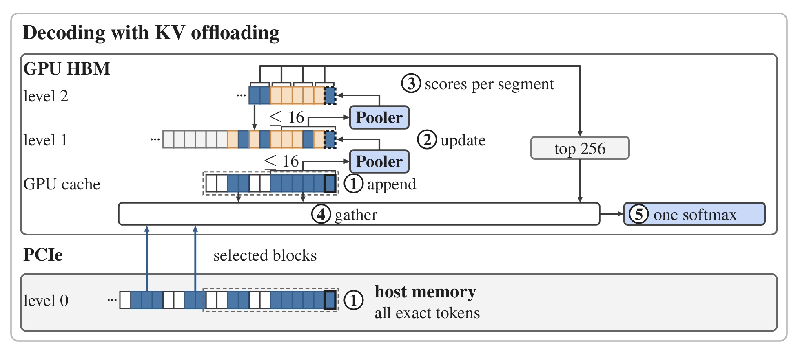

[RecSA: Million-Token Extrapolation at Logarithmic Cost](https://haoailab.com/blogs/recsa/)  
Ruitian Wang, Xinyu Yang, Minshen Zhang, Hao Zhang · 2026-11-17

RecSA addresses two long-context costs together: how much history attention reads and how a model interprets positions beyond its training length. It builds a tree over KV state, expands selected nodes for each query and retains unexpanded subtrees as summaries. Selection itself avoids a full-history scan, rather than only reducing the final attention reads.

## Replace a full scan with bounded expansion

Every 16 adjacent tokens form a parent, and groups of 16 parents form higher levels until the top has at most roughly 4K candidates. Values are child means; keys come from a learned pooler. At each level, a query selects 256 nodes, including its own node, and expands their children. The next level therefore has at most 4,096 candidates.

With fixed branching and selection budgets, tree height carries the growth in context length. Per-query selection and the number of entries read grow logarithmically; whole-model execution and complete prefill do not thereby become logarithmic. Unselected nodes enter one softmax alongside exact leaves as subtree summaries. Each historical token is covered once, but coverage is not preservation of every token’s exact information: summaries remain approximate.

<a class="note-image-link" href="/assets/images/tech/recsa/method.png" target="_blank" rel="noopener" aria-label="Exact leaves may stay on the host; GPU selection gathers needed blocks and combines summaries and exact tokens in one softmax. · View original image ↗">View original image ↗</a>

*Exact leaves may stay on the host; GPU selection gathers needed blocks and combines summaries and exact tokens in one softmax.*

## Keep positional distances within the trained range

Standard RoPE uses original sequence positions, exposing a short-context model to unseen distances at million-token lengths. RecSA instead numbers each level’s candidate list in order and places the query at its last index. Gaps between candidates disappear. At most 4,096 candidates means bounded relative distances.

This is not a training-free patch for arbitrary models. Stage one freezes Qwen3-4B and distills the pooler from teacher attention mass. Stage two freezes the pooler and trains the backbone under RecSA. Both stages use 32K sequences, processing 0.62B tokens in total. Distillation selects only 64 nodes per level, producing more levels even in short sequences and teaching the pooler to pool already pooled keys. Additional inference levels reuse its parameters.

A further safeguard penalizes a shared key shift. Candidate-local RoPE can turn such a shift into positional bias, allowing lower distillation loss without better subtree retrieval. Penalizing that shortcut while preserving differences between nodes couples the position scheme to the learning objective.

## What moves when KV exceeds GPU memory

At 1M and 2M, exact leaves live in pinned host memory while upper summaries remain on the H200, occupying less than 7% of the cache. GPU selection determines which exact blocks to gather; spare GPU memory caches a suffix. Appending a token updates only the last node at each level.

The kernels must also handle query-specific candidate positions. Prefill separates child-local key rotations from parent-slot rotations applied through queries, letting adjacent queries share loaded KV blocks. Decode segments candidate scoring to occupy more of the GPU at batch size one. Sparse ratios alone do not explain the execution benefit.

## Results and their operating envelope

With matched sparse read budgets, RecSA scores 60.5 on RULER at 1M against 40.0 for Dense+DCA, the strongest comparator. Its 2M score is 49.3: extrapolation works without making quality independent of length. On one H200 at batch size one, against dense FlashAttention in the same framework, 524K prefill takes 80 versus 257 seconds, about 3.2× faster; decode takes roughly 6 versus 23 ms, about 3.8× faster. At 32K, prefill is slightly slower, 1.6 versus 1.5 seconds.

At 1M and 2M, dense KV also requires host offloading, so larger speedups include different data-access behavior. Current evidence centers on Qwen3-4B, retrieval and book tasks, and single-request latency. Larger models and concurrent multi-user serving need separate validation. For agents, RecSA makes retained history cheaper to access without eliminating the question of what must remain exact.
