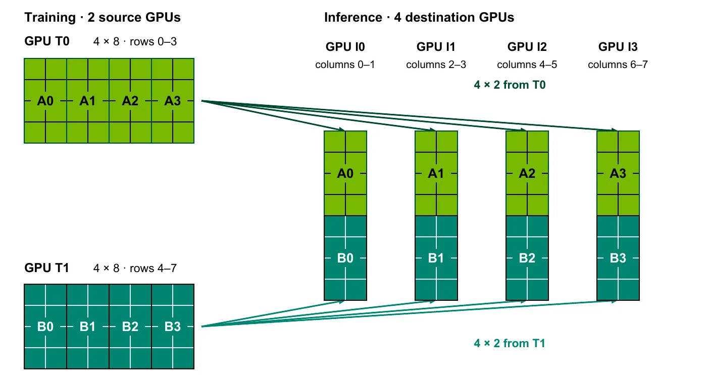

**NVIDIA · Youngeun Kwon, Kaushik Kandadi Suresh, Sreeram Potluri, Terry Kong and Sangkug Lym · 2026-11-06**  
Original: [Accelerating Reinforcement Learning Weight Refit with the Reshard Collective](https://developer.nvidia.com/blog/accelerating-reinforcement-learning-weight-refit-with-the-reshard-collective/)

RL post-training often separates trajectory generation from parameter updates. After learning, inference GPUs need refreshed weights before generating with the updated policy. This refit is a distributed-layout conversion: the two sides may use different GPU counts and tensor, pipeline, expert or data parallelism. Reshard makes that conversion an explicit collective.

## Why reconstructing a complete tensor is expensive

A conventional path all-gathers training shards into a full parameter, broadcasts it to inference and lets each destination retain its own shard. This handles diverse layouts simply, but recipients receive data they discard. Larger models make that redundant movement harder to hide.

For illustration, the post estimates 5.6 TB of BF16 weights for Kimi K3’s 2.8T parameters and approximately 11.2 TB of two-stage logical payload. This is an accounting estimate, not a measured network-byte counter or a universal per-step payload. The useful engineering question is which regions each destination lacks and which sources already hold them.

## Derive transfers from shard intersections

DTensor describes a global shape, device mesh and sharded or replicated placements. Reshard takes source and destination descriptions, computes intersections and transfers the required regions directly.

<a class="note-image-link" href="/assets/images/tech/reshard-rl-refit/shard-transfer.webp" target="_blank" rel="noopener" aria-label="Training row shards directly assemble inference column shards · View original image ↗">View original image ↗</a>

*Each source sends the required 4×2 intersection; four destinations assemble their own 8×2 shards without a full-matrix broadcast.*

For an 8×8 matrix split by rows across two training GPUs, each source holds 4×8. Four inference GPUs split by columns each need 8×2. Every destination receives 4×2 from each source and assembles its column shard; it never needs the full matrix. The framework supplies layouts while the communication library determines who sends which region, separating parallelism choices from transfer algorithms.

Minimum payload still requires attention to replication and physical topology. Sending each intersection directly to every replica can duplicate it over the slower network.

## Keep replication inside the NVLink domain

NCCL M2N Reshard groups destination replicas by NVLink domain. Ranks divide incoming contributions so that each source contribution enters a domain once, then exchange missing subsets over NVLink. Network transfer and local exchange are pipelined.

Replication is moved rather than eliminated. In the TP4-to-TP2×DP2 example, naive transfers send each source contribution across the network to both DP replicas. Reshard divides external reception among destination GPUs and fills gaps locally. Counting API calls alone would miss the benefit: the relevant quantity is how many times a shard crosses each network tier.

## The hybrid NeMo RL path and measured results

Real parameter layouts have many edge cases. NeMo RL therefore uses Reshard for dominant feed-forward projection weights—around 95% of parameters in the post’s discussion—and retains gather-and-broadcast for smaller weights such as QKV or Mamba parameters. This captures most payload savings while preserving broader functional coverage.

In official NeMo RL measurements on DGX H100, Qwen 3 235B refit falls from 6.4 to 1.9 seconds and DeepSeek v3 671B from 14.9 to 2.6 seconds. The latter falls from 6.1 to 2.3 seconds on DGX GB200. Across the table, refit speedups are 2.7–5.7×. The separate 4.3-second Qwen3.8 2.4T BF16 result is a refit-only microbenchmark, not full training-step throughput.

These measurements establish a shorter refresh stage for specified models and layouts. End-to-end benefit depends on its share of the training step and existing overlap with generation. Faster transfer also does not remove stale-weight semantics in asynchronous RL: movement time and policy version are distinct constraints.

## Membership changes still require a valid new layout

Recovery or membership changes alter GPU groups and shard ownership. The current NeMo RL integration destroys and recreates communication groups; using NCCL shrink/grow on existing groups is future work. Library APIs should not be mistaken for a completed integration.

The useful design is an explicit layout-conversion primitive that removes redundancy at the appropriate network tier. It targets disaggregated RL with material refit cost. The evidence does not promise identical gains for arbitrary layouts, precision modes or elastic recovery paths.
