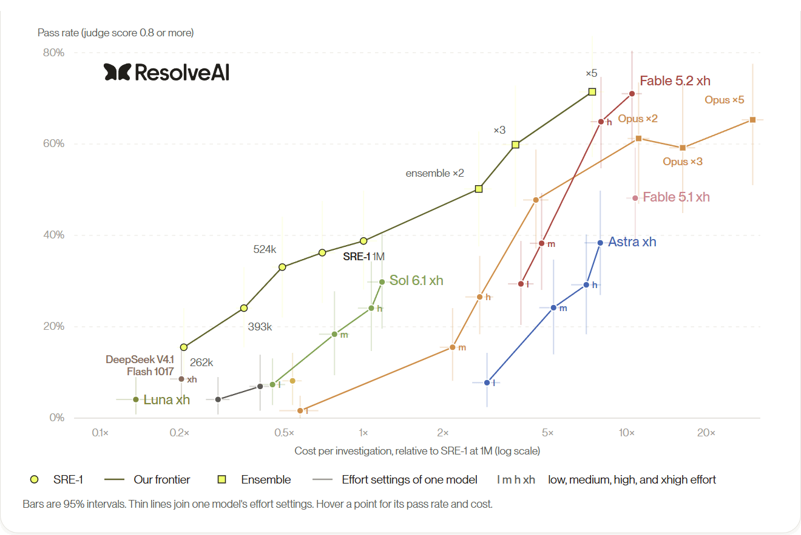

Production alerts usually identify a threshold crossing. A recent deployment and a handful of log lines can make a plausible story without explaining the incident. ResolveAI Labs gives a 27B model a narrower deliverable. Starting from an alert, query records available at the time and return a causal chain that can be checked against the eventual diagnosis. The cost of a correct investigation depends on which evidence it finds and whether the environment inadvertently reveals the answer.

## Reconstructing what was knowable at alert time

The investigator searches across metrics, traces, code and deployments. An end-time filter on a dashboard is insufficient. In one replay an agent followed the hash of a later commit and retrieved the incident's own fix. The team implemented time pinning per tool and removed tools it could not constrain. Queries run against real or captured data. An attempt to have a model invent responses for unrecorded queries had poor fidelity. In training, 18.1% of investigations encountered a tool failure. Keeping timeouts and rate limits in the environment lets the policy experience what happens when a source of evidence disappears mid-investigation.

<a class="note-image-link" href="/assets/images/tech/resolve-sre-1/overview.png" target="_blank" rel="noopener" aria-label="View original image ↗ — The horizontal axis shows relative investigation cost and the vertical axis case pass rate. Ensemble size changes both.">View original image ↗</a>

*The horizontal axis shows relative investigation cost and the vertical axis case pass rate. Ensemble size changes both.*

## Investigating live and synthesizing saved evidence

One training task lets the model gather new evidence. Another supplies read-only investigation records containing tool arguments, full outputs and consulted runbooks. The model reconstructs the diagnosis from those records. This gives an ensemble a mechanism beyond voting on final answers. One trajectory might locate a deployment, another the affected request population. Synthesis can join their evidence into a better chain. Judges calibrated with on-call engineers score against a reference chain, with 0.8 as the passing threshold. This measures diagnostic explanations for known incidents. Successful automated remediation would need its own endpoint.

## Preserving the actions that earned the reward

A sampler produces token IDs while a serving API typically returns text. Tokenizing that text again can produce a different sequence, causing a policy update to attribute reward to actions different from the sampled ones. The authors estimate that retokenization would change IDs in about 94% of rollouts. Retaining the sampler's sequence prevents this mismatch. Training started from Qwen3.8-27B and covered 1,549 distinct incidents. The final run lasted 7.4 days on up to 512 GPUs. This investment is distinct from the cost charged to an individual investigation.

The asynchronous platform places training and sampling behind low-level compute APIs, with tools, judging and orchestration near the environments. As one trajectory waits on a backend, others can progress. Peak concurrency reached 8,736 rollouts. Of 812,695 completed rollouts, 409,600 were used for training. The 51.5 million tool calls describe the whole run. Concurrent work, completed trajectories and samples used for updates measure different loads on the system.

## What the 49-case cost curve measures

On 49 difficult production cases, single-investigation pass rate rose from 6.9% for the base model to 38.8%. Synthesis across three investigations reached 60% and five reached roughly 71%. The five-run configuration matched the tested Fable 5.2 xhigh result at 37% lower cost under the authors' accounting, including synthesis. The return on extra investigations depends on their finding complementary evidence. Several trajectories can share the same blind spot. Tool access, reference-chain quality, the modest case count and the grading procedure all matter when transferring the curve to another on-call organization.

[SRE-1: Frontier Incident Investigation from a 27B Model](https://resolve.ai/labs/sre-1) · ResolveAI Labs · 2026-11-18
