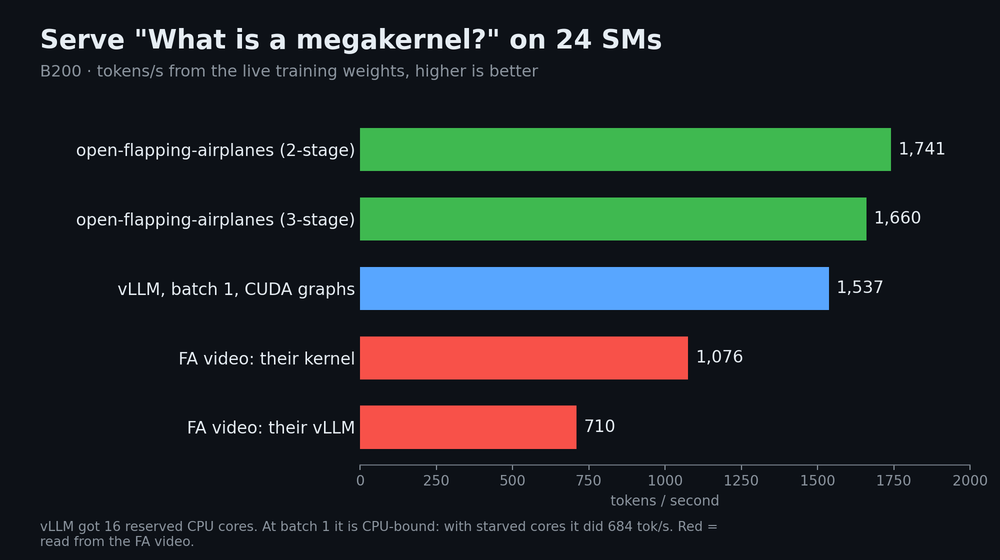

## How one persistent kernel runs three jobs

open-flapping-airplanes independently reconstructs a public demonstration: one persistent GPU kernel trains a language model, serves its changing weights and runs Doom. It does not use the original code, and the original model and training settings are unpublished, so it is an independent implementation rather than a reproduction of the original performance.

Blocks read their SM IDs and assume static roles. The B200 experiment assigns 116 SMs to training, 24 to serving and eight to Doom, without preemption. Training and serving claim tasks through ticket counters. Completed phases publish writes with a memory fence before incrementing counters; dependents use acquire reads and wait when necessary. Forward releases backward, and one token releases the next, without host launches between operations.

## Fewer launches do not guarantee fastest training

The 162.4M GPT experiment runs 4,000 steps of 4,096 tokens. The three-stage tcgen05 version trains in 48.1 seconds while serving and running Doom. On the same SM allocation, standalone eager Megatron with Transformer Engine takes 62.4 seconds, but its CUDA Graph version takes only 43.1 seconds and is faster.

Serving is also sensitive to CPU allocation. vLLM reaches 1,537 tokens/s with 16 reserved cores versus 684 without them; the authors use the stronger baseline. The comparison of sequential, separate concurrent and single-kernel execution includes a concurrent value estimated from separate runs, so not every total is measured directly.

<a class="note-image-link" href="/assets/images/tech/review-github-open-flapping-airplanes/serving-on-24-sms.png" target="_blank" rel="noopener" aria-label="View figure">View figure ↗</a>

*The project compares decode throughput for one prompt on 24 SMs. The two bars from the original demonstration video are distinct from the project’s own measurements.*

## Sharing is not a general scheduler

Doom is compiled for GPU execution, with a logic thread distributing drawing work to other threads. Sound is disabled and a scripted player controls the game. This demonstrates heterogeneous co-residency, but static partitions consume real capacity and do not automatically balance changing workloads.

My interpretation is to use the artifact to investigate execution boundaries: when host launch overhead matters and when matrix kernels or resource shares dominate. Tiny character-model results, the 162M model and A100/B200/B300 measurements must remain distinct. A strong CUDA Graph baseline is more informative than launch-count headlines alone.

Source: [Original engineering article](https://github.com/Bobliuuu/open-flapping-airplanes)
