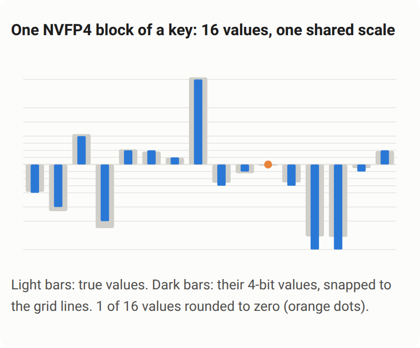

## Decoding can cost more than denoising

Pika H3 Flex is post-trained from MiniMax H3 and generates synchronized video and audio from text, keyframes or multimodal references. It uses six sampling steps, no CFG and dense attention. On one GB200, FastVideo reports about 20 seconds for six DiT forwards on a five-second 768p clip, versus 38 seconds for the original fp32 VAE decoder. Attention-only optimization misses the larger delay.

FastVideo replaces cuDNN SDPA with FlashAttention-4 and fuses glue operations, QKV preprocessing, normalization, modulation and SwiGLU. Decoding moves through BF16 to an NVFP4 decoder. For fifteen-second clips with roughly 109K tokens, quadratic attention reaches about 75% of each forward, making low-precision attention more relevant.

## Quantization must account for both modalities

<a class="note-image-link" href="/assets/images/tech/review-haoailab-pika-h3-flex/official-figure.png" target="_blank" rel="noopener" aria-label="View figure">View figure ↗</a>

*Sixteen values in one NVFP4 key block share a scale; one small value rounds to zero in this example.*

The NVFP4 path merges LoRA in fp32 before rounding once. Activation calibration uses Flex's own six-step trajectories and balances video and audio errors, preventing the more numerous video tokens from dominating clipping choices.

QAD trains a four-bit student under deployment numerics from the first step, matching frozen BF16 final predictions and block outputs, sometimes starting from its own states to learn drift correction. FP4 attention subtracts the mean key and applies the same orthonormal Hadamard transform to Q and K to spread outliers. Those transforms preserve pre-quantization attention semantics; quantization still introduces error. Sensitive blocks 45 and 49 retain BF16. Full-clip checks cover keyframe fidelity, motion and audio rather than accepting a better distillation score alone.

## What the sevenfold comparison includes

Timing is end-to-end prompt-to-MP4 with audio, resident models and warm medians, excluding loading. The fastest four-GB200 fifteen-second 768p configuration takes 31.8 seconds: 7.07 times faster than the 225-second single-GPU official path, but 4.58 times faster than the 146-second four-GPU path, with changed decoder precision.

The roughly 5.8-second result for a five-second 480p clip uses NVFP4 on Blackwell; it does not establish near-real-time performance at every duration or resolution. My interpretation is to separate DiT, attention, VAE and quantization effects: address decoder cost in short clips, dense attention in longer ones, and constrain numerical optimization with complete audiovisual behavior.

Source: [Original engineering article](https://haoailab.com/blogs/pika-h3-flex/)
