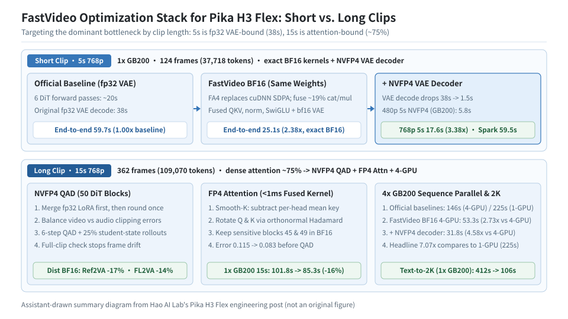
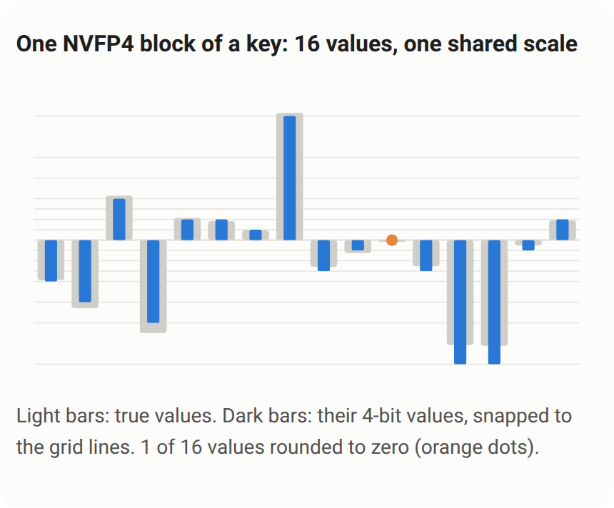

Hao AI Lab @ UCSD (FastVideo team · Aryan Kumar, Will Lin, Hao Zhang) · 2026-11-04 · [Original article](https://haoailab.com/blogs/pika-h3-flex/)

Pika H3 Flex is post-trained by Pika on top of MiniMax H3 with two LoRA adapters: `fl2va` (handling text-to-video/audio `T2VA` and first/last-frame conditioning `I2VA / L2VA / FL2VA`) and `ref2va` (accepting up to 9 images, 3 videos, and 3 audio clips in `Ref2VA`). The model runs six denoising steps with no classifier-free guidance (no CFG) and full dense attention. FastVideo released exact BF16 optimizations alongside two 4-bit NVFP4 variants trained with quantization-aware distillation (`FastVideo/Pika-H3-Flex-NVFP4-QAD` with BF16 attention and `FastVideo/Pika-H3-Flex-NVFP4-FP4Attn-QAD` with FP4 attention), open-sourcing inference, the full training recipe, and a two-stage 2K workflow.

> **Benchmark scope & comparison boundaries**: All reported timings are warm, resident-model medians measured end-to-end from prompt to MP4 with audio (excluding weight loading) on NVIDIA Blackwell hardware (targeting GB200 down to DGX Spark and RTX 5090). Notably, the headline **`7x` (`7.07x`) speedup** compares a **4× GB200 sequence-parallel run using fused kernels + the NVFP4 VAE decoder (`31.8 s`)** against the **single-GPU official BF16 baseline (`225 s`)**, rather than holding GPU count and BF16 decoder precision fixed.

## Shifting Bottlenecks: fp32 VAE Decode vs. Dense Attention & BF16 Kernels

Before quantizing weights or activations, FastVideo profiled the official code (`diffusers + cuDNN SDPA + fp32 VAE`) on one GB200. On a **5-second 768p clip (1344×768, 124 frames / 37,718 tokens)**, all six DiT forward passes take roughly **20 s**, whereas the default `fp32` VAE decoder alone consumes **38 s**—over half of total wait time.

FastVideo tackles this in two layers. First, without altering BF16 weights, it swaps cuDNN SDPA for **FlashAttention-4 (FA4)**, fuses scattered `cat`/`mul` glue operations (~19% of an official forward pass) along with QKV prologues, normalization, modulation, and SwiGLU kernels, and moves decoding to BF16 (`25.1 s`, `2.38x`). Second, introducing an **NVFP4 VAE decoder** slashes decoding from `38 s` down to **`1.5 s`**, reaching `17.6 s` total (`3.38x`).

Extending the clip to **15 seconds at 768p (362 frames / 109,070 tokens)** flips the bottleneck completely: quadratic dense attention grows to roughly **75%** of every DiT forward pass. Even with 4-GPU sequence parallelism (diffusers Ulysses CP), official 1-GPU and 4-GPU runs still take `225 s` and `146 s`, setting up the 4-bit attention optimizations below.

<figure>
  <a class="note-image-link" href="/assets/images/tech/review-haoailab-pika-h3-flex/pika-h3-pipeline-en.svg" target="_blank" rel="noopener">
    
    Expand diagram ↗
  </a>
  <figcaption>Assistant diagram (not an original figure): Bottleneck shift between 5s VAE-bound and 15s attention-bound clips alongside exact FastVideo speedup baselines.</figcaption>
</figure>

| Workload (`1344×768`, 1×/4× GB200) | Pipeline Configuration | End-to-End Time | Same-GPU Speedup | vs. 1-GPU Official (`225 s`) |
| :--- | :--- | :--- | :--- | :--- |
| `5 s · 124 frames` · 1× GB200 | Official `pika-h3-pro` (`cuDNN SDPA + fp32 VAE`) | `59.7 s` | `1.00x` | — |
| `5 s · 124 frames` · 1× GB200 | FastVideo BF16 (`FA4 + fused ops + bf16 VAE`) | `25.1 s` | `2.38x` | — |
| `5 s · 124 frames` · 1× GB200 | `+ fused kernels + NVFP4 VAE decoder` (`38 s -> 1.5 s`) | `17.6 s` | `3.38x` | — |
| `15 s · 362 frames` · 1× GB200 | Official `pika-h3-pro` (`fp32 VAE`) | `224 s` | `1.00x` | — |
| `15 s · 362 frames` · 1× GB200 | FastVideo BF16 / `+ NVFP4 VAE decoder` | `104 s` / `94.7 s` | `2.15x` / `2.37x` | — |
| `15 s · 362 frames` · 4× GB200 | Official 4-GPU (`diffusers Ulysses CP`) | `146 s` | `1.00x` | `1.54x` |
| `15 s · 362 frames` · 4× GB200 | FastVideo BF16 (`sequence parallel DiT + VAE`) | `53.3 s` | `2.73x` | `4.22x` |
| `15 s · 362 frames` · 4× GB200 | `+ fused kernels + NVFP4 VAE decoder` | `31.8 s` | **`4.58x`** | **`7.07x`** |

At lower resolution (`480p`, 5 seconds), the NVFP4 model reaches **`5.8 s`** on one GB200 (`5.79 s` with BF16 attention vs. `5.74 s` with FP4 attention), and generates a 5-second `480p` `FL2VA` clip in **`59.5 s`** on a single desktop **DGX Spark**.

## NVFP4 QAD: fp32 LoRA Merge, Dual-Modality Calibration & Drift Guards

Both adapters compress every attention and feed-forward linear layer across all 50 DiT blocks into **NVFP4** (4-bit weights and activations sharing one 8-bit scale per 16 values). Three choices preserve alignment and temporal structure:

1. **Merge LoRA in `fp32` before rounding once**: Flex ships `fp32` LoRA adapters. Evaluating `(W.float() + (alpha / rank) * B.float() @ A.float()).to(torch.bfloat16)` avoids folding intermediate quantization drift into merged base weights.
2. **Joint video + audio static activation calibration**: Scales are calibrated along Flex's six-step trajectories. Scaling to raw maximum spikes wastes 4-bit dynamic range, whereas minimizing aggregate token reconstruction error lets abundant video tokens drown out audio fidelity; per-layer clipping therefore optimizes a balanced audio-video trade-off.
3. **Deployment-exact 6-step QAD & own-state drift recovery**: Training runs 4-bit math from step 1 (so exported 4-bit weights are **byte-identical** to quantized training state), matches both final predictions and intermediate block outputs of the frozen BF16 teacher, and rolls out from the student's own states 25% of the time so it learns to self-correct compounding trajectory drift.

Crucially, the team pairs loss tracking with **full-clip seed-noise guardrails** evaluating first/last-frame fidelity, motion, and audio. In one run where distillation loss kept improving while the final frame drifted, those full-clip checks flagged the regression and a lowered learning rate resolved it.

<figure>
  <a class="note-image-link" href="/assets/images/tech/review-haoailab-pika-h3-flex/official-figure.png" target="_blank" rel="noopener">
    
    Expand diagram ↗
  </a>
  <figcaption>Original figure (Hao AI Lab): Sixteen values inside one NVFP4 key block share one scale (E4M3); outliers force smaller components toward zero.</figcaption>
</figure>

## Long-Clip FP4 Attention: Smooth-K, Hadamard Rotation & Mixed-Precision Blocks

For 15-second 109K-token workloads, FastVideo also quantizes queries and keys for FlashAttention-4's NVFP4 path (keeping `P` and `V` in BF16). Naive FP4 quantization surrenders 13–17% of QAD quality; three targeted measures recover almost all of it:

- **Smooth-K (mean-key subtraction)**: Subtracting each head's mean key (`q·(k_j - k̄) = q·k_j - q·k̄`) is mathematically exact under softmax shift invariance and removes shared per-channel bias.
- **Shared orthonormal Hadamard rotation**: Multiplying both `Q` and `K` by the same orthonormal Hadamard matrix satisfies `(qH)·(kH) = q·k`, leaving `softmax(QKᵀ)` unchanged pre-quantization while spreading outlier channels across 16-value blocks. One fused kernel applies both transforms alongside quantization in **under `1 ms`** per attention call and matches FlashAttention-4's training-time error within **`1%`**.
- **Keeping blocks 45 and 49 in BF16**: Per-layer profiling showed most residual distortion concentrates in blocks 45 and 49, so their attention stays BF16.

| Metric / Stage | `Ref2VA` | `FL2VA` | Scope & Notes |
| :--- | :--- | :--- | :--- |
| Distance to BF16 Flex: Quantized only -> After QAD (lower is better) | `0.326 -> 0.270` (**`-17%`**) | `0.272 -> 0.234` (**`-14%`**) | 6-step QAD + 25% student rollout |
| Real-activation FP4 attn error: Plain FP4 | `0.113` | `0.115` | Direct Q/K 4-bit quantization |
| `+ smooth K + Hadamard` | `0.095` | `0.095` | Pre-quantization exact transforms (`< 1 ms`) |
| `+ blocks 45 & 49 in BF16` | `0.080` | `0.083` | Selective mixed precision on outlier blocks |
| Post-QAD distance to BF16 (FP4 vs. BF16 attn) | `0.276` vs. `0.270` | `0.237` vs. `0.234` | Closes nearly all Q/K precision gap |
| 1× GB200 end-to-end latency (`768p 15 s`, FP4 vs. BF16 attn) | `85.3 s` vs. `101.8 s` (**`-16%`**) | `480p 5 s`: `5.74 s` vs. `5.79 s` | Biggest win appears once clips enter 100K-token regime |

Across the five synchronized 5s 768p comparison scenes (`Blue hour`, `Cannonball`, `Fireworks`, `Campfire`, `References to video`) on 1× GB200, official runs took `59.7 s–75.4 s`, dropping to `26.6 s–61.7 s` in FastVideo BF16, `16.8 s–61.7 s` with NVFP4 QAD (`BF16` attn), and `15.1 s–51.4 s` with `FP4` attention (`15.1 s–16.5 s` across prompt/keyframe tasks; `51.4 s` on multi-reference conditioning due to reference encoding cost).

## 2K Regeneration & Takeaways for Multimodal Serving

Pairing NVFP4 QAD Flex as a draft generator with NVIDIA's **`Open-H3-Regenerate-2K`** (`2560×1440`) and the NVFP4 2K decoder reduces 2K decode time from `23.3 s` to `5.0 s` and shrinks drafting from a 50-step `316 s` base H3 pass down to `16.8 s`, bringing **total text-to-2K latency on 1× GB200 from `412 s` (~7 min) to `106 s` (< 2 min)**.

Three takeaways extend cleanly to broader multimodal serving: profile VAE vs. DiT before touching 4-bit weights (decode and `19%` glue ops dominate short clips while quadratic attention dominates long ones), calibrate quantization across modalities explicitly rather than letting high-count visual tokens starve audio fidelity, and gate quantization sweeps on rendered video/audio checks rather than MSE loss alone.

---

> **Provenance**: Rewritten and translated by the assistant from Hao AI Lab's primary engineering post (`authoring_source: assistant`, `translation_source: assistant`). Retains original `official-figure.png`, adds assistant-drawn `pika-h3-pipeline-en.svg`, and corrects tags strictly to `inference-serving`.
