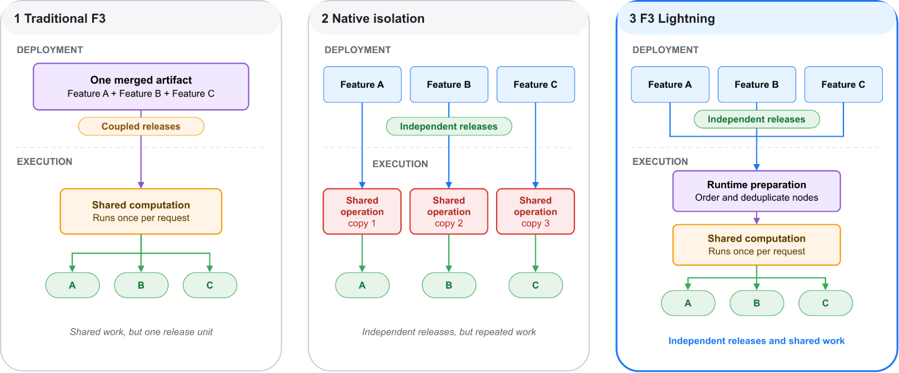

## Why the shared graph delayed releases

F3 extracts features for ads ranking; one request can require more than 20,000 features. Seven-day click and impression counts can share event reads and time filters, while click-through rate reuses both counts. The original compiler merged every feature into one DAG so common nodes ran once per request. That graph was also the release unit: one invalid definition blocked valid features, and expensive model tests for an existing feature held up new ones.

F3 Lightning compiles each feature into a self-contained configuration containing every required node. Validation, deployment and rollback are independent. A priority queue distinguishes new features with no model consumers from changes that require additional model testing. This removes release coupling, but early prototypes consumed substantially more CPU because they executed separate graphs.

## Recovering shared computation and memory

<a class="note-image-link" href="/assets/images/tech/review-meta-f3-lightning/official-figure.png" target="_blank" rel="noopener" aria-label="View figure">View figure ↗</a>

*Features release independently; runtime ordering and deduplication recover shared computation.*

Independently compiled configurations need to recognize equivalent work. The compiler derives stable computation IDs from the operation, parameters and input IDs, recursively incorporating upstream semantics. Commutative inputs are normalized; aggregation IDs include windows and grouping keys. Local node numbering can therefore change without preventing sharing.

At startup, the runtime deduplicates active configurations, orders nodes by dependency and flattens them into one execution sequence. Requests walk that sequence. If an input or computation fails, dependent nodes become not ready and are skipped; independent branches continue. Independent release does not eliminate runtime dependencies.

Deduplication alone did not restore CPU efficiency. Intermediate values remained scattered across per-feature containers, causing cache misses. Lightning uses one buffer per request and a separate readiness vector: an empty list is a valid result, not an indication that work is unfinished. Lists and maps share references, while small scalars are copied. Startup also maps stable IDs to dense integer slots, replacing request-time hashing with direct array access.

## What the reported gain means

Meta reports that comparable extraction features reach production about 3.6 times faster without additional infrastructure compute cost. This measures release time, not prediction throughput, and does not imply free development or migration. The article supplies an engineering explanation rather than a universal performance guarantee.

My interpretation is that this design fits feature platforms with substantial common subcomputation and different component release cadences. The transferable choice is to separate release boundaries from execution boundaries and move invariant deduplication, ordering and address resolution to startup. Shared execution still needs explicit failure propagation to keep an affected branch from contaminating unrelated outputs.

Source: [Original engineering article](https://engineering.fb.com/2026/11/03/ml-applications/f3-lightning-how-meta-accelerates-ads-ml-features-to-production/)
