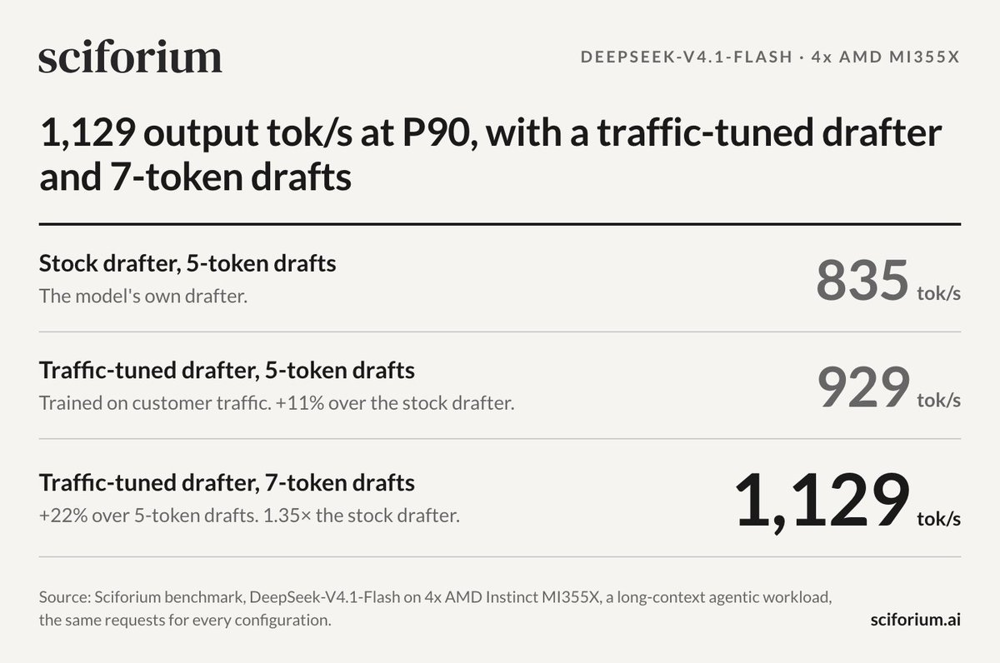

[Unlocking 1,129 output tps on AMD MI355x using Traffic-tuned Speculators](https://x.com/i/article/2122759644397674496)  
Hassan Akbari / Sciforium · 2026-11-17

Sciforium reports P90 output speed of 1,129 tokens/s on four AMD Instinct MI355X GPUs using original DeepSeek-V4.1-Flash main-model weights. Its path combines customer-traffic-trained drafters, expansion from five-token to seven-token proposals, and optimization of intermediate computation and communication. The useful question is how these pieces cooperate, not whether one number describes every workload.

## Improve acceptance before extending the draft

Speculative decoding asks a cheaper drafter for several continuations and verifies them together with the main model. Only the accepted prefix advances generation. If rejection happens near the beginning, proposing extra positions adds work without progress. Draft length and acceptance length are different variables; additional useful output must outweigh drafting and verification costs.

Sciforium first trains customer-specific drafters on traffic shared with permission, leaving the main-model weights unchanged. Better acceptance makes seven-token proposals worth testing. The article also mentions stability fixes without detailing their failure conditions or implementations. They belong to the final configuration, but do not support claims about specific correctness bugs repaired.

## What the performance ladder establishes

<a class="note-image-link" href="/assets/images/tech/sciforium-traffic-speculators/method.jpg" target="_blank" rel="noopener" aria-label="P90 output speed on the same request set changes with traffic tuning and draft length; it is not total request latency. · View original image ↗">View original image ↗</a>

*P90 output speed on the same request set changes with traffic tuning and draft length; it is not total request latency.*

The official figure uses the same requests on four MI355X GPUs and a long-context agentic workload. P90 output rates rise from 835 tokens/s with the stock five-token drafter to 929 with a traffic-tuned five-token drafter, then 1,129 with traffic tuning and seven-token drafts. This supports the combined strategy for that workload, without supplying enough traffic and configuration detail to predict another customer’s gains.

P90 output speed is a high speed percentile, not a latency guarantee for the slowest 10% of requests or aggregate multi-request throughput. Dividing 10,000 by 1,129 gives roughly nine seconds of generation at that rate, excluding prompt processing, queueing and tools. Unchanged main-model weights rule out one source of simplification, but alone do not prove identical quality for every sampling and verification path.

## Fusion and overlap have different outcomes

The authors fuse operations such as mHC and projections around major kernels and fuse all-reduce with computation to reduce intermediate work and movement. CUDA graphs already remove launch gaps, so benefits should not be attributed entirely to filling idle periods. Beyond concurrency eight, diminishing megakernel returns motivate optimization around the large kernels.

A useful negative result is that moving all-reduce to a separate stream for overlap does not help: concurrent operations contend for memory bandwidth. Communication–computation fusion and separate-stream overlap are different mechanisms. The article also warns against adding higher-concurrency kernel improvements as extra percentages onto the complete 1,129-token/s result.

## How to use this industrial evidence

The account connects traffic distribution, draft depth, stability and execution, including an unsuccessful optimization. It argues for measuring net speculative-decoding benefit on real requests rather than converting acceptance improvements directly into latency gains.

Evidence remains vendor-reported production-workload performance without a public replay set, complete latency distribution or concurrency matrix. A market-first claim is unnecessary to the technical conclusion. Customer-specific distribution, extra verification cost and bandwidth competition are already concrete boundaries for interpreting the result.
