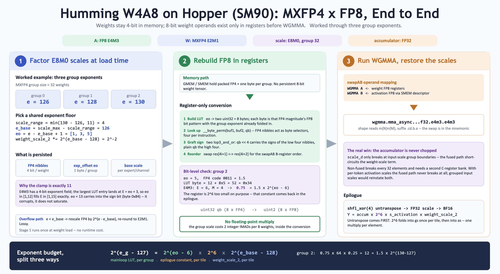

MoE quantization involves storage, arithmetic and routing shape. Storage determines bytes moved, the tensor core determines available operands, and routing determines tokens per expert. Humming supplies low-bit computation inside SGLang while existing routing, scheduling and distributed execution remain responsible for their original work. This makes it possible to distinguish a kernel change from an activation-precision change.

## Moving part of conversion to load time

On Hopper's MXFP4-weight, FP8-compute path, model loading factors scales and prepares layouts while retaining compact weights. At runtime registers reconstruct FP8 operands from FP4 values and residual exponents. Matrix multiplication accumulates in FP32, then the epilogue applies the remaining weight and activation scales. Expanded weights need not reside in HBM. The exponent span is finite, so range adjustment can introduce rounding or underflow. In the reported Humming 0.1.18 configuration, no valid target groups needed adjustment, versus 11.27% of valid draft groups, largely because padded scales affected range selection.

<a class="note-image-link" href="/assets/images/tech/sglang-humming/overview.png" target="_blank" rel="noopener" aria-label="View original image ↗ — From left to right, scales are factored at load time, operands are reconstructed in registers, and remaining scales are applied after multiplication.">View original image ↗</a>

*From left to right, scales are factored at load time, operands are reconstructed in registers, and remaining scales are applied after multiplication.*

## Measuring prefill and accepted tokens separately

Comparing Humming and Marlin at A16 first holds activation precision fixed. On H20-3e with DeepSeek-V4.1-Flash-1017, exact-length synthetic inputs were tested after warmup and a prefix-cache flush. Median TTFT across three requests at concurrency one gave 1.07–1.23× prefill speedup. In separate EP1 throughput tests at equal precision, Humming ranged from 2.89% below Marlin at concurrency one to 7.65% above at 64. Decode also depends on how many tokens DSpark delivers per target verification, which routed GEMM timings alone cannot capture.

## Checking quality again under AFP8

Switching expert activations to dynamic per-token FP8 adds rounding to the comparison. Eight-shot evaluation on the full GSM8K set gave 97.12% for Marlin A16, 97.04% for Humming A16 and 96.82% for Humming AFP8. Targeted retrieval tests at 32K and 128K cover a narrower capability and leave quality at the 1016K performance point open. The post also describes native Blackwell compute paths. The measurements here are all on Hopper, which matters when selecting a backend for a different deployment.

[Humming in SGLang: Flexible Low-Bit Kernels for Efficient MoE Serving](https://www.lmsys.org/blog/2026-11-18-humming-sglang/) · Ant Group Venus and SCT Teams, and the SGLang Team · 2026-11-18
