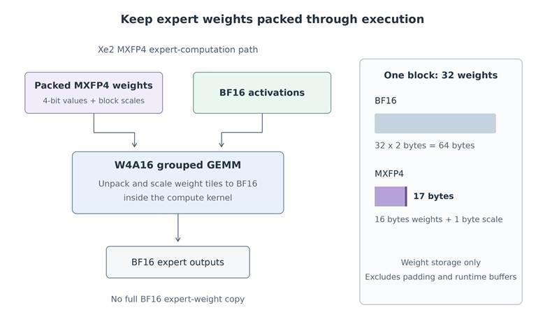

A GPT-OSS-20B checkpoint can store compact expert weights and still need a much larger copy when matrix multiplication begins. In SGLang’s Xe2 backend, RadixArk and Intel keep the packed blocks in device memory and convert only the tiles the computation consumes. That placement explains which allocation a deployment can save.

## Where an expert block expands

MoE routing sends different numbers of tokens to different experts in the same batch. The XPU path arranges their inputs on the device, runs grouped GEMM over the differently sized expert computations and combines the results there. Python need not launch each expert separately. To retain the compact weights throughout this process, the grouped kernel itself has to understand their layout.

On Xe2, 32 four-bit weights occupy 16 bytes, plus one byte for a shared scale. The corresponding BF16 weights occupy 64 bytes. The kernel fetches a tile, unpacks and scales it to BF16 internally, and computes with BF16 activations to produce BF16 expert outputs. W4A16 describes the stored weights and activation precision. The matrix multiplication on this path does not use native FP4 arithmetic.

<a class="note-image-link" href="/assets/images/tech/sglang-intel-xeon-xpu/expert-block.jpg" target="_blank" rel="noopener" aria-label="View original image">View original image ↗</a>

*Follow the left branch to see where weights expand. The byte counts on the right cover the weights and their block scale.*

The documented target is Xe2/BMG, including Arc B-Series and Arc Pro B-Series. In the GPT-OSS-20B example, MXFP4 applies to MoE expert weights. Attention, routing, embeddings and the output head remain BF16. A device capacity budget also includes padding, KV cache, activations and workspaces. The ratio of 17 to 64 gives a raw expert-weight storage ratio. It cannot predict whole-service memory savings or output tokens per second. Expert parallelism on this path still awaits validation.

## How Xeon executes the same serving request

On supported Xeon processors, AMX accelerates matrix work in projections and expert layers, with benefits that depend on shape and batch size. Compatible checkpoints can use W8A8 INT8 with eight-bit weights and activations. Memory placement matters alongside arithmetic. The backend groups physical cores by NUMA node or shared L3 topology and exposes per-rank affinity. Local access can reduce remote traffic, while additional tensor-parallel ranks introduce communication. Operator speed alone gives little indication of total decode latency.

AMX systems can also compile CPU graphs to reduce repeated Python overhead. Decode groups work by batch size for graph reuse. Optional prefill graphs group by total input tokens, and the full prefill graph backend remains experimental. GPU graph capture and replay are opt-in too. Flash Attention and MLA each have dedicated prefill and decode kernels. Processing a prompt and repeatedly reading a growing KV cache present different shapes and access patterns.

## What a cross-device deployment still requires

The authors sketch a vision encoder on Xeon with separate GPU pools for language-model prefill and decode. Capacity could then track image count, prompt length and output length independently. Each split adds a transfer. Encoder embeddings must reach the prefill pool, and initialized KV state must reach the decode pool. The stages need compatible tensor formats, cache layouts, transport and model support.

The article documents single-backend execution paths and the compressed block layout in detail. Its three-stage Intel deployment remains a proposal awaiting validation, without an end-to-end throughput measurement. Expert storage can already be budgeted from the layout. The performance of a distributed serving configuration still depends on measurements under its intended load.

RadixArk & Intel · 2026-11-27 · [SGLang on Intel Xeon CPUs and Intel GPUs as First-Class Platforms: Execution Paths and Low-Precision Inference](https://www.lmsys.org/blog/2026-11-27-sglang-intel/)
