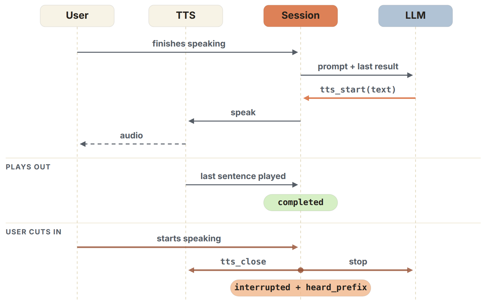

A voice assistant writes a pickup code at the end of a sentence. The user interrupts before the code plays, then asks whether it was read aloud. Saving the full reply preserves the plan but loses the playback position. Trimming the reply loses the code itself. SGLang Omni makes speech a tool call and keeps both the intended words and the playback result. On the next turn, the model can say that the code has yet to be read and still supply it.

## One result for each speech request

The model submits spoken text through `tts_start`. The synthesizer processes and plays it sentence by sentence. A Session owns conversation state and plays one speech at a time. A concurrent start gets BUSY. A refused call returns immediately. An accepted call returns once, on completion, interruption or failure. One call identifier connects the intended words to the outcome in the next prompt.

When voice activity detection (VAD) detects an interruption, the Session stops speech and LLM generation and clears playback buffers. Waiting for recognition and a model decision would allow more audio to play over the user’s words, weakening the playback record as an estimate of what the user heard. Fast stopping has its own cost. VAD cannot interpret a sound or identify the speaker, so music and nearby conversations can interrupt a response.

<a class="note-image-link" href="/assets/images/tech/sglang-omni-speech-tool/sequence.png" target="_blank" rel="noopener" aria-label="View original image">View original image ↗</a>

*The model requests speech. The Session receives playback or interruption events and returns the played prefix on the interrupted call.*

The `heard_prefix` result estimates what played. The Session takes the client’s reported cutoff, caps it at the amount of audio sent and uses completed sentence boundaries. A forced aligner can supply word timings. For a sentence cut short without those timings, the system recognizes the delivered audio and retains the longest prefix the transcript supports. Later playback reports can revise the record.

## Where the wait for first audio goes

The stock tool parser holds the text until the argument closes. A streaming parser releases it as it arrives, allowing synthesis of the first complete sentence while the model writes the rest. A separate change prefills the opening of the tool call. Decoding starts with the spoken text, skipping generated reasoning, which can change the answer itself.

The team replayed the same 15 clips per configuration and requested length. Timing ran from the client packet carrying the VAD end-of-speech event to the first nonempty audio chunk. Inkling 2 Mini and Qwen3.8-27B each ran on one H200. Inkling 2 Small used four H200s with tensor parallelism. On three-sentence requests, the mean of the three model medians was 1,826 ms for direct speech with low thinking and 567 ms for streamed arguments with a prefilled opening. Reasoning differed between those conditions, so the gap measures more than parser speed.

Holding low thinking fixed and comparing the two tool parsers on paired clips, streaming saved a median 148 ms for Small and 417 ms for Qwen on three-sentence requests. Mini finished its reply within about 70 ms of the first word and gained little. All three streamed tool paths were still slower than direct speech at low thinking. Overlap across sentences matters when there is enough generation left to hide.

## Which decisions benefit from a playback receipt?

In history replay, both histories in each pair contained a random code in the tool argument. Only one included it in the played prefix. All three models correctly identified both conditions in all 32 pairs at low and medium thinking. With trimmed replies, scores ranged from 12 to 29 correct pairs. The models received supplied histories. Live interruption detection and alignment remain separate determinants of how accurate those records are.

The receipt also mattered after partial synthesis failure. Adding an instruction to speak only the remainder reduced restarts from the first sentence from 231 of 238 samples to 2 of 238. Conversational timing showed a different pattern. In Full-Duplex-Bench with four concurrent sessions and thinking enabled, the judge labeled an average of 15.2 of 25 backchannel cases as resuming the original speech on the tool path, against 19.5 for direct speech. Remembering what played and deciding when to keep talking require separate tests.

SGLang Omni Team · 2026-11-24 · [Speaking Is an Action: Turning TTS into a Tool for Interactive Models](https://www.sglang.io/blog/tts-as-a-tool)
