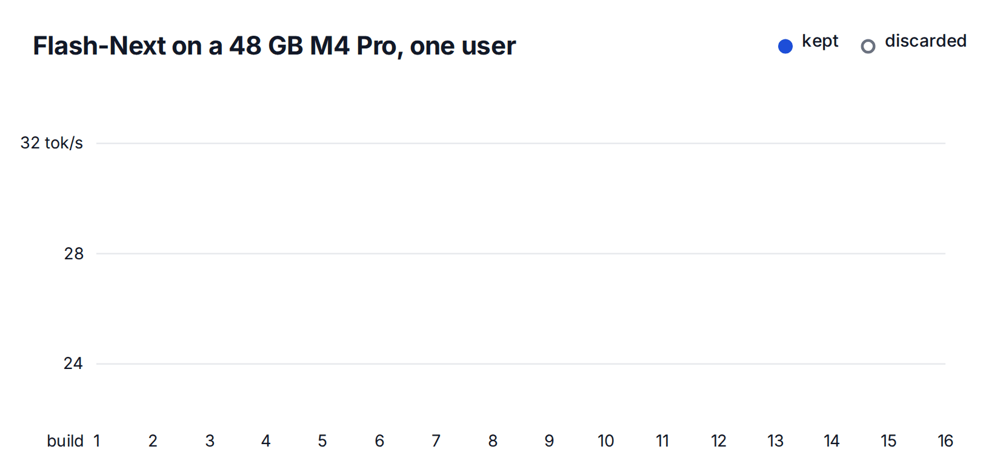

Original: [Your Mac Deserves Its Own LLM Engine](https://skydiscover-ai.github.io/blog-jitengine.html) 
Mert Cemri, Shubham Agarwal, Shu Liu, Alexander Krentsel, Sidharth Sankhe, Alexandros G. Dimakis, Ion Stoica · 2026-11-04

## Specialization starts with the bottleneck

SkyDiscover uses SkySynth with Claude Opus 5.5 coding agents to build six model/hardware-specific engines on Apple MLX. “No human-written engine code” still relies on existing MLX, models, and design techniques; this is agent-led implementation and optimization rather than generation of the entire software stack. Three models run on 24 GB M2 and 48 GB M4 Pro systems with memory reserved for the operating system.

The useful finding is that the same optimization can fail on another machine. Resident models face computation or memory-bandwidth limits; offloaded MoE models add expert-cache, SSD, and CPU/GPU synchronization constraints. Each result needs its model, hardware, context, and concurrency conditions.

## MTP depends on incremental verification cost

For Qwen3.6 on M4 Pro, an ordinary step takes 11.1 ms and a step checking one guessed token takes 13.4 ms. An additional 2.3 ms can yield a second token; an average 1.85 tokens per pass makes speculation worthwhile. Custom verification kernels retain single-token arithmetic to avoid changing selected tokens through numerical differences.

On M2, verification adds 65%–73%, so the agents disable MTP. They instead optimize three-bit weight unpacking, input reuse, and command buffers. Declaring only selected experts’ weights avoids submissions triggered by the entire expert stack. Single-user throughput is 44.9 tok/s versus 32.9 for llama.cpp with MTP.

The main Qwen3.6 M4 Pro comparison uses eight concurrent requests: 200.5 versus 181.5 tok/s. It is not a single-user result. The authors also report a faster single-user baseline mode that fails their exactness check, demonstrating why performance comparisons need an explicit correctness threshold.

## Scheduling changes cache reuse

The 104 GB Qwen3.8-Flash-Next requires expert offloading on both machines. Under a 40 GB M4 Pro budget, compact expert representations, speculative execution with miss handling, and overlapping reads reach 32.9 tok/s for one user versus 12.1 for slotstream, about 2.72×. This peak belongs to that configuration, not all six engines.

M2 has lower SSD bandwidth and an 18 GB budget. Advancing eight requests together causes mutual cache eviction. Giving each request 64 decode tokens before switching reduces SSD expert reads per token from 243.5 to 140.9. That trades lockstep progression for locality and must be considered alongside latency objectives.

Flint differs again. On M4 Pro at long context, a persistent GPU program divides history across 240 thread groups to approach memory-bandwidth limits. On M2, SSD pauses lower GPU clocks; a helper issuing tiny kernels produces a major gain by keeping the GPU active. That result does not establish improved energy efficiency, which the article does not measure.

<a class="note-image-link" href="/assets/images/tech/skydiscover-jitengine/search.gif" target="_blank" rel="noopener" aria-label="Flash-Next M4 Pro search history showing accepted and discarded builds · View original image ↗">View original image ↗</a>

*The blue line tracks the best build retained after checks. An isolated faster measurement does not necessarily become the shipped version.*

## Test whether the engine is optimizing the measurement

SkySynth changes code, checks output and memory, measures speed, and retains improvements that pass its gates, with held-out prompts checked again. A separate auditor looks for shortcuts. Qwen3.6’s initial offloading tests did not validate self-reported hit-rate and byte counters. Added checks derive expert-lookup counts from the checkpoint, require a full expert read per miss and actual misses below model capacity, and reject deliberately dishonest engines that fabricate counters or compute fewer experts.

Flint’s raw benchmark supplies future tokens in advance, inviting batched processing or omission of the output layer. The team records every timed step’s output scores, then recomputes the same tokens cold, one at a time, requiring bitwise agreement. Changing a token midway must also affect subsequent outputs. These adversarial checks are stronger evidence about test coverage than a bare “tests passed” statement.

Correctness guarantees and baselines differ across engines. Flint’s M2 gain is relative to the authors’ M4 build because rec does not fit the budget. The transferable contribution is bottleneck-specific design paired with precise baselines and independent checks on self-reported performance. Specialization is useful only when its measurement and correctness constraints evolve with the implementation.
