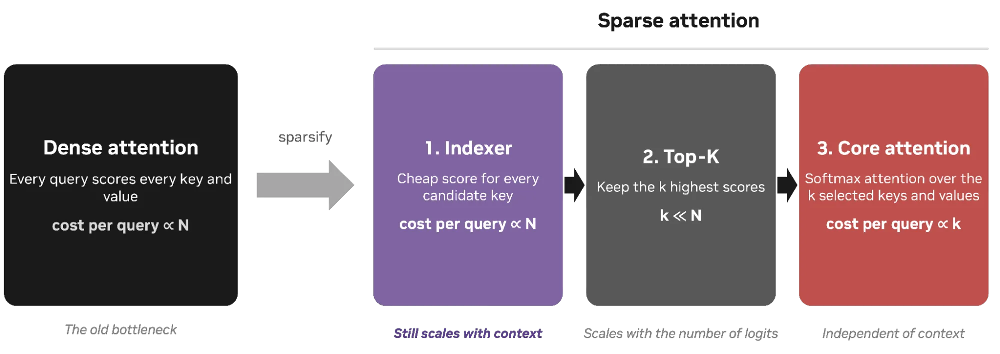

[Co-Designing Sparse Attention for Efficient Long-Context Inference](https://developer.nvidia.com/blog/co-designing-sparse-attention-for-efficient-long-context-inference/)  
Timmy Liu, Nidhi Bhatia, Samkit Jain, Makesh Tarun Chandran, Bita Darvish Rouhani · 2026-11-17

Sparse attention reads only a subset of keys and values, but selection can still scan the full history. NVIDIA separates execution into an indexer, Top-k and core attention: the last operates on selected k entries while the first may still scale with context N. Selection rules, tensor shapes and kernels must be designed together, or sparsity simply relocates the bottleneck.

## The indexer is both matrix multiplication and data movement

The article concerns model-level sparsity incorporated during training, not a training-free patch. The indexer performs batched QK multiplication with a fused epilogue, followed by operations such as ReLU and weighted cross-head reduction. Prefill processes many query rows and tends toward compute limitation; decode streams the index-key cache for few queries and is more bandwidth-sensitive.

<a class="note-image-link" href="/assets/images/tech/sparse-attention-codesign/method.webp" target="_blank" rel="noopener" aria-label="Core attention handles selected entries, while the indexer and Top-k still pay for candidate selection. · View original image ↗">View original image ↗</a>

*Core attention handles selected entries, while the indexer and Top-k still pay for candidate selection.*

With group size G=QH/KH, more query heads share each key head and add computation without rereading independent keys. Cross-head reduction also writes one logit per key. Increasing KH at fixed QH reduces sharing; in the reported sweep, moving from one to eight key heads raises decode runtime about 7.6×. This is a measured kernel regime, not a universal attention law.

## Speculation depth and head count share a tile budget

Verifying D draft tokens plus one new token can reuse the same key read across D+1 queries. That reuse is bounded: G×(D+1) must fit one Tensor Core tile. Register pressure with an FP32 epilogue limits the practical budget to roughly 200 rows; FP16 permits 256. Beyond it, extra CTAs and work produce latency steps.

Additional draft tokens are therefore inexpensive only within a regime, and model head count affects useful speculation depth. Reduced-precision epilogues and accumulation can help, but QK scaling must keep values within FP16 range.

Head dimension introduces another trade-off. Narrow heads can leave Tensor Cores waiting on the CUDA-core epilogue; wider heads amortize that work but increase decode bytes. The suggested 128 or 256 dimensions reflect this balance, not a rule that wider is better.

## Count Top-k inside the selection budget

Keeping fewer entries need not greatly reduce Top-k time because every candidate must first be inspected. Compressed keys, hierarchical indexing and cross-layer selection sharing reduce candidates scored, helping both indexer and Top-k. They reduce total work without automatically changing arithmetic intensity.

Fusing Top-k with the indexer avoids writing and rereading a complete logit matrix. During decode, Guess-Verify-Refine reuses the previous selection as a guess, then verifies and refines it. The cited DeepSeek V3.2/V4 measurements show 2.1–2.4× faster Top-k than standard radix select, not that multiplier for whole-model throughput.

## Make selected reads hardware-friendly

Token-level selection generates scattered addresses and query-specific sets, limiting reuse. Block selection loads contiguous entries together and shares them among queries choosing the same block. With 2,048 selected keys held constant, smaller blocks increase address handling, partial results and merges. Equal FLOPs and KV bytes do not guarantee equal runtime.

Default sweeps use an FP8 indexer, 64K index keys, Hsz=128, KH=1, prefill batch one and decode batch 128. The article does not establish universal quality preservation or a cross-hardware optimum. Read alongside RecSA: RecSA changes selection’s asymptotic structure, while this analysis explains how remaining selection work maps efficiently onto GPU execution.
