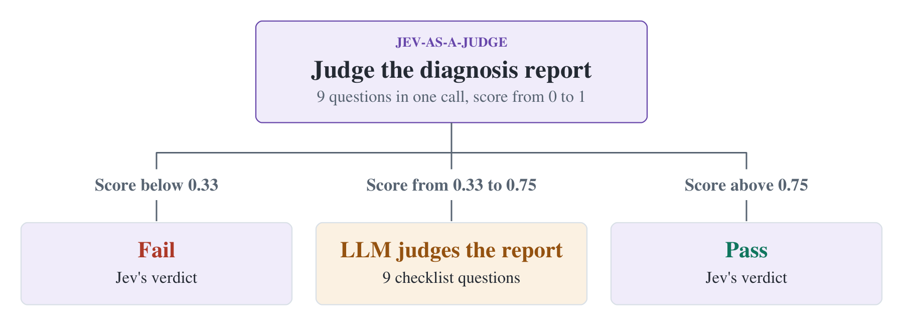

[Jev-as-a-Judge for SRE](https://www.sregym.com/blog/jev-as-a-judge)  
Yukun He, Saad Mohammad Rafid Pial, Jackson Clark, Yiming Su, Tianyin Xu · 2026-11-08

SRE diagnosis reports can be long, but evaluation often turns on specific questions: did the agent identify the origin, distinguish downstream symptoms, and cover the relevant components? SREGym uses TypeSafe Jev to make these decisions and forwards uncertain cases to an LLM. The useful contribution is the scoring interface and calibration procedure, not merely replacing a judge with a cheaper model.

## Nine decisions replace a holistic verdict

After fault injection and agent investigation, the original LLM judge compares the report with an answer key through nine binary questions. Fault localization, characterization, and scope precision receive weights of 0.33, 0.33, and 0.34. Each dimension is its fraction of affirmative answers; the weighted score passes at 0.70, requiring at least seven affirmative answers under these weights.

Jev instead returns answer probabilities. The pipeline substitutes each Yes probability into the same weighted score. That composite is a decision statistic, not automatically a calibrated probability that the whole report is correct.

## Adapt both wording and thresholds

Naively reusing the LLM checklist at threshold 0.70 gives approximately 86% agreement on tuning reports. Some questions refer to injection logic that Jev cannot inspect. The authors split the answer key into component, namespace, and description fields and explicitly define which matches, omissions, or contradictions imply Yes or No.

Of SREGym-Lite's 21 problems, 15 tune the judge and six remain unseen. Leave-one-problem-out cross-validation selects agreement-maximizing thresholds on the other problems; the median threshold is 0.62. Rewritten questions reach approximately 91% tuning agreement. Holding out problems is more informative than mixing reports from the same fault across splits, although six unseen problems remain limited coverage.

## Route uncertainty within a budget

Mixed Judge scores every report with Jev and delegates the middle range to the LLM. The authors budget roughly one quarter of tuning reports for delegation and cross-validate the center, obtaining an interval around 0.33–0.75. Lower scores fail, higher scores pass, and the LLM decides cases inside it.

<a class="note-image-link" href="/assets/images/tech/sregym-jev-as-a-judge/mixed-flow.png" target="_blank" rel="noopener" aria-label="Jev scores every report; only the middle range goes to the LLM. The 0.33–0.75 interval comes from tuning-budget cross-validation.">View original image ↗</a>

*Jev scores every report; only the middle range goes to the LLM. The 0.33–0.75 interval comes from tuning-budget cross-validation.*

This avoids paying for an expensive judgment on every report without making outer-range decisions infallible. New report styles or fault distributions can change scores and delegation frequency. The interval is a tuned routing rule, not a universal confidence interval.

## Agreement is not independently established correctness

Across 872 reports, Jev agrees with the reference LLM on about 91% at an estimated 1/510 of API cost. Mixed Judge reaches 98.7% agreement at approximately 74% lower cost. The article estimates about eight cents versus $42 per thousand reports and approximately 0.1 versus 14 seconds per report. These figures depend on the stated API prices and evaluation conditions.

Mixed Judge's agreement approaches the LLM's own repeat-judgment consistency, but shared agreement does not prove shared correctness. The target is the first LLM verdict; without independent human ground truth, 98.7% must not be described as RCA accuracy. The transferable lesson is to supply accessible evidence, operationalize the checklist, and then tune thresholds and delegation. Broader fault coverage and human error audits remain open evidence needs.
