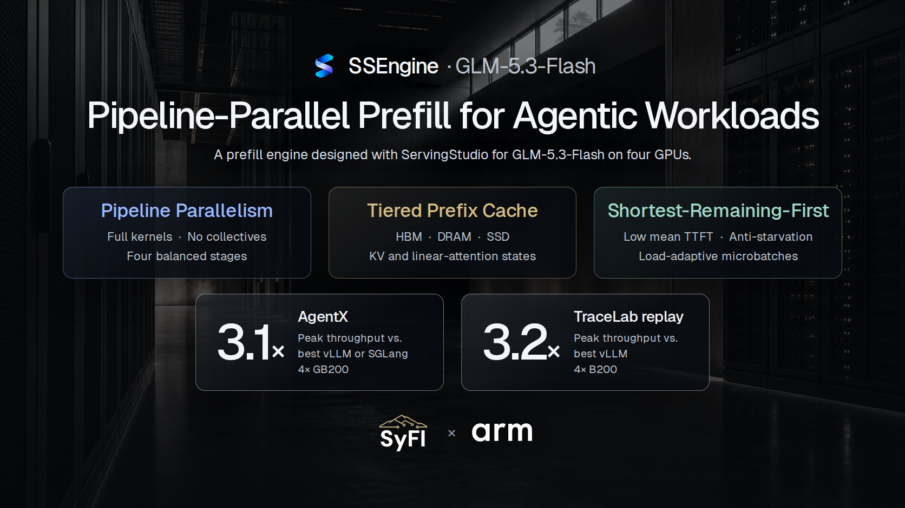

A median TraceLab turn carries a 154K-token prompt, while the median append is only 1.2K tokens. Cost therefore depends on whether the previous turn's state survives until the next request. ServingStudio built a GLM-5.3-Flash engine that ends at the first output token. Model partitioning, state retention and admission into the pipeline are closely coupled in this design.

## Four pipeline stages preserve kernel shapes

Splitting each layer over four GPUs does not always quarter its runtime. Some operations repeat on every GPU, while smaller matrices can run less efficiently. The authors instead partition layers into four stages and balance their measured work. A lone request must traverse all four sequentially, which can favor tensor parallelism under light load. With enough concurrent turns, microbatches fill the stages. The often-quoted 49.1 requests/s is a simulated comparison under an assumption of sufficient cache for every prefix.

<a class="note-image-link" href="/assets/images/tech/ssengine-glm53-flash/overview.png" target="_blank" rel="noopener" aria-label="View original image ↗ — Pipeline parallelism, tiered caching and remaining-prefill scheduling address communication, restoration and queueing.">View original image ↗</a>

*Pipeline parallelism, tiered caching and remaining-prefill scheduling address communication, restoration and queueing.*

## Restoring KV and recurrent state together

DSA layers retain per-token KV while KDA layers update a fixed-size state. If a new prompt matches only part of a cached context, a later recurrent state cannot stand in for the state at the matching position. The cache therefore needs jointly usable restoration boundaries. A median TraceLab session takes about 1.2 GB, leaving room for roughly 330 contexts across four B200s. Evicted states extend into host memory and SSD. Asynchronous reads keep loading turns outside microbatch formation so ready turns can continue.

The slower tiers use different retention rules. Host memory is scarce enough that data moving back to HBM releases its DRAM copy. SSD retains its copy so the next eviction need only append new KV and KDA state. Even with that policy, an eight-hour simulation implies about 66 TB of SSD writes per GPU per day. Sustaining read bandwidth alone does not settle drive endurance for a long-running fleet.

## Favoring short turns while admitting long ones

The scheduler prioritizes remaining prefill tokens and increases microbatch size with backlog. Pure shortest-first scheduling can starve a long prompt behind a steady stream of short ones. A turn waiting 60 seconds enters the next microbatch, a scheduling guarantee rather than a bound on TTFT. In simulation at 1,200 sessions, mean TTFT fell from 1.72 to 0.53 seconds, while the median for turns with more than 100K new tokens rose from 2.7 to 19 seconds. The aggregate benefit has a visible cost for rare long turns.

## Comparing peak rates on hardware

On AgentX with four GPUs in a GB200 system, 512 agents reached 24.0 requests/s with a median TTFT of 1.7 seconds. The strongest baseline, SGLang with pipeline parallelism, peaked at 7.7 requests/s with 256 agents. The 3.1× ratio compares each system at its own peak. At peak TraceLab replay throughput, the authors estimate about $0.18 of GPU time per thousand prefills at $6.73 per B200-hour. That accounting excludes host memory, SSD, idle capacity and subsequent decoding.

[SSEngine-GLM5.3-Flash: Pipeline-Parallel Prefill with Tiered Prefix Caching for Agentic Workloads](https://servingstudio.cs.washington.edu/blog/ssengine-glm53-flash/) · ServingStudio · 2026-11-18
