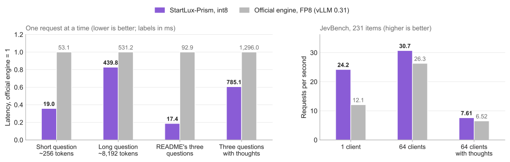

A specialized inference engine can gain from request structure that a general serving framework does not fully exploit. StartLux-Prism targets structured decisions with StartLux-Decision: several choice, yes/no or score questions can refer to the same evidence. It combines shared computation, branching questions and low-precision execution. The interesting result concerns both short-request latency and stable outputs as concurrency changes.

**StartLux Labs · StartLux-Prism**  
Original title: *StartLux-Prism: Fast, exact inference for StartLux-Decision models on NVIDIA GPUs*. Repository created on 2026-10-13; the initial visible code commit is dated 2026-10-22. [Project](https://github.com/StartLuxLabs/StartLux-Prism/blob/f32ed8eee9d89ea56dde03a978cf4128d2bbf497/README.md) · [Design](https://github.com/StartLuxLabs/StartLux-Prism/blob/f32ed8eee9d89ea56dde03a978cf4128d2bbf497/docs/design.md) · [Full benchmarks](https://github.com/StartLuxLabs/StartLux-Prism/blob/f32ed8eee9d89ea56dde03a978cf4128d2bbf497/docs/benchmarks.md).

## Compute shared evidence once

StartLux-Decision returns probabilities for the available options. AutoThink generates a thought and reads the answer again when its initial confidence falls below a gate. Direct decisions and thought generation are consequently different workloads. Prism preserves the model's prompts, read-outs and decision rules while replacing the forward pass and scheduling. It loads released Q8_0 and Q4_K_M GGUF files directly, but direct loading does not mean unchanged internal arithmetic: the Q8_0 weights are requantized with SmoothQuant at startup, and activations are quantized per token for W8A8 execution.

The central structure is a packed forest of token segments. System text is computed at startup, each request's evidence is computed once, and its questions branch from that state. A batch executes a body graph and an answer-head graph. Device tables describe the batch, allowing a CUDA Graph to serve different structures in the same token bucket. Linear attention first processes segments whose parent state is available, then their children; ordinary attention reads shared parent K/V directly. In the last layer, query, output and read-out work is restricted to the positions needed for answers.

This reduces repeated prefix work and host scheduling overhead together. Across requests, a cache retains recurrent states, convolution tails and attention K/V, using exact token matches and image digests. It suits follow-up questions about identical evidence; semantic similarity alone does not make changed evidence reusable.

## Bitwise consistency is not lossless quantization

Prism's int8 matrix multiplications accumulate exactly in int32, then scale and add to the residual with a fixed rounding sequence. Split-K partial sums remain integers; tensor parallelism also combines integer partial sums before scaling. This avoids floating-point differences caused by reduction order. The optimization log describes a concrete failure: floating-point atomic accumulation once flipped a near-tie decision between runs, and cache hits could differ from misses. The final design also fixes scaling, addition and read-out paths. Integer multiplication alone does not establish whole-model determinism.

Reported tests cover cache hits versus recomputation, 64 answers submitted by 32 concurrent clients, and one GPU versus two- or four-GPU tensor parallelism. The target is consistent output within the same quantized execution path across those conditions. Thought sampling is seeded per question to reduce dependence on batch composition. This is useful for scaling services and replaying failures, but does not imply identical probabilities or thoughts to a BF16 or FP8 engine. The BF16 path does not have the same batch-invariance property either.

## Where the 5.3× result comes from

<a class="note-image-link" href="/assets/images/tech/startlux-prism/v11-performance.png" target="_blank" rel="noopener" aria-label="Latency and throughput of Prism int8 versus official FP8 on one H200 · View original image ↗">View original image ↗</a>

*Reading the chart: latency on the left is normalized to official FP8 = 1, while labels show actual milliseconds. The right shows requests per second. Three questions sharing evidence benefit most; the gap narrows with long inputs and high concurrency.*

The vendor comparison uses StartLux-Decision-v1.1-27B-AutoThink with one H200 per service and the official vLLM 0.31.0 service as baseline. That service loads the BF16 release with FP8 enabled; Prism loads Q8_0 GGUF. Weight rounding, random number generators and recurrent-state precision differ. Serial measurements discard five warm-up requests from each set of 25. Every request carries unique evidence to prevent repeated-request cache hits from inflating the result.

| Workload | Official FP8 | Prism int8 |
|---|---:|---:|
| One question, about 256 tokens, mean latency | 53.1 ms | 19.0 ms |
| README's three questions, no thoughts, mean latency | 92.9 ms | 17.4 ms |
| One question, about 8,192 tokens, mean latency | 531.2 ms | 439.8 ms |
| JevBench, 64 clients, read-outs only | 26.3 requests/s | 30.7 requests/s |

The approximately 5.3× ratio is 92.9/17.4. At 64 clients, read-out throughput improves by about 17%. The authors attribute the narrower gap under load to both engines becoming limited by tensor-core computation. These figures support reducing overhead for short and multi-question requests, without establishing a fivefold gain for arbitrary tasks.

Thought generation supplies a counterexample. On sequential JevBench requests, Prism averages 1,212 ms versus 1,150 ms for official FP8, although both generate about 94 tokens/s for one sequence. Longer thoughts in Prism offset its faster read-outs. Serving evaluation therefore needs thought length and tail latency as well as the time to an initial decision.

## Similar average accuracy can hide a generation gap

Across the seven evaluation suites inherited from v1, comprising 12,351 decisions, v1.1 AutoThink scores 92.94 on average with Prism int8, versus 92.97 with official BF16 and 93.07 with W4A8. The W4A8 run uses an RTX 5090 and different capacity settings, so its runtime is not directly comparable with H200 runs. Its small score advantage does not establish that four-bit quantization improves quality. These evaluations use gate 0.9; the serving default is 0.6, which changes how often requests enter the thought path.

Repeated sampling is more revealing. Across nine samples of JevBench's 231 items, Prism int8 averages 221.2 correct answers, official BF16 226.0 and FP8 224.9. The authors then generate three thoughts for each of 67 questions requiring reasoning and exchange the read-out engines. Thoughts written by official BF16 yield 187/185 correct answers under the two readers; Prism int8 thoughts yield 180/178. Generating with BF16 arithmetic on the same Q8_0 weights restores the result to 186/185. This comparison supports the authors' attribution of the main gap to int8 activation quantization during generation, rather than only answer read-out or GGUF weight rounding.

## What transfers to inference operations

Systems making repeated structured judgments about a ticket, alert evidence or state snapshot could benefit from shared computation and execution invariance. These are application inferences; the source does not establish AIOps diagnosis accuracy. The design document and cross-read experiment are particularly useful: one explains where speed comes from, while the other separates an accuracy regression into weight, arithmetic and generation effects.

The version discussed here serves v1 and v1.1 AutoThink at 4B, 9B and 27B; v1.1 Instant's bidirectional prompt computation is not yet supported. This is a model-specific engine, so its gains do not automatically transfer to arbitrary LLMs. At this version, the repository's own code has no chosen license, vendored code has a separate Apache-2.0 license, and the model weights use CC BY-NC 4.0. Source visibility and permission for commercial deployment are separate conditions.
