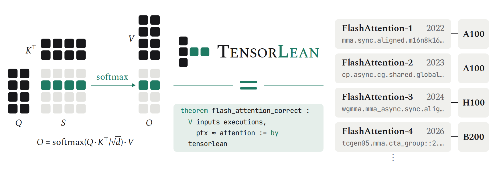
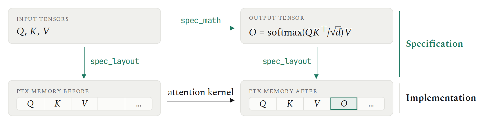
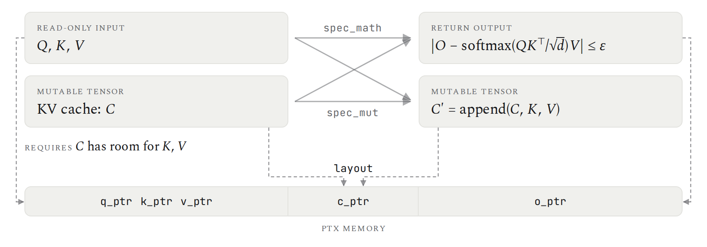
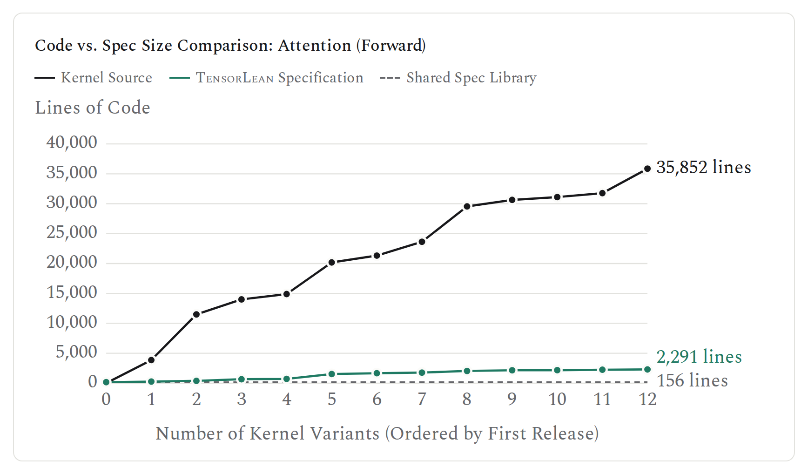
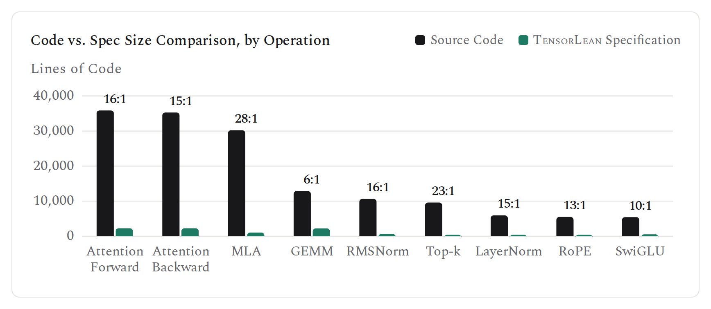
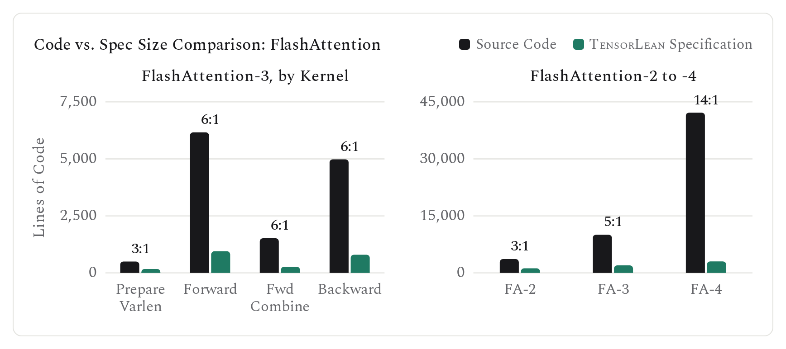
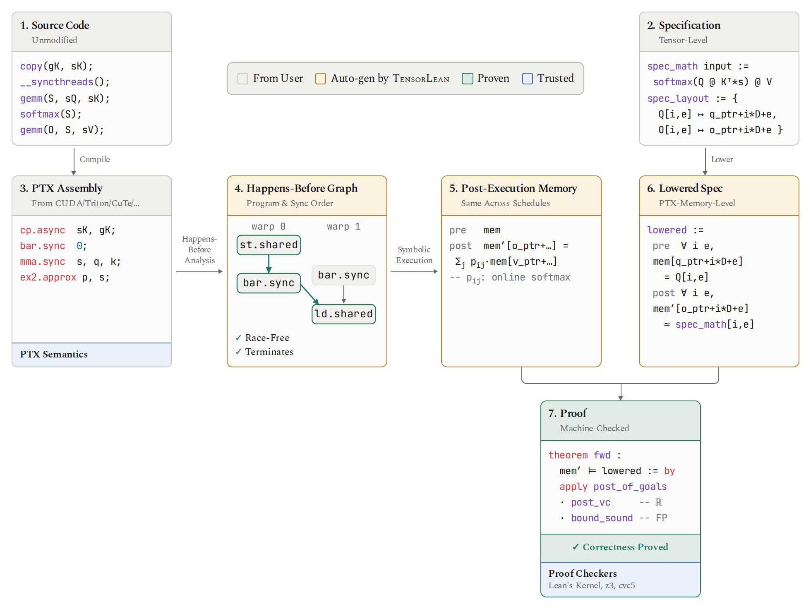
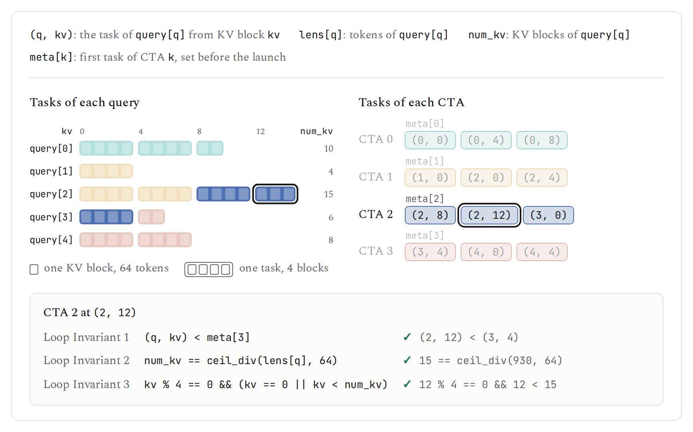
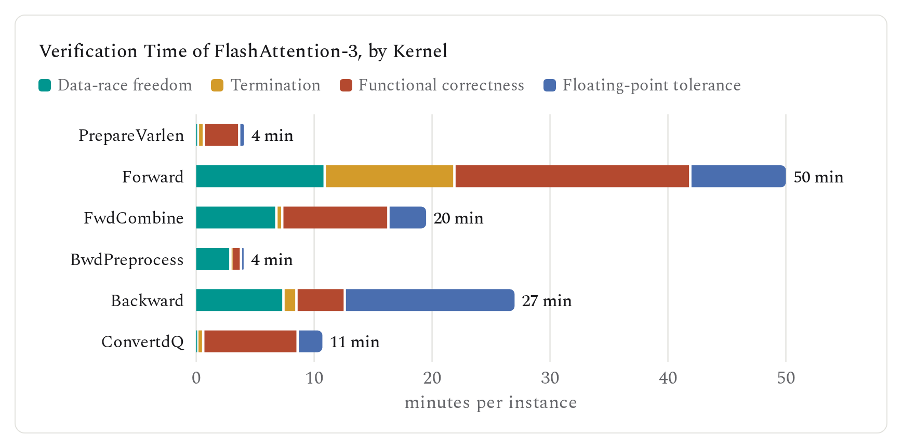
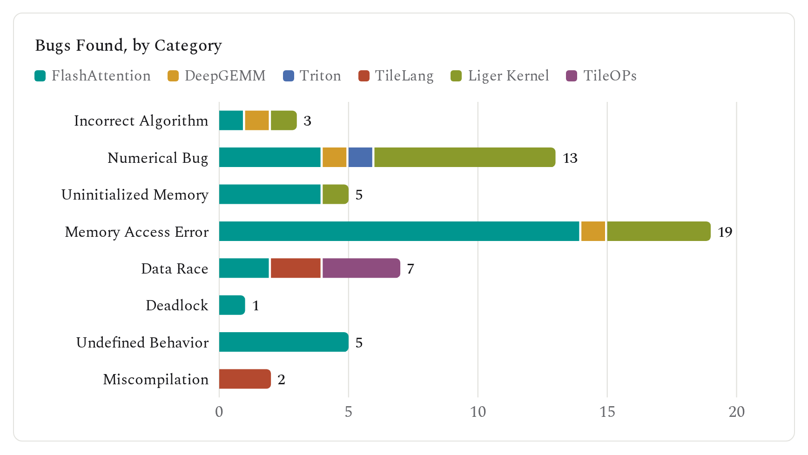

> Prepared with AI assistance from the [TensorLean technical report](https://tensorlean.ai/) published by Columbia University (Wei Qiang, Ganxiang Yang, Yi Rong, and Ronghui Gu) and CertiK (Xupeng Li and Ronghui Gu) on `November 20, 2026`, together with pinned inspection of [`TensorLean/TensorLean@3e83208`](https://github.com/TensorLean/TensorLean/tree/3e83208f3b11fa96ca9e2097e2f1bd524b0c60c2) (`November 22, 2026`) and live upstream issue/PR state as of **`November 23, 2026`**. All 10 figures are preserved verbatim from `tensorlean.ai` as requested. Note a critical release boundary: **as of commit `3e83208`, the public repository contains only `README.md` (listing 39 discovered bugs) and banner assets; the paper, Lean 4 PTX semantics, 1.8K-LoC PTX parser, and proof scripts are marked "coming soon."** All analysis here relies strictly on public primary text, embedded structured figure datasets, and upstream GitHub records; no local Lean 4, SMT, or GPU experiments were executed.

**Confidence in modern AI kernels still rests largely on sampled inputs and numerical tolerance checks—yet once kernels adopt warp specialization, asynchronous TMA transfers, WGMMA, and Blackwell `tcgen05` pipelines, catastrophic bugs rarely crash; they corrupt tensors silently under untested shapes and rare thread interleavings.** [`TensorLean`](https://tensorlean.ai/) bridges the gap between toy academic prototypes and production kernel libraries without asking engineers to rewrite CUDA, CuTe, or Triton source code. Instead, it inspects compiled **NVIDIA PTX assembly** against a declarative Lean 4 tensor specification, discharging four machine-checked obligations via Lean and SMT solvers (`cvc5` / `Z3`): **data-race freedom, termination, exact algebraic equivalence over real numbers, and linear-time floating-point round-off bounds**.

<figure>
<a class="note-image-link" href="/assets/images/tech/tensorlean-close-reading/orig-00-hero.png" target="_blank" rel="noopener" aria-label="Original overview graphic from tensorlean.ai showing TensorLean equating attention math O = softmax(Q K^T / sqrt(d)) V with FlashAttention-1 to -4 PTX across A100, H100, and B200."><span class="note-image-action">Enlarge original figure ↗</span></a>
<figcaption>Figure 1 · Overview mapping (<code>theorem flash_attention_correct</code>): across valid inputs and thread schedules, TensorLean proves compiled PTX spanning Ampere <code>mma.sync</code> / <code>cp.async</code>, Hopper <code>wgmma</code>, and Blackwell <code>tcgen05</code> meets the tensor formula (Source: <code>tensorlean.ai</code>).</figcaption>
</figure>

Examining the report prose alongside its embedded interactive figure datasets, the `TensorLean@3e83208` commit delta, and all 15 upstream pull requests reveals both why TensorLean reaches a **15:1 code-to-spec ratio** and **50-minute verification of Hopper `FlashAttention-3 Forward` (`31,402` proof goals)**, and where its real **Trusted Computing Base (TCB)** sits: `ptxas` SASS lowering, undocumented Tensor Core rounding assumptions, and out-of-scope atomic acquire/release multi-GPU communication kernels.

<h2 id="section-a">Why testing and fixed-shape equivalence checkers miss frontier kernel failures</h2>

The report opens with a familiar pattern of silent AI failures: ChatGPT's incoherent outputs in February 2024, a Claude miscompilation incident in September 2025, and Google DeepMind's October 2026 finding ([arXiv:2610.31642](/digest/en/daily/2026-10-26/#paper-arxiv-2610.31642)) that even standard PyTorch/JAX softmax and cross-entropy implementations dropped small gradients. Across these failures, the shared danger is **silent correctness degradation**: normal smoke-test shapes pass cleanly while tail batch sizes, rare head dimensions, unaligned tiles, or subtle compiler rewrites corrupt gradients or KV caches without throwing an exception.

Contrasting TensorLean against dynamic test suites and recent GPU equivalence checkers (specifically citing Dubey et al., OOPSLA 2026, and Wu et al.'s SentryWard, 2026), three structural gaps stand out:

1. **Concrete-configuration unrolling misses combinatorial corners**: Checkers that unroll loops for concrete sequence lengths or batch sizes prove only the exact launch geometry inspected. TensorLean's authors report that **`19` of the `23` new bugs discovered in FlashAttention (82.6%) appear only under specific combinations of shapes and optional features** that developers rarely exercise together (such as 32-bit offsets wrapping past `2^31`, zero-column page tables, or partial last blocks).
2. **Low-level synchronization races hide from brute-force testing**: The block-sparsity data race caught in FlashAttention-4 ([`#3195`](https://github.com/Dao-AILab/flash-attention/issues/3195)) **never failed across `17,760` test runs**.
3. **High-level source analysis misses compiler miscompilations**: In [`tile-ai/tilelang#2699`](https://github.com/tile-ai/tilelang/issues/2699) / [`#2700`](https://github.com/tile-ai/tilelang/pull/2700), the user source program was valid, but TileLang's `ThreadSync` pass omitted the shared-write annotation for Blackwell (`sm_120`) `st.bulk` instructions, emitting unsafe PTX without barriers. **Verifying compiled PTX captures front-end logic bugs, synchronization races, numerical wraps, and compiler lowering flaws in a single net.**

Evidence: [TensorLean Introduction and PTX-Level Verification](https://tensorlean.ai/), [TileLang PR #2700](https://github.com/tile-ai/tilelang/pull/2700).

<h2 id="section-b">Extensional specification: how math-from-memory decoupling reaches a 15:1 code-to-spec ratio</h2>

Classic systems verification suffers extreme specification and proof overhead (the authors point to `seL4`'s `20` person-years and `200,000` proof lines for `8,700` lines of C, as well as `Verus` specs and hints frequently exceeding code size) primarily because **specifications fuse mathematical intent with low-level memory representations**.

TensorLean leverages a clean structural property: **GPU kernel correctness is extensional**. A specification only constrains pre-launch and post-completion GPU memory state on valid inputs across every execution schedule—meaning how warps specialize, swizzle shared memory, or overlap copies never enters the spec.

<figure>
<a class="note-image-link" href="/assets/images/tech/tensorlean-close-reading/orig-02-spec-square.png" target="_blank" rel="noopener" aria-label="Original Figure 2 commuting square from tensorlean.ai separating mathematical spec_math over abstract tensors from spec_layout over PTX memory."><span class="note-image-action">Enlarge original figure ↗</span></a>
<figcaption>Figure 2 · Extensional commuting square (original Fig. 2): pure mathematical transitions via <code>spec_math</code> on abstract tensors map downward to pre- and post-launch PTX memory solely through <code>spec_layout</code> (Source: <code>tensorlean.ai</code>).</figcaption>
</figure>

Accordingly, each Lean 4 specification (`KernelSpec`) splits into five decoupled fields:

- **`spec_math`**: A pure mathematical function over abstract tensors of real numbers $$\mathbb{R}$$, written via a Mathlib-backed tensor library matching PyTorch operator semantics (`@`, `softmax`, `tanh`, `repeat_interleave`).
- **`spec_mut`**: In-place memory updates mapping mutable `state` and `input` to `state'` (such as appending new `K, V` tokens to a KV cache $$C' = \mathrm{append}(C, K, V)$$).
- **`spec_layout`**: Pure index-to-address maps placing each tensor element in PTX memory without cluttering `spec_math`—even for multi-level paged KV caches:

```lean
-- Mathematical dimension signature stays aligned with PyTorch tests
structure Attn (H G L D : ℕ) where
  q : Tensor ℝ [H * G, L, D]
  k v : Tensor ℝ [H, L, D]
  scale cap : ℝ
  mask : Tensor Bool [H * G, L, L]

-- Memory layout binds abstract indices to PTX pointers separately
{ tensor := state.k[b, p, g, d]
  var    := k_ptr
  layout := block_table[b, p / page_size] * k_batch_stride
            + (p % page_size) * k_row_stride
            + g * k_head_stride + d }
```

- **`spec_tol` and `requires`**: Allowable error bound $$\varepsilon$$ per output/state tensor, plus preconditions on inputs and capacity bounds (such as sufficient room in the KV cache).

<figure>
<a class="note-image-link" href="/assets/images/tech/tensorlean-close-reading/orig-03-spec-shape.png" target="_blank" rel="noopener" aria-label="Original Figure 3 sample specification diagram from tensorlean.ai showing read-only inputs, mutable KV cache state, requires, tolerance epsilon, and layout pointers."><span class="note-image-action">Enlarge original figure ↗</span></a>
<figcaption>Figure 3 · Five-tuple specification anatomy (original Fig. 3): separating read-only <code>Q, K, V</code>, mutable cache <code>C</code>, precondition <code>requires</code>, output tolerance <code>ε</code>, and pointer <code>layout</code> regions in PTX memory (Source: <code>tensorlean.ai</code>).</figcaption>
</figure>

Across the 12 Attention Forward variants supported by a shared 156-LoC operator library, source size climbs monotonically to **`35,852` lines** while cumulative specifications flatten near **`2,291` lines**:

<figure>
<a class="note-image-link" href="/assets/images/tech/tensorlean-close-reading/orig-01-spec-attention.png" target="_blank" rel="noopener" aria-label="Original Figure 1 cumulative line chart comparing 35,852 kernel source lines against 2,291 specification lines across 12 forward attention variants."><span class="note-image-action">Enlarge original figure ↗</span></a>
<figcaption>Figure 4 · Cumulative growth across 12 Attention (Forward) variants ordered by release (original Fig. 1): <code>35,852</code> source lines require <code>2,291</code> spec lines including a <code>156</code>-line shared tensor library (Source: <code>tensorlean.ai</code>).</figcaption>
</figure>

Across embedded datasets from Figure 4 and Figure 6, this abstraction covers **`72` open-source kernels spanning `9` operations**, compressing **`151,285` lines of kernel source** into **`10,278` lines of specifications** (`~14.7:1`, summarized as **`15:1`**):

<figure>
<a class="note-image-link" href="/assets/images/tech/tensorlean-close-reading/orig-04-spec-by-operation.png" target="_blank" rel="noopener" aria-label="Original Figure 4 bar chart comparing source vs. TensorLean specification LoC across 9 operations totaling 72 kernels."><span class="note-image-action">Enlarge original figure ↗</span></a>
<figcaption>Figure 5 · Source vs. specification comparison across 9 operations (original Fig. 4, 72 kernels, <code>151,285</code> vs. <code>10,278</code> LoC, Source: <code>tensorlean.ai</code>).</figcaption>
</figure>

| Operation / Family | Variants | Source LoC | Spec LoC (Own + Shared Lib) | Code : Spec | Engineering Observation |
|---|---:|---:|---:|---:|---|
| Attention Forward | 12 | 35,852 | 2,291 (2,135 + 156) | 16:1 | Spans FA-1..4, CUTLASS, FlashInfer SM100/120, ThunderKittens, FlashMLA, vLLM sparse; only 156 LoC shared library |
| Attention Backward | 10 | 35,254 | 2,285 (2,178 + 107) | 15:1 | Backward differentiation shares core mathematical primitives |
| MLA | 6 | 30,194 | 1,070 (956 + 114) | 28:1 | High implementation bloat relative to compact multi-head latent attention math |
| GEMM | 16 | 12,866 | 2,220 (2,110 + 110) | 6:1 | Lower ratio due to diverse scaling/grouped/E8M0 layouts across 16 matmul variants |
| RMSNorm | 9 | 10,646 | 646 (545 + 101) | 16:1 | Short reduction math amortized cleanly over 9 hardware variants |
| Top-k | 6 | 9,594 | 419 (348 + 71) | 23:1 | Control-heavy sorting/selection code vs concise extensional spec |
| LayerNorm / RoPE / SwiGLU | 4 / 4 / 5 | 5,929 / 5,499 / 5,451 | 408 / 408 / 531 | 15:1 / 13:1 / 10:1 | Baseline per-operation layout wiring floors near `300–420` spec LoC |
| FlashAttention-2 (Ampere) | 6 | 3,669 | 1,223 (1,085 + 138) | 3:1 | Earlier, smaller kernels pay fixed specification setup cost without massive code bloat |
| FlashAttention-3 (Hopper) | 8 | 10,065 | 1,993 (1,853 + 140) | 5:1 | Adding TMA + WGMMA triples source size while spec grows only `+63%` |
| FlashAttention-4 (Blackwell) | 23 | 42,176 | 3,026 (2,892 + 134) | 14:1 | CuTe DSL kernel count & complexity explode across 23 variants while math stays constant |

<figure>
<a class="note-image-link" href="/assets/images/tech/tensorlean-close-reading/orig-06-spec-flashattention.png" target="_blank" rel="noopener" aria-label="Original Figure 6 chart breaking down source vs. spec size by FlashAttention-3 kernel and across FlashAttention-2 to -4."><span class="note-image-action">Enlarge original figure ↗</span></a>
<figcaption>Figure 6 · Source and specification sizes across <code>FlashAttention-3</code> component kernels (left) and the <code>FA-2</code> to <code>FA-4</code> generational progression (right, original Fig. 6, Source: <code>tensorlean.ai</code>).</figcaption>
</figure>

**Analytical takeaway**: Notice the two parallel baselines in the report—`15:1` (`151,285 : 10,278`) holds across the `72`-kernel cross-section of `9` operations, whereas the end-to-end **FlashAttention-2 to -4 suite** (`37` kernels, `55,910` LoC source vs `6,242` LoC spec, including FA-3 kernel breakdown `PrepareVarlen` `3:1`, `Forward` `6:1`, `FwdCombine` `6:1`, and 3 `Backward` kernels `6:1`) averages **`9.0:1`**. **What drives the ratio from `3:1` in FA-2 up to `14:1` in FA-4 is architectural complexity bloating implementations on Hopper/Blackwell while tensor mathematics remains invariant.**

Evidence: [Embedded JSON datasets from Figures 1, 4, and 6 on tensorlean.ai](https://tensorlean.ai/).

<h2 id="section-c">Inside the PTX verifier: happens-before sequentialization, semiring invariants, and tolerance bounds</h2>

Clean specifications do not verify themselves; the heavy lifting happens in translating massively concurrent PTX (`mma.sync` + `cp.async` on Ampere, TMA + WGMMA + `mbarrier` warp specialization on Hopper, Tensor Memory `tmem` + `tcgen05` on Blackwell) into decidable SMT/Lean proof obligations across symbolic launch parameters.

<figure>
<a class="note-image-link" href="/assets/images/tech/tensorlean-close-reading/orig-05-proof-pipeline.png" target="_blank" rel="noopener" aria-label="Original 7-step TensorLean PTX verification pipeline diagram showing user inputs, auto-generated analysis, Lean/SMT discharge, and trusted components."><span class="note-image-action">Enlarge original figure ↗</span></a>
<figcaption>Figure 7 · End-to-end seven-step PTX verification workflow (from <code>tensorlean.ai</code> Chapter 3): separates user inputs (gray), TensorLean synthesis/lowering (amber), proved obligations (green), and trusted base components (blue: PTX semantics, Lean's kernel, Z3, and cvc5; Source: <code>tensorlean.ai</code>).</figcaption>
</figure>

### 1. Reducing fine-grained concurrency via a symbolic Happens-Before graph

Rather than exploring exponential warp interleavings, TensorLean constructs a symbolic **Happens-Before (HB) graph** over the relaxed PTX memory model parameterized by all CTAs, threads, and loop iterations:

1. **Data-race freedom**: Every pair of conflicting accesses to the same memory address (at least one a write) must be ordered by program order or PTX synchronization edges (`bar.sync`, `mbarrier` arrive/wait, async copies). Any unordered pair fails with a race counterexample.
2. **Termination**: Every loop is bounded and every `wait` matches its corresponding `arrive` without cyclic waits—crucial because a kernel that hangs would satisfy postconditions vacuously.
3. **Sequentialization by warp role**: With race freedom and termination proved in Lean, final memory depends solely on the **last write** to each address regardless of thread schedule. Each homogeneous thread role (e.g., producer warp vs consumer warps) executes symbolically once in program order, pushing writes out at `arrive` and pulling arriving writes in at `wait`.

### 2. Automatic semiring loop invariants and 298 cut-rule `tensorlean_assert` hints

Because tensor dimensions and loop trip counts arrive dynamically at launch, TensorLean must verify loops with symbolic bounds. Rather than demanding manual invariants for loops like `FlashAttention-3`'s split-KV combine kernel—which carries **`86` live loop variables**—TensorLean exploits three properties common to compute loops (**tiled iteration, accumulative updates, and data-independent control flow**) to model carried values $$f$$ as affine semiring recurrences:

$$f_{k+1} = a_k \otimes f_k \oplus b_k$$

By inspecting one symbolic iteration of the loop body, TensorLean extracts $$(a_k, b_k)$$ and discharges the closed-form invariant by induction in a single SMT query. For FlashAttention's online softmax over key blocks $$B_k$$:

| Carried Value $$f$$ | Semiring $$(\oplus, \otimes)$$ | Rescaling Factor $$a_k$$ | Block Contribution $$b_k$$ | Auto-Inferred Closed Form |
|---|---|---|---|---|
| Running max $$m_k$$ | $$(\max, +)$$ | $$0$$ (identity) | $$\max_{j \in B_k} S_j$$ | $$m_k = \max_{j \le k} S_j$$ |
| Softmax denom $$\ell_k$$ | $$(+, \times)$$ | $$e^{m_k - m_{k+1}}$$ | $$\sum_{j \in B_k} e^{S_j - m_{k+1}}$$ | $$\ell_k = \sum_{j \le k} e^{S_j - m_k}$$ |
| Unnormalized $$O_k$$ | $$(+, \times)$$ | $$e^{m_k - m_{k+1}}$$ | $$\sum_{j \in B_k} e^{S_j - m_{k+1}} V_j$$ | $$O_k = \sum_{j \le k} e^{S_j - m_k} V_j$$ |

Where semirings hit their limit, developers insert inline `tensorlean_assert` statements (**`298` total** across FlashAttention 2–4 and DeepGEMM) invoking Lean's logical **cut rule**:

$$\frac{\Gamma \vdash P_{\mathrm{assert}} \qquad \Gamma, P_{\mathrm{assert}} \vdash P_{\mathrm{goal}}}{\Gamma \vdash P_{\mathrm{goal}}}$$

- **Case 1 — Pruning massive WGMMA expression trees**: In Hopper backward `flash_bwd_sm90.py`, register accumulators `dK`, `dV`, `dQ` expand into thousands of arithmetic terms. Asserting `sdK[r, c] == softmax_scale * dK[j, c]` right after `epi_barrier.arrive_and_wait()` proves the tile sum once through the `(+, ×)` loop and replaces giant symbolic expressions with the clean `spec_math` slice for all downstream TMA global stores.
- **Case 2 — Non-semiring persistent schedulers**: In `DeepGEMM` `sm90_fp8_paged_mqa_logits.cuh`, each CTA walks a variable-length range of queries `lens[q]` and resets `kv = 0` per query (data-dependent trip counts). Three invariants placed at the `while` header (`(q, kv) < meta[sm+1]`, `num_kv == ceil_div(lens[q], 64)`, `kv % SPLIT == 0 && (kv == 0 || kv < num_kv)`) are proved by induction to bound every block-table lookup, KV read, and logit write.

<figure>
<a class="note-image-link" href="/assets/images/tech/tensorlean-close-reading/orig-07-cta-tasks.png" target="_blank" rel="noopener" aria-label="Original Figure 5 from tensorlean.ai illustrating DeepGEMM paged MQA persistent CTA task partitioning and three loop invariants."><span class="note-image-action">Enlarge original figure ↗</span></a>
<figcaption>Figure 8 · Non-semiring persistent scheduler in <code>DeepGEMM</code> paged MQA (original Fig. 5): three header <code>tensorlean_assert</code> invariants proved by induction keep table and KV cache accesses in bounds despite data-dependent <code>lens[q]</code> and <code>kv = 0</code> resets (Source: <code>tensorlean.ai</code>).</figcaption>
</figure>

### 3. Splitting exact algebra from linear round-off error propagation

Comparing floating-point outputs directly against real specifications drags SMT solvers into bit-blasting non-associative IEEE-754 operations. TensorLean avoids exponential search via an intermediate real-valued PTX model ($$\mathrm{kernel}_{\mathrm{Real}}$$): first proving zero algebraic/indexing error over $$\mathbb{R}$$, then propagating instruction-level rounding errors (`ex2.approx`, `mma`/`wgmma`, FP8/BF16/FP32) through the computation tree in linear time:

$$\lvert \mathrm{kernel}_{\mathrm{Float}} - \mathrm{spec\_math} \rvert \le \underbrace{\lvert \mathrm{kernel}_{\mathrm{Float}} - \mathrm{kernel}_{\mathrm{Real}} \rvert}_{\text{Round-off Error } \le\, \varepsilon} + \underbrace{\lvert \mathrm{kernel}_{\mathrm{Real}} - \mathrm{spec\_math} \rvert}_{\text{Algebraic Error } =\, 0} \le \varepsilon$$

**Measured runtime (`16-core` workstation)**: Median **`~10` minutes** per PTX instance. On Hopper `FlashAttention-3` ([`Dao-AILab/flash-attention@68bd095`](https://github.com/Dao-AILab/flash-attention/tree/68bd095cdd338c5171bccb9c200529f3620b85c9/hopper)), per-instance runtimes span `4 min` (`PrepareVarlen`, `BwdPreprocess`), `11 min` (`ConvertdQ`), `20 min` (`FwdCombine`), `27 min` (`Backward`), up to `50 min` for `Forward` (`FlashAttnFwdSm90`, discharging **`31,402` proof goals**).

<figure>
<a class="note-image-link" href="/assets/images/tech/tensorlean-close-reading/orig-08-fa3-verif-time.png" target="_blank" rel="noopener" aria-label="Original Figure 7 stacked bar chart showing FlashAttention-3 Hopper verification time broken down by data-race freedom, termination, functional correctness, and FP tolerance."><span class="note-image-action">Enlarge original figure ↗</span></a>
<figcaption>Figure 9 · Per-property verification time across Hopper <code>FlashAttention-3</code> kernels on a 16-core workstation (original Fig. 7; <code>Forward</code> completes in <code>50 min</code> across <code>31,402</code> proof goals, Source: <code>tensorlean.ai</code>).</figcaption>
</figure>

Evidence: [tensorlean.ai PTX-Level Verification & Figures 5, 7](https://tensorlean.ai/), [FA-3 `flash_fwd_kernel_sm90.h`](https://github.com/Dao-AILab/flash-attention/blob/68bd095cdd338c5171bccb9c200529f3620b85c9/hopper/flash_fwd_kernel_sm90.h#L28).

<h2 id="section-d">Empirical audit: 149 instances, 39 bug reports, and live upstream PR status</h2>

Cross-checking the November 20 blog (`38` listed bugs) against commit `3e83208` in [`TensorLean/TensorLean`](https://github.com/TensorLean/TensorLean/blob/3e83208f3b11fa96ca9e2097e2f1bd524b0c60c2/README.md) (`November 22, 2026`, adding `DeepGEMM #514/#515` for **`39` total entries**), and querying all **`50` upstream GitHub links (`35` issues + `15` PRs)** as of `November 23, 2026` yields the complete empirical picture:

<figure>
<a class="note-image-link" href="/assets/images/tech/tensorlean-close-reading/orig-09-bug-categories.png" target="_blank" rel="noopener" aria-label="Original Figure 8 chart showing 38 TensorLean bug findings broken down by 8 bug categories and 6 kernel libraries."><span class="note-image-action">Enlarge original figure ↗</span></a>
<figcaption>Figure 10 · Multi-label bug distribution by category and library (original Fig. 8 covering the <code>38</code> findings published Nov 20, led by <code>19</code> memory access errors and <code>13</code> numerical bugs; commit <code>3e83208</code> on Nov 22 added <code>DeepGEMM #514/#515</code> for a total of <code>39</code> entries, Source: <code>tensorlean.ai</code>).</figcaption>
</figure>

| Library | Verified Scope Note | Public Bugs (`@3e83208`) | Upstream PR Status (`2026-11-23`) | Representative Root Causes |
|---|---|---:|---|---|
| FlashAttention 2–4 | 102 instances (56 proved / 46 failed across all 37 kernels) | **23** (FA-4: 4 · FA-3: 10 · FA-2: 9) | `1` merged (`#3152`) · `7` open | `FA-4 #3195` unbarriered `reduction_buffer` race (missed in `17,760` test runs); `FA-3 #3193` latent warp deadlock masked by `ptxas 13.0`; `FA-3 #3014` silent KV corruption on odd head dims |
| Liger Kernel | Part of 47 additional instances (softmax / CE / swizzle / embedding) | **7** | `0` merged · `1` open (`#1525`) | Widespread `int32` offset/tile wrap past `2^31` (`#1570`, `#1573`, `#1658`, `#1659`, `#1661`); NaN in CE/GRPO when first block logits are all `-inf` (`#1660`) |
| DeepGEMM | Part of 47 additional instances (SM90 FP8/BF16) | **3** (`2` in blog + `#514` added Nov 22) | `0` merged · `2` open (`#477`, `#515`) | `#476` `fp8_einsum` silently drops accumulator `c`; `#490` `int32` scale index wrap; `#514` unaligned masked grouped GEMM writes past boundary into group `g+1` |
| TileOPs | Reported kernel defects | **3** | `2` merged (`#1728`, `#1730`) · `0` open | Shared-memory stride write-write race (`#1584`), missing intra/inter-CTA barriers |
| TileLang | Blackwell `sm_120` compiler lowering defect | **2** (`#2699`, `#2703`) | `1` merged (`#2700` fixes both) | `ThreadSync` missed `ptx_st_bulk_shared` (`st.bulk`) write effect, dropping barrier (`20/20` failures before fix) |
| Triton | Scaling utility defect | **1** | `0` merged · `1` open (`#12226`) | FP16 underflow/overflow converting E8M0 scales in `_upcast_from_mxfp` |
| **Total** | **149** PTX instances (**83** proved / **66** failed) | **39** entries | **`4` merged PRs (5 entries) · `11` open · `0` closed unmerged** | Top categories (38-bug blog multi-label): `Memory Access 19(+1)`, `Numerical 13`, `Data Race 7(+1)`, `Uninit 5`, `UB 5` |

### Four diagnostic cases showing why PTX verification finds what testing misses

1. **A latent deadlock currently hidden by `ptxas 13.0` SASS reconvergence ([`FlashAttention-3 #3193`](https://github.com/Dao-AILab/flash-attention/issues/3193))**: In Hopper forward `mainloop_fwd_sm90_tma_gmma_ws.hpp#L805`, producer warp 0 omits `__syncwarp()` after `barrier_O.wait` upon reconverging from divergent `NumProducerThreads` checks. Because `ptxas 13.0` happens to insert SASS reconvergence ahead of the wait, **no hardware run hangs today and no reproducer exists**—yet the PTX diverges from NVIDIA's independent thread scheduling guarantee and risks deadlock on future compilers.
2. **A `max_m = 4096` power-of-two blind spot causing cross-group races ([`DeepGEMM #514`](https://github.com/deepseek-ai/DeepGEMM/issues/514) / [`#515`](https://github.com/deepseek-ai/DeepGEMM/pull/515))**: Added on November 22, this bug stems from constructing a 2D TMA descriptor of `M * G` rows for `D`. Whenever `M` is not divisible by `BLOCK_M`, group `g`'s tail block overwrites rows belonging to `g + 1` in race with `g + 1`'s CTAs—silently corrupting valid outputs without raising any error, undetected because DeepGEMM's test generator hardcoded `max_m = 4096`.
3. **Silent KV-cache corruption on non-standard rotary dims ([`FlashAttention-3 #3014`](https://github.com/Dao-AILab/flash-attention/issues/3014) / [`#3015`](https://github.com/Dao-AILab/flash-attention/pull/3015))**: Non-interleaved RoPE combined with `flash_attn_with_kvcache` silently corrupts KV cache contents when head dimensions fall outside `{64, 96, 128, 192, 256}`.
4. **Blackwell `st.bulk` miscompilation fixed within days ([`TileLang #2699/#2700`](https://github.com/tile-ai/tilelang/pull/2700))**: Merged on July 21, 2026 (`#2700`), eliminating silent races on `sm_120` where `ThreadSync` failed to track `ptx_st_bulk_shared` as a memory write.

**Accounting nuance**: Keep the three numbers distinct when reading the report: **`149`** PTX instances (`102` FA-2..4 + `47` from DeepGEMM/Liger Kernel, yielding `83` proved and `66` buggy) measure compiled kernel instantiations; **`39`** represents distinct upstream bug entries across six libraries (including compiler/library bugs reported to Triton, TileLang, and TileOPs, which sit in the same compilation/operator stack); and **`72`** kernels (`151,285` source LoC) represent the spec-size study across `9` operations. One root bug routinely causes multiple compiled PTX instances to fail (`23` FA bugs across `46` failed FA instances).

Evidence: [tensorlean.ai Findings & Figure 8](https://tensorlean.ai/), [TensorLean@3e83208 README](https://github.com/TensorLean/TensorLean/blob/3e83208f3b11fa96ca9e2097e2f1bd524b0c60c2/README.md), GitHub API state checked `2026-11-23`.

<h2 id="section-e">Proved vs. trusted: dissecting the five-layer TCB and scope boundaries</h2>

To its credit, the TensorLean report's `Limitations` section refuses to oversell its guarantees. Any engineering team evaluating PTX-level verification for release gates needs an exact inventory of what stays *outside* the machine-checked proof:

| Boundary Layer | What the Report Discloses (`Limitations`) | Critical Engineering Takeaway |
|---|---|---|
| 1. `PTX ISA` & `ptxas -> SASS` | Trusts NVIDIA PTX ISA 9.4 documentation, `ptxas`, and hardware fidelity | PTX is virtual assembly; register allocation, SASS scheduling, and reconvergence remain inside closed-source `ptxas` (`FA-3 #3193` shows PTX vs SASS divergence cutting both ways) |
| 2. Undocumented Tensor Core rounding | Explicitly notes PTX ISA **does not specify** Tensor Core rounding behavior; TensorLean trusts its own rounding model | Soundness of $$\lvert\mathrm{kernel}_{\mathrm{Float}} - \mathrm{kernel}_{\mathrm{Real}}\rvert \le \varepsilon$$ rests on an empirical hardware model that must be re-validated per microarchitecture or format (`NVFP4`/`E8M0`) |
| 3. `1.8K`-LoC PTX parser & user `spec` | Trusts its unverified `1.8K`-LoC PTX parser and developer-written five-tuple spec | As shown in [Verified but Vacuous](/digest/en/daily/2026-11-06/#paper-arxiv-2611.05590), overly restrictive `requires` clauses yield vacuously green proofs; lower spec size eases human audit but does not automate spec-adequacy auditing |
| 4. `Lean 4` kernel + external `cvc5`/`Z3` | Explicitly trusts **both** Lean's kernel **and** external `cvc5`/`Z3` solver answers | Obligations discharged by SMT solvers are trusted directly rather than replayed via an independent proof-reconstruction checker inside Lean's kernel |
| 5. Scope caps & unreleased artifacts | ① Pure spec functions exclude stochastic kernels (`Dropout`, `Top-p`); ② **Does not model atomic `acquire/release` order**, placing **NCCL / DeepEP multi-GPU kernels out of scope**; ③ Missing `requires`, loose bounds, or SMT timeouts still fail (`incompleteness`) | Independent reproducibility awaits open-sourcing: as of `TensorLean@3e83208`, Lean PTX semantics, parser, and proofs are not yet public for external verification |

**Judgment**: Leaving `cvc5`/`Z3`, a `1.8K`-LoC parser, and a Tensor Core rounding model inside an explicit TCB is a **deliberate, high-leverage engineering tradeoff**—shipping an automated verifier that actually proves 37 real FlashAttention kernels and uncovers 39 upstream bugs beats spending a decade reconstructing every SMT arithmetic proof inside Lean over toy matrices. The key discipline is never conflating *"proved in TensorLean"* with *"proven down to bare silicon without TCB assumptions."*

Evidence: [TensorLean Limitations](https://tensorlean.ai/), [TensorLean@3e83208](https://github.com/TensorLean/TensorLean/tree/3e83208f3b11fa96ca9e2097e2f1bd524b0c60c2).

<h2 id="section-f">System positioning: contrasting arXiv:2611.04447 and pairing with VeriServe</h2>

Readers following formal AI systems work in November 2026 should carefully separate **three distinct efforts** rather than conflating similar Lean/verification headlines:

| Dimension | [Koska et al. (`arXiv:2611.04447`)](/digest/en/daily/2026-11-05/#paper-arxiv-2611.04447) | [`TensorLean`](https://tensorlean.ai/) (Columbia & CertiK) | [`vstack` + `VeriServe`](/tech/en/verifiable-llm-infra-close-reading/) (Hao AI Lab) |
|---|---|---|---|
| **Verification layer & target** | Hand-written simplified PTX ops (WGMMA GEMM, scalar FA, **3-kernel sequential MoE pipeline**) | **Compiled PTX from existing production libraries** (FA-2..4, DeepGEMM, Liger), single-kernel extensional correctness | **Distributed PD serving control plane & KV-page capability ledger** (`PdLedger`, GPUDirect RDMA, prefix sharing) |
| **Effort & automation** | Manual Lean proofs: **`454` PTX instructions -> `34,034` proof lines** (`~75:1` proof bloat) | Automated HB sequentialization + semiring invariants + SMT: **`151,285` LoC -> `10,278` LoC spec (`15:1`)** + `298` hints | Anti-reward-hacking `S0–S8` agent gates + `TLA+/TLAPS` (`517,493` obligations, explicit 4-instance/cache caveats) |
| **Concurrency & memory model** | Models **acquire-release, proxies, multi-kernel state handoff, data-dependent control**; partial correctness + manual witness | HB graph for barriers/`mbarrier`/`cp.async`/TMA/WGMMA/`tcgen05`, **proves race-freedom + termination**; omits atomic acquire-release (no NCCL/DeepEP) | Models one-sided RDMA DMA races, lease expiry, and 9-field `LAYOUT_COMPARED` handshakes; isolates uncertain pages in `QUARANTINED` |
| **Numerical & release transparency** | Floating point idealized as **exact real numbers** (cannot catch rounding/NaN); arXiv paper details `81` instruction subset | **Real equivalence + linear FP error bound $$\varepsilon$$** catching `13+` numerical bugs; **39 bugs / 4 merged PRs live, but prover/PTX semantics still unreleased** | Focuses on monotonic `(page, gen)` integrity (no tensor arithmetic); full codebase, specs, and `42`-bug ledger open for inspection |

### Three architectural takeaways for verifiable AI infrastructure

1. **Data-plane and control-plane verification click together**: `VeriServe` enforces via `PdLedger` that stale RDMA traffic from request A never overwrites request B's KV page—yet its verification treats the internal attention invocation (`k_launch()`) as a trusted oracle. `TensorLean` verifies the exact opposite seam: ensuring that each production attention or GEMM PTX kernel neither suffers 32-bit offset wraps, CTA races, uninitialized reads, nor unexpected NaNs.
2. **Formal CI gates must target lowered IR/PTX with symbolic shapes**: `19/23` shape/feature-combination bugs in FlashAttention, `DeepGEMM #514` slipping past hardcoded `max_m = 4096` generators, and `TileLang #2700` breaking only in Blackwell PTX lowering jointly demonstrate that **leaving tensor dimensions symbolic and verifying post-compiler artifacts** is indispensable—both for human kernels and coding-agent kernel synthesizers.
3. **What to inspect once TensorLean opens its codebase**: When the authors release their paper and Lean repository beyond `3e83208`, three audit points will decide its long-term impact: (a) instruction coverage and self-testing of the `1.8K`-LoC PTX parser across `PTX 9.x`, (b) whether agent-generated `tensorlean_assert` hints on non-semiring scheduler loops preserve soundness without vacuous preconditions, and (c) extending HB reasoning to `acquire/release` atomic flags so multi-GPU kernels like `DeepEP` and `NCCL` come into reach.

Evidence: [TensorLean technical report](https://tensorlean.ai/), [TensorLean@3e83208](https://github.com/TensorLean/TensorLean/tree/3e83208f3b11fa96ca9e2097e2f1bd524b0c60c2), [Formalizing PTX in Lean (`arXiv:2611.04447`)](/digest/en/daily/2026-11-05/#paper-arxiv-2611.04447), [vstack and VeriServe close reading](/tech/en/verifiable-llm-infra-close-reading/).

[vstack & VeriServe Close Reading](/tech/en/verifiable-llm-infra-close-reading/) · [arXiv:2611.04447 (Formalizing PTX in Lean)](/digest/en/daily/2026-11-05/#paper-arxiv-2611.04447) · [DeepMind Softmax Numerical Fix](/digest/en/daily/2026-10-26/#paper-arxiv-2610.31642) · [Verified but Vacuous Close Reading](/digest/en/daily/2026-11-06/#paper-arxiv-2611.05590)
