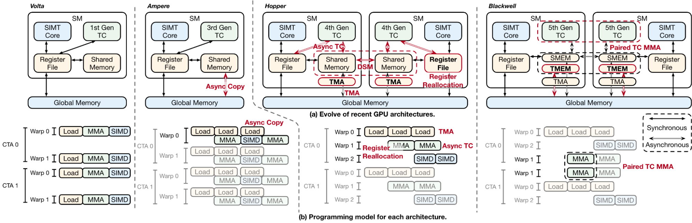

Modern GPU optimization depends on when the next tile moves, which warps compute, and when buffers become reusable. Triton offers tensor-level productivity, while CUDA/CUTLASS expose more execution control. Meta’s TLX adds an orchestration layer inside Triton so critical asynchronous structure can be explicit without abandoning Python, autotuning or tensor operations.

Original: [How We Built TLX: A Hardware-Native GPU Compiler for Production ML at Scale](https://engineering.fb.com/2026/11/10/open-source/tlx-a-hardware-native-gpu-compiler-for-production-ml/)  
Hongtao Yu, Peng Chen, Daohang Shi, Nick Riasanovsky, Lei Wang, Partha Kanuparthy · 2026-11-10

## Hardware increasingly needs cooperating execution roles

From Volta through Hopper and Blackwell, data movement and Tensor Core work become increasingly asynchronous. Different warps can load, multiply and process results, while CTA clusters can cooperate through distributed shared memory. Without explicit roles and dependencies, the compiler must infer that pipeline from generic loops.

<a class="note-image-link" href="/assets/images/tech/tlx-production/official-1.png" target="_blank" rel="noopener" aria-label="GPU generations and warp-level load, compute and synchronization roles · View original image ↗">View original image ↗</a>

*Reading the figure: hardware and memory connections appear above, execution timelines below. Later generations expose asynchronous transfers, specialized warps and cooperation more directly.*

TLX makes warp/wave groups first-class execution tasks. A producer asynchronously loads tiles; a consumer waits for readiness and issues matrix work; an epilogue waits for completion. Multistage buffers and lightweight barriers coordinate when data can be written, read and reused. Fetching the next tile while computing the current one creates overlap. The gain is not attributable to one new instruction alone.

## Tensor expressions with explicit handoffs

The article organizes TLX around warp-group orchestration, group-level synchronization, memory orchestration, cluster execution and optional layouts. It exposes TMA, asynchronous dots, TMEM and mbarriers while leaving finer thread behavior to the underlying model and compiler. Default layout inference permits a correct initial implementation, with explicit layouts added for tuning.

This helps fusion. Previously, stages could impose different tiles, swizzles and shared-memory layouts, making representation reconciliation a major engineering task. The compiler resolves compatible layouts where possible, leaving developers to focus on pipeline dependencies. Inference does not remove synchronization obligations: a producer must not overwrite a ring-buffer slot still being consumed.

The sample code is useful for roles and dependencies, rather than a complete specification of every backend. NVIDIA warps, AMD waves and generation-specific memory structures still need distinct mappings.

## Three production examples have different evidential scopes

GEM recommendation training has smaller shapes, many norms and heterogeneous modules. Meta reports 20%–25% end-to-end MFU on thousands of Blackwell GPUs through combined model, kernel, compiler and hardware optimization. Its GDPA forward kernel reaches up to about two-times speedup. Whole-stack MFU should not be attributed entirely to TLX, and kernel speedup is not end-to-end training speedup.

IKBO changes how user features are broadcast. Rather than materializing identical input for each candidate, kernels consume the natural user/candidate batch sizes and perform the broadcast internally. A final persistent TLX kernel uses producer/consumer roles and ping-pong scheduling across stages. The reported linear-compression kernel becomes four times faster on H100; compute-intensive net latency falls by up to two-thirds for co-designed models. Those gains include model and runtime changes, not merely a syntax replacement.

The third case is distributed grouped GEMM in large-scale LLM pretraining, integrating expert matrix multiplication with communication. The article emphasizes sustained operation, debugging and maintenance but supplies no complete comparative performance table. It establishes adoption scope rather than an additional quantified speedup.

## Portability and automation are still bounded

Listed targets include NVIDIA Hopper/Blackwell and AMD MI300/MI350X. Additional backends such as MTIA, higher-level orchestration inference and `torch.compile` integration remain future directions. GEM or IKBO running on MTIA does not establish that all TLX capabilities and performance already transfer there unchanged.

For systems optimization, the advance is readable and debuggable control over asynchronous execution rather than reliance solely on opaque heuristics. Read alongside the small kernel-agent study, it also highlights a separate requirement: an expressive performance interface still needs execution-grounded verification of automatically generated code.
