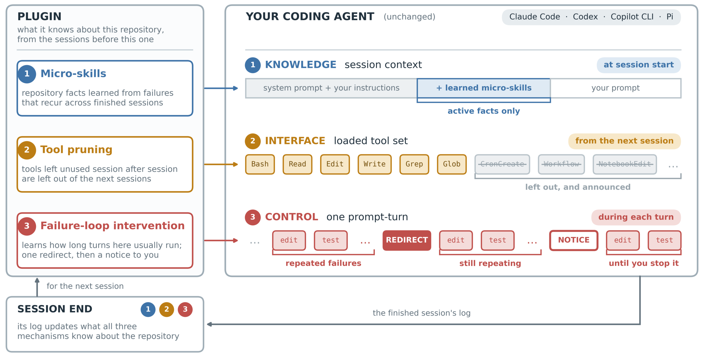

[TokenEconomizer: Learning from Experience to Make AI Coding Agents More Efficient](https://www.microsoft.com/en-us/research/blog/tokeneconomizer-learning-from-experience-to-make-ai-coding-agents-more-efficient/)  
Aaron J. Li, Weijia Xu, Chandan Singh, Zixiao Chen, Jeevana Priya Inala, Bin Yu, Ion Stoica, Michel Galley, Jianfeng Gao · 2026-11-16

Coding-agent waste often spans sessions: rediscovering a test command confirmed yesterday, repeatedly loading unused tool descriptions, or spending more turns on the same failure. TokenEconomizer uses repository history to adjust initial knowledge, tool interfaces and failure intervention without modifying the underlying agent or model. It targets the cost of sustained repository work.

## Why single-session optimization misses recurring costs

The official Microsoft Research article profiles Claude Code on 60 SWE-Bench tasks. After at least five completed tasks in a repository, 30% of tool calls repeat an earlier action there, compared with 7% matching another repository’s history. Of 23 tool descriptions supplied each turn, 16 are never called. Failed tasks account for 17% of tasks but 32% of spending.

Not every repetition is waste: changed code or environments can require revalidation. These measurements identify an opportunity for repository-specific experience rather than proving that repeated calls should always disappear. Fixed-strategy plugins save money inconsistently across repositories, motivating decisions that update with evidence.

## Three connected control points

Micro-skills encode recurring repository facts as one-line notes. Several sessions must confirm a pattern before it enters future starting context; contradictory evidence retires it. This compresses repeated exploration rather than indefinitely appending the whole history. Expiration matters because stale knowledge can propagate old mistakes.

<a class="note-image-link" href="/assets/images/tech/tokeneconomizer/method.png" target="_blank" rel="noopener" aria-label="Session logs update starting knowledge, tool selection and in-session failure intervention. · View original image ↗">View original image ↗</a>

*Session logs update starting knowledge, tool selection and in-session failure intervention.*

Tool pruning removes interfaces history suggests are unlikely to be used, while preserving command execution and file editing. Removed tools can return. It reduces repeated interface-description cost without permanently removing capabilities; restoration matters when a new task differs from history.

Failure-loop intervention watches repeated failures and asks a judge whether progress continues. When stuck, the agent receives a short redirection. If it remains stuck, the open-source plugin alerts the developer rather than terminating work. Detecting repetition and deciding to abandon a difficult task remain distinct responsibilities.

## Savings include the controller’s own calls

The main evaluation covers 277 SWE-Bench bug-fixing tasks in six repositories and five agent–model combinations, starting each repository without history. Mean cost falls 18.4–30.9%, with broadly stable task success; four of five combinations improve Pass@1 in the figure. Controller model calls count toward costs, so the reported savings do not simply move spending into an unmeasured component.

Learning has startup cost. Early tasks can be more expensive, but cumulative cost falls below default by the sixth task in every tested repository. That crossover is a property of these task sequences, not a guarantee for new repositories. Sequential web development saves 16.0–21.2%; security auditing, with a new repository for each task, saves 6.4–19.6%. Long-term same-repository accumulation cannot alone explain the latter.

## What deserves continued attention

This is experience-driven external control, not self-improving model weights. It operates at a different layer from ELITE’s implementation changes and RepoFactory’s training environments. It also differs from lowering reasoning effort, which can save comparable amounts while reducing success in the authors’ comparisons.

Important boundaries are stale repository facts, tool restoration and judges mistaking productive exploration for a failure loop. The article provides mechanisms and net-cost evidence without guaranteeing gains for every repository or language. Its concrete AgentOps direction is to manage historical knowledge, interface overhead and non-progressing turns together while preserving task quality.
