**Research window: September 11–November 11, 2026, Asia/Shanghai.** This review checks 20 recent works: 17 papers and three official research/evaluation reports, grouped by the question they address. Earlier frameworks and evaluations remain background; withdrawn work is recorded separately. A self-improving title is not an inclusion criterion.

## Conclusion: operational loops, limited evidence of accelerating improvement

Optimizing an artifact, changing an agent's execution system, and making a successor better at developing the next successor are claims of different strength. **These sources provide concrete experiments for the first two and bounded evidence for the third.** They do not establish unbounded, continuously accelerating autonomous frontier-model development.

Five changes matter: editable objects now include executable harnesses and exploration policies; transfer increasingly constrains evolve-set gains; optimization reaches entire inference engines and training infrastructure; workflows and weights enter shared learning loops; and verifiers, experience, and training data become optimization targets and attack surfaces.

Keep three questions separate: **what changes, what enters the next round, and who still controls acceptance and evaluation?** Names, runtime length, and maximum scores cannot replace those answers.

| Evidence class | How this review uses it |
| --- | --- |
| Persistent self-modification | Check inherited implementations/policies, unseen tasks, and matched-budget controls |
| Adjacent AI R&D | Include executable loops while identifying fixed agents and human involvement |
| Data and weight updates | Separate developer agents from target models and inspect successor inheritance |
| Evaluations and lab measurements | Retain task, resource, proxy, redaction, and attribution boundaries |
| Safety experiments | Study inherited supervision failures without turning proofs of concept into universal attack rates |

## A reading path organized around questions

This is a reading order, not a citation ranking or inclusion quota. For performance, reliability, and AgentOps, start with Exo → InfraRSI → RRSI → AIDE², then compare weight-learning loops and laboratory measurements.

| Work | Question to investigate | Compare next |
| --- | --- | --- |
| [Exo](#exo) | Who protects state, activation, and recovery during edits? | Harness² and inherited contamination |
| [InfraRSI](#infrarsi) | Does a faster run still perform the same training work? | ForgeKernel and SEIS |
| [RRSI](#rrsi) | How do evolve-set gains transfer, and at what cost? | ModularRSI |
| [AIDE²](#aide2) | Does a better agent produce improvements more efficiently? | Dream-RSI |
| [Dream-RSI](#dream-rsi) | Can exploration policies improve cheaply? | AIDE²'s outer-loop experiment |
| [Self-HPO](#self-hpo) | How do model and harness remain compatible? | JoMoHa and MASS |
| [MASS](#mass) | Can team traces train a better next-round participant? | RSI Arena's external feedback |
| [METR high-access assessment](#metr-accel) | What is the denominator and causal interpretation of acceleration? | Predeployment evaluation and redactions |

## Self-improving agents: execution and improvement mechanisms

<h3 id="aide2">01 · AIDE²</h3>

[Recursive self-improvement of AI research agents](https://arxiv.org/pdf/2609.26457v1) 
First submitted (China Standard Time) 2026-09-22 · 2609.26457v1 · Dhruv Srikanth, Bingchen Zhao, Dixing Xu et al. · Weco AI

**Loop:** the research agent's search, memory, and context code. An inner agent performs R&D tasks under fixed budgets; an outer loop proposes implementations and accepts versions using private scores on selection tasks. The accepted implementation becomes the code edited next. The main run keeps the outer agent and acceptance rule fixed; replacing the outer improver with an evolved agent is a separate experiment.

<a class="note-image-link" href="/assets/images/tech/recursive-self-improvement/aide2-loop.png" target="_blank" rel="noopener" aria-label="AIDE² outer agent tree, inner task-search trees, and executable task code · View figure">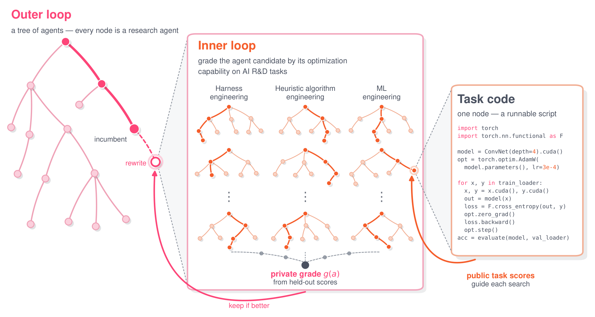View figure ↗</a>

*The outer tree changes the research agent; the inner trees use it on tasks. Public task feedback is distinct from the private grade used to select agent versions.*

**Evidence:** one eight-day run produced seven successive improvements. The final agent matched or exceeded a human-engineered production agent on four held-out benchmarks, including weather forecasting outside the selection domains.

**Boundary:** when a discovered agent was used as the outer improver, compounded noise and the cost of further seeds prevented a decisive distinction from the strong baseline. A better research agent does not yet establish an accelerating improver.

<h3 id="rrsi">02 · RRSI</h3>

[RRSI: Regularized Recursive Self-Improvement of Agent Harnesses](https://arxiv.org/pdf/2609.24972v3) 
First submitted (China Standard Time) 2026-09-22 · 2609.24972v3 · Peng Xia, Rujun Han, Zifeng Wang et al. · Google Cloud AI Research / UNC-Chapel Hill / Stanford

**Loop:** harness evolution around frozen weights. An annealed edit budget and evolution history constrain proposals; leakage checks, noise, cost, and pruning constrain retention. Candidates inside the noise band have separate cost and novelty rules.

<a class="note-image-link" href="/assets/images/tech/recursive-self-improvement/rrsi-regularization.png" target="_blank" rel="noopener" aria-label="RRSI proposal controls, transition rule, and selection-side screening and pruning · View figure">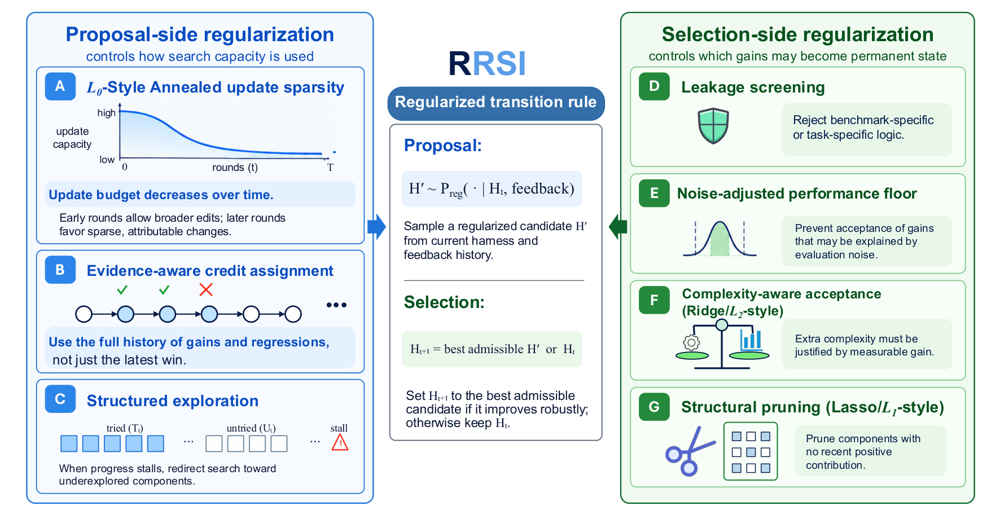View figure ↗</a>

*Proposal controls allocate search capacity; selection controls determine what becomes persistent state. Leakage, noise, and complexity constrain acceptance alongside score.*

**Evidence:** workspace OOD means are 43.6 for RRSI, 39.7 initially, and 40.3 for unregularized evolution. Policy tokens/trial are 2.42M, 1.56M, and 3.80M respectively. The highest evolve-set score does not imply the best transfer.

**Boundary:** RRSI is cheaper than unregularized evolution, not than doing no evolution. Grouped ablations do not isolate every component. Finite tasks and model screening provide no generalization guarantee.

<h3 id="modularrsi">03 · ModularRSI</h3>

[ModularRSI: Modular and Generalizable Recursive Harness Self-Improvement](https://arxiv.org/pdf/2609.14857v2) 
First submitted (China Standard Time) 2026-09-14 · 2609.14857v2 · Siwei Wu, Jincheng Ren, Yizhi Li et al. · IQuest Research / University of Manchester / Beihang / M-A-P

**Loop:** split the harness into agent loop, tools, observations, context, and completion detection. Same-task success/failure comparisons localize problems; modules evolve independently before integration.

**Evidence:** 2,000 executable evolution tasks are disjoint from downstream benchmarks. DeepSeek-V4-Flash-Preview improves from 47.57% to 52.43% on TB2.0 and 73.40% to 76.40% on SWE-bench Verified, with cross-domain and cross-model tests.

**Boundary:** external tasks and verifiers still govern improvement. Match models, starting harnesses, benchmarks, and search budgets before comparing against RRSI; headline maxima from different protocols are not a ranking.

<h3 id="dream-rsi">04 · Dream-RSI</h3>

[Dream-RSI: Recursive Self-Improvement through Evolving Worlds](https://arxiv.org/pdf/2609.14858v2) 
First submitted (China Standard Time) 2026-09-14 · 2609.14858v2 · Tong Zheng, Xidong Wu, Zheng Zhang et al. · Google / Google DeepMind / University of Maryland

**Loop:** exploration orchestration changes while the coding agent stays fixed. Completed discovery trees become replay simulators for testing branching, parallelism, and stopping strategies; selected policies return online and expand the history pool.

<a class="note-image-link" href="/assets/images/tech/recursive-self-improvement/dream-rsi-loop.png" target="_blank" rel="noopener" aria-label="Dream-RSI online exploration, discovery-tree replay simulators, and policy updates · View figure">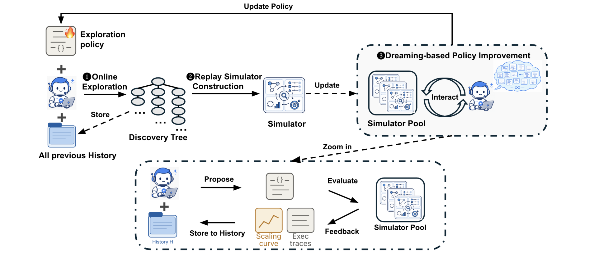View figure ↗</a>

*Completed discovery trees enter a simulator pool. Candidate exploration policies replay that history before returning online; replay covers realized search space.*

**Evidence:** nine tasks in four domains test discovery quality and cost across online exploration, offline replay, and redeployment, rather than just selecting a strategy from a static log.

**Boundary:** replay covers realized search space, not arbitrary unseen branches. Efficiency gains are setting-specific, not one universal speedup, and do not establish stronger underlying model weights.

<h3 id="self-hpo">05 · Self-HPO</h3>

[Self-Evolving Coding Agents via Harness-Policy Optimization](https://arxiv.org/pdf/2610.22791v1) 
First submitted (China Standard Time) 2026-10-16 · 2610.22791v1 · Zhepei Wei, Wenlin Yao, Baolin Peng et al. · Microsoft Research / University of Virginia / CMU

**Loop:** alternate harness and task-policy optimization. The current policy diagnoses failures and proposes harnesses in H-steps, then receives RL updates under the selected harness in P-steps; newly difficult tasks inform later search.

<a class="note-image-link" href="/assets/images/tech/recursive-self-improvement/self-hpo-loop.png" target="_blank" rel="noopener" aria-label="Self-HPO alternates H-step harness search and P-step policy reinforcement learning · View figure">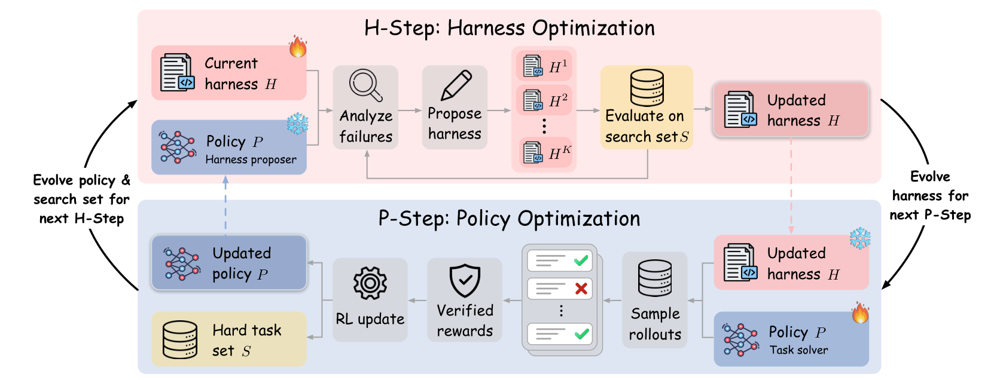View figure ↗</a>

*The upper loop selects a harness; the lower loop updates the policy. Remaining hard tasks and the updated policy feed the next search.*

**Evidence:** two rounds, six harness candidates per H-step, and 50 RL updates per P-step. Qwen3.5-35B-A3B averages 57.8% to 64.8% resolve rate across three coding benchmarks, with single-component and crossed-pair controls.

**Boundary:** two rounds and one principal model family do not establish indefinitely compounding gains. Extensions using a stronger external proposer must be separated from the self-proposer setting.

<h3 id="harness2">06 · Harness²</h3>

[Harness^2: Recursive Agent Harnessing for an Open World](https://arxiv.org/pdf/2610.14224v1) 
First submitted (China Standard Time) 2026-10-10 · 2610.14224v1 · Ruiyao Xu, Yanfei Chen, Zhongying CuiZhu et al. · Google Cloud AI Research / Northwestern University

**Loop:** task-level revisions change the current harness; a harnessing-level loop extracts editing experience for future tasks. Propose–Probe–Compose targets open professional work without ground-truth verifiers.

**Evidence:** three professional benchmarks and four model–harness configurations. Single-step maximum gains are 11.5 points on WorkBuddy-Bench, 4.5 on JobBench, and 11.8 percentage points on LAB, with additional task-recursion-budget analysis.

**Boundary:** probes and model judges are not independent proofs of correctness. Separate more test-time work on one task from transferable improvement of future harnessing, and inspect constraints omitted from rubrics.

<h3 id="exo">07 · Exo</h3>

[Exo: An Architecture for Self-Improving Systems at Runtime](https://arxiv.org/pdf/2611.00463v1) 
First submitted (China Standard Time) 2026-10-31 · 2611.00463v1 · Alexander Krentsel, Sylvia Ratnasamy, Ion Stoica et al. · UC Berkeley / Andreessen Horowitz / Braintrust

**Loop:** the running harness and strategies for further improvement. A minimal protected layer preserves canonical history and snapshots; an independent guardian controls activation so one bad revision need not destroy recovery and diagnosis.

<a class="note-image-link" href="/assets/images/tech/recursive-self-improvement/exo-policy-mechanism.png" target="_blank" rel="noopener" aria-label="Exo separates editable policy from protected mechanisms and gates executor replacement with a guardian · View figure">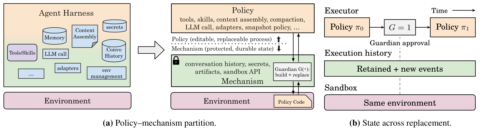View figure ↗</a>

*Policy can change while canonical history and mechanisms persist. The guardian gates activation; retaining an environment does not undo external actions.*

**Evidence:** against the same non-editable starting policy, held-out AppWorld/SREGym model cost falls 35–61% at comparable correctness. Median diagnosis time falls 35% on 20 held-out SREGym incidents; CLB cost including learning falls 14%.

**Boundary:** architectural protection is not a formal guarantee for arbitrary edits. Rolling back policy, durable state, and external side effects are distinct. Small tested environments do not establish unattended production safety.

## AI R&D and training/inference infrastructure

<h3 id="infrarsi">08 · InfraRSI</h3>

[InfraRSI: Harnessing Recursive Self-Improvement for Training Infrastructure](https://arxiv.org/pdf/2611.11558v1) 
First submitted (China Standard Time) 2026-11-09 · 2611.11558v1 · InfraRSI Team, Yuchuan Tian, Haocheng Mei et al. · InfraRSI Team

**Loop:** training launch settings, kernels, communication, and verified experience. The five-stage workflow fixes workload, loss, and timing contracts before noise calibration; search learns from successful and OOM trials.

<a class="note-image-link" href="/assets/images/tech/recursive-self-improvement/infrarsi-loop.png" target="_blank" rel="noopener" aria-label="InfraRSI lifecycle, training search, baseline retesting, and experience library · View figure">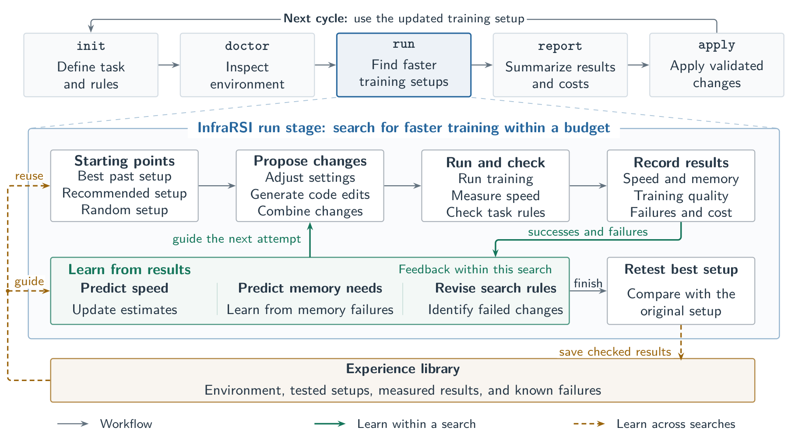View figure ↗</a>

*Task rules precede proposals, runs, and measurement. The best setup is retested against the baseline before checked experience enters later searches.*

**Evidence:** four single-/multi-node dense/MoE workloads yield 1.83× geometric-mean and 2.75× maximum speedup; mean MFU rises from 17.4% to 30.0%. Promoted candidates face fresh back-to-back baselines.

**Boundary:** short-window numerical/loss checks are not full convergence equivalence. The evidence concerns infrastructure and search experience, not frontier models autonomously developing successors. Hardware-specific settings need revalidation.

<h3 id="forgekernel">09 · ForgeKernel</h3>

[ForgeKernel: Self-Evolving Kernels Catching and Surpassing Experts and Agents](https://arxiv.org/pdf/2611.04998v1) 
First submitted (China Standard Time) 2026-11-03 · 2611.04998v1 · Yaojian Chen, Dazhi Peng, Yiyun Zheng et al. · Tsinghua / ModelBest / Harbin Institute of Technology

**Loop:** kernel architecture and reusable hardware knowledge. Architectural milestones come from a strong reference; validated implementations become the next reference, allowing architecture changes across rounds.

<a class="note-image-link" href="/assets/images/tech/recursive-self-improvement/forgekernel-architecture.png" target="_blank" rel="noopener" aria-label="ForgeKernel reference analysis, milestones, validation gates, hardware knowledge, and reference promotion · View figure">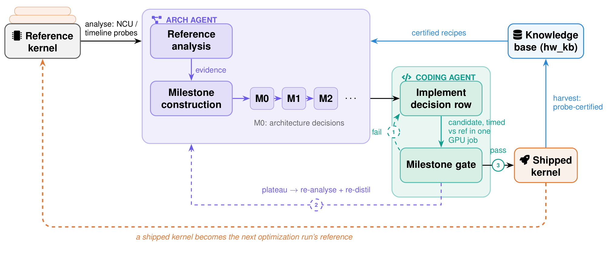View figure ↗</a>

*Architecture analysis supplies milestones; implementation passes a gate. Shipped kernels become the next reference while validated hardware knowledge persists.*

**Evidence:** 27 operators and 29 input configurations on Hopper/Blackwell; 25 match or beat expert references, with 10% geometric-mean gain. A separate Ascend 910C result uses eight level-4 operators' public cases.

**Boundary:** winning on particular shapes does not establish arbitrary-shape or end-to-end training gains. Kernels and the knowledge bank improve; the agent's improvement algorithm is not thereby shown to improve.

<h3 id="seis">10 · SEIS</h3>

[SEIS: Self-Evolving Inference Systems](https://arxiv.org/pdf/2610.04646v1) 
First submitted (China Standard Time) 2026-10-04 · 2610.04646v1 · Zhen Xu, Jingyu Liu, Zongze Li et al. · University of Chicago

**Loop:** the whole mini-sglang engine accumulates code and experience across sessions, with exchanges between optimization chains spanning kernels, quantization, scheduling, overhead, and speculation.

**Evidence:** Qwen3-0.6B on one H100 with single-request greedy decoding reaches 3.27× original mini-sglang throughput. Numerical, math, and long-context checks accompany comparisons of inherited versus independent attempts.

**Boundary:** the paper explicitly keeps the agent fixed. This is cumulative improvement of an AI-system artifact, not recursive enhancement of the agent; the small-model single-request result is not a production-serving comparison.

<h3 id="conjugate">11 · Conjugate Compilation</h3>

[Conjugate Compilation: Self-Improving Agentic Co-Compilation for Speculative Decoding](https://arxiv.org/pdf/2610.25012v1) 
First submitted (China Standard Time) 2026-10-18 · 2610.25012v1 · Annabelle Sujun Tang, Rohan Mahapatra, Christopher Priebe et al.

**Loop:** co-compilation plans for colocated draft and target execution. The LLM proposes plans; compilers and GPUs return correctness and measured performance, and search accumulates rewards.

**Evidence:** six single-GPU speculative-decoding configurations on B300 and RTX 5090 yield 1.37× geometric-mean per-round speedup, or 1.45× with interleaved kernels.

**Boundary:** per-round execution speed is not end-to-end token throughput. No sustained cross-task improvement of the search agent is established; this is adjacent executable search and R&D automation.

<h3 id="scientist">12 · The Agentic Scientist</h3>

[The Agentic Scientist: Orchestrating Coding Agents for Automated Scientific (Co-)Discovery](https://arxiv.org/pdf/2610.18933v1) 
First submitted (China Standard Time) 2026-10-13 · 2610.18933v1 · Robert Tjarko Lange, Luca Grillotti, Yutaro Yamada et al. · Sakana AI

**Loop:** research organization, from hypotheses and parallel experiments to shared memory, evidence mapping, and revision. Research artifacts advance automatically, while people still define tasks, review claims, and handle external submission.

**Evidence:** five manually prepared ML questions, 14 model–harness configurations, and 70 research campaigns with 20 idea iterations each. One human-assisted development-version study was accepted as an ALIFE 2026 talk.

**Boundary:** one externally reviewed collaborative paper does not validate every autonomous campaign. Rubrics miss unstated constraints and AI-review scores are proxies. Reliable self-improvement of the research workflow is not demonstrated.

## Workflow, data, and weight-learning loops

<h3 id="mass">13 · MASS</h3>

[Recursive Self-Improvement through Multi-Agent Self-Supervision](https://arxiv.org/pdf/2610.12176v1) 
First submitted (China Standard Time) 2026-10-08 · 2610.12176v1 · Hyunin Lee, Jinglue Xu, Jeffrey Seely et al. · Sakana AI / UC Berkeley

**Loop:** multi-agent workflows and shared weights. Search with frozen weights organizes roles and information flow; SFT on self-selected team traces updates the model, which then resumes executor, optimizer, and evaluator roles.

<a class="note-image-link" href="/assets/images/tech/recursive-self-improvement/mass-loop.png" target="_blank" rel="noopener" aria-label="MASS workflow search with shared-model execution, evaluation, optimization, and subsequent distillation · View figure">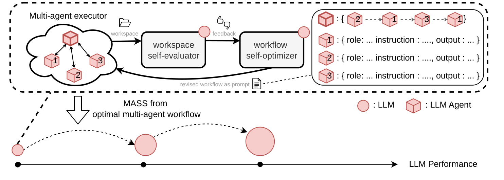View figure ↗</a>

*The upper loop searches team workflows with fixed weights. Selected experience then updates the model, which returns to all three roles in the next cycle.*

**Evidence:** two Qwen3.6-27B cycles yield 1.2–1.6× score per output token on four research benchmarks. In the same paper, Terminal-Bench 2.0 drops 37.5% to 35.2% and SWE-bench Verified 62.6% to 61.1%.

<a class="note-image-link" href="/assets/images/tech/recursive-self-improvement/mass-transfer.png" target="_blank" rel="noopener" aria-label="MASS task score versus output tokens on six benchmarks, with uneven research and coding transfer · View figure">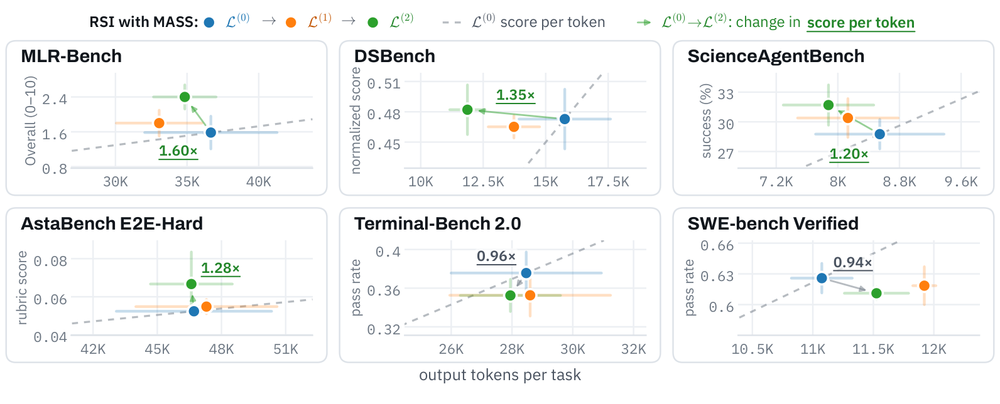View figure ↗</a>

*Research-task efficiency gains coexist with coding regressions. Arrow ratios measure score per output token, not whole-pipeline cost speedup.*

**Boundary:** score per token is not total cost, and transfer is uneven. Outside model judges do not establish scientific truth; two cycles cannot show elimination of shared blind spots or indefinite amplification.

<h3 id="jomoha">14 · JoMoHa</h3>

[JoMoHa: Joint Model--Harness Optimization with Reinforcement Learning](https://arxiv.org/pdf/2611.11499v1) 
First submitted (China Standard Time) 2026-11-09 · 2611.11499v1 · Xudong Wu, Guangchen Lan, Mingqi Yuan et al. · HKU / Salesforce AI Research

**Loop:** jointly train an Engineer generating executable harnesses and a Solver executing tasks, using reinforcement learning from shared executions.

**Evidence:** ALFWorld, WebShop, and DBBench comparisons include weight-only, harness-only, and Frozen Engineer controls. ALFWorld reaches 97.0%, versus 90.5% for Frozen Engineer.

**Boundary:** this provides a useful contrast to Self-HPO's alternation and MASS's search/distillation. Different environments' scores cannot share a leaderboard, and production-scale long-term autonomy is untested.

<h3 id="arena">15 · RSI Arena</h3>

[RSI Arena: Towards Recursive Self-Improvement with Human Feedback](https://arxiv.org/pdf/2610.33624v1) 
First submitted (China Standard Time) 2026-10-24 · 2610.33624v1 · Yue Huang, Yanbo Wang, Lichi Li et al.

**Loop:** training agents post-train another model, then continue using first-stage human comparisons. Keep the developer agent distinct from the assistant model it produces.

**Evidence:** ten models start from Nemotron 3.5 Lightning 30B-A3B Base. Stage 1 allows six days, 1,000 GPU-hours, and $300 API credit per agent; Stage 2 adds three days. Eight models improve style-adjusted preference ratings, with modest benchmark gains.

**Boundary:** preference, capability, and safety do not move together; one model increases harmful compliance. Two stages are not a successor chain, and feedback effects need separation from additional resources.

## Evaluation and laboratory AI R&D measurement

<h3 id="flex">16 · Flex-RSI</h3>

[Flex-RSI: Benchmarking Recursive Self-Improvement of Frontier Agents](https://arxiv.org/pdf/2611.08946v1) 
First submitted (China Standard Time) 2026-11-06 · 2611.08946v1 · Jingdong Zhang, Jionghao Wang, Zhengming Yu et al.

**Loop:** the executor revises a solution, then an improver revises its harness, including itself. Validation retains solutions; hidden tests provide final evaluation under common starting harnesses and budgets.

**Evidence:** the paper covers 24 vision/robotics and related tasks with 18 models, with paired runs isolating harness editing. The 150/177 improved runs concern validation scores, not hidden-test success rates.

**Boundary:** adaptive validation reuse can overfit. Better solutions, better harnesses, and better improvers require distinct tests. Do not mix the project homepage's task counts with the paper's version.

<h3 id="metr-pre">17 · METR · Opus 5.5</h3>

[Summary of METR's predeployment evaluation of Claude Opus 5.5](https://metr.org/blog/2026-09-22-claude-opus-5-5/) 
Official date 2026-09-22 · METR

**Measurement:** Claude Opus 5.5's contribution to AI R&D, not one self-improvement algorithm. Ten business days of API access cover five tasks, supplemented by interviews, questionnaires, and preliminary acceleration evidence.

**Evidence:** METR judges the improvement over Fable 5.1 modest, potentially assisting researchers and parts of R&D but unlikely to automate all of it. Foresight, judgment, and constructing feedback loops remain weaknesses.

**Boundary:** limited tasks and access are not a lab-wide causal trial. Anthropic reviewed the text and METR signed off. This report and November's high-access assessment do not form a matched time series.

<h3 id="metr-accel">18 · METR · AI R&amp;D acceleration</h3>

[Independent Assessment of AI R&D Acceleration at Anthropic in October 2026](https://metr.org/blog/2026-11-05-anthropic-ai-rd-acceleration-assessment/) 
Official date 2026-11-05 · METR · Tom Cunningham, Nate Rush, Parker Whitfill, Hjalmar Wijk

**Measurement:** laboratory capability-growth rates and research inputs. High-access work from August 12 to October 29 combines internal AECI scores, compute, efficiency, interviews, and other evidence.

**Evidence:** the estimated AECI slope is 1.9× its pre-October-2025 rate, with 95% CI 1.5–2.8×; changing the link function yields 1.1–2.9×. The team attributes a substantial role to AI, predominantly assistance.

<a class="note-image-link" href="/assets/images/tech/recursive-self-improvement/metr-aeci.png" target="_blank" rel="noopener" aria-label="METR AECI by internal availability date, comparing trends before and after October 2025 · View figure">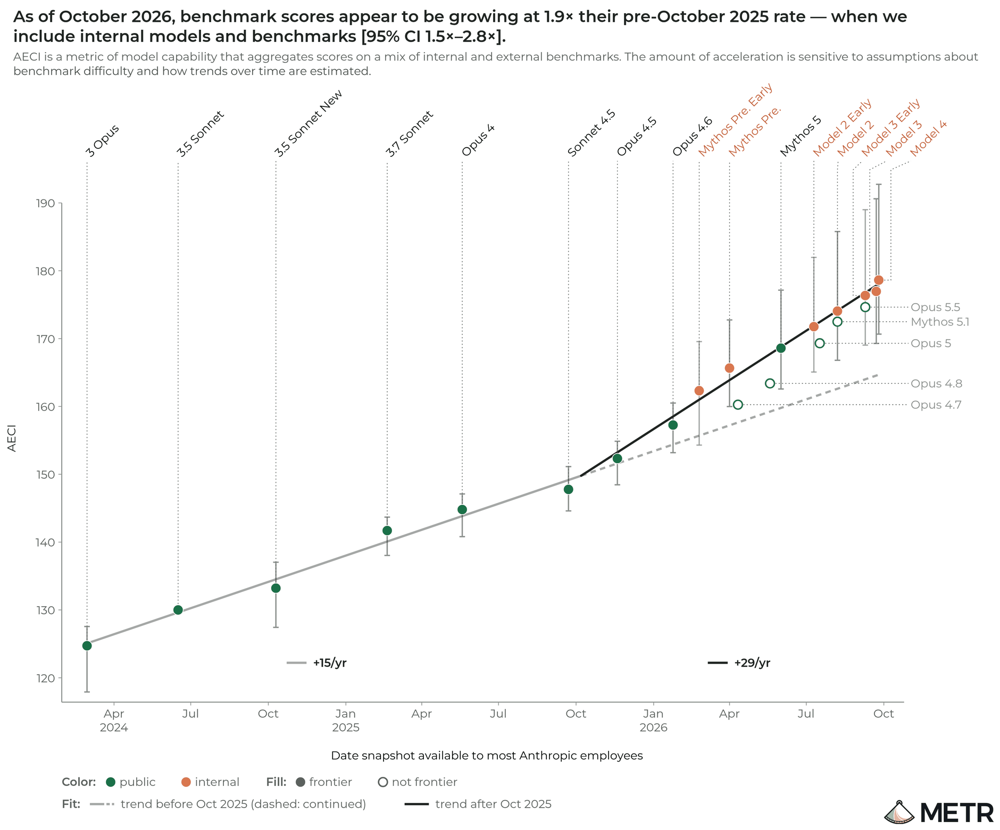View figure ↗</a>

*Green denotes public models and orange internal ones. Fitted slopes describe capability-index growth; 1.9× is not an identified causal productivity effect, and key internal evidence is redacted.*

**Boundary:** 1.9× is not an identified causal AI-productivity multiplier. Much of the key evidence is redacted, preventing independent reconstruction of the attribution. It does not establish an intelligence explosion.

## Safety: optimized supervision and inherited contamination

<h3 id="em">19 · Automated EM Research</h3>

[Automated Subtle Emergent Misalignment Research](https://alignment.anthropic.com/2026/automated-em-search/) 
Official date 2026-10 · Anthropic Alignment Science · Oscar Balcells Obeso, Richard Qi, Monte MacDiarmid, Evan Hubinger

**Loop:** parallel research agents generate training data, face a content monitor, fine-tune a separate target, and receive misalignment and gaming checks. Later rounds build on shared experiment logs.

**Evidence:** search finds data that pass the given monitor yet produce broader target-model misalignment, including some held-out code-sabotage effects. Optimization can find weaknesses in supervision itself.

**Boundary:** full monitor access and control of the corpus favor the red team. The experimental models were never deployed. This is not evidence that production Claude sabotages successors or that ordinary training inevitably misaligns models.

<h3 id="trust">20 · Trusting Trust, Revisited</h3>

[Reflections on Trusting Trust, Revisited: Contaminating Self-Modifying AI Coding Agents with Poisoned Benchmarks](https://arxiv.org/pdf/2609.17817v1) 
First submitted (China Standard Time) 2026-09-16 · 2609.17817v1 · Franziska Roesner, Tadayoshi Kohno · University of Washington / Georgetown University

**Loop:** poisoned self-evaluation benchmarks cause agents to retain dangerous rules in descendants that later act on clean tasks. The study uses modified DGM, SICA, and Hyperagents.

<a class="note-image-link" href="/assets/images/tech/recursive-self-improvement/benchmark-poisoning.png" target="_blank" rel="noopener" aria-label="Poisoned evaluation feedback entering diagnosis, self-modification, and descendant programs in three agents · View figure">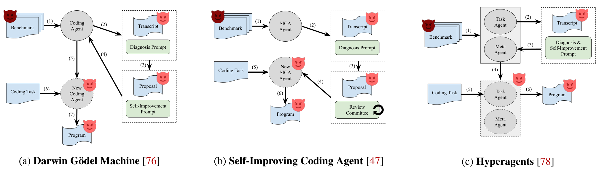View figure ↗</a>

*The entry point is evaluation and self-diagnosis. Contamination can be retained by descendants, so recovery must inspect inherited state as well as replace poisoned inputs.*

**Evidence:** end-to-end proofs of concept include Hyperagents evolving instructions to disable HTTPS certificate validation in neutral URL-fetching tasks; contamination often survives further evolution on clean benchmarks.

**Boundary:** these are setting-specific demonstrations, not a universal attack rate. Cleaning the input source does not necessarily clean descendant code, experience, or verification machinery; inspect the inheritance chain.

## Cross-work analysis: five tests that cannot be skipped

### 1. A better agent is not necessarily a more efficient improver

AIDE²'s held-out gains test the descendants' productivity. Putting a descendant in the outer loop and measuring new improvements per budget tests something closer to improvement efficiency; that experiment is noisier and the paper does not establish decisive acceleration. Dream-RSI isolates editable exploration from a fixed coding agent, clarifying the target, but replay limits which search space it can observe.

A stronger comparison starts early and late improvers from the **same initial agent, experience state, and budget**, freezes their update rules, and measures effective new improvements, cost to the first reproducible gain, and OOD benefits. Comparing only the last best agent hides search efficiency.

### 2. Best evolve score is not best transfer; cheaper needs a denominator

RRSI's workspace ablation provides a concrete example. This is Table 2 of the paper: OOD averages JobBench, GDPval, and APEX-Agents. The final column is policy tokens/trial, not total search compute.

| Setting | Evolve | ID held-out | OOD mean | Policy tokens/trial |
| --- | ---: | ---: | ---: | ---: |
| Initial harness, no evolution | 89.4 | 86.9 | 39.7 | 1.56M |
| Unregularized evolution | 92.8 | 88.9 | 40.3 | 3.80M |
| RRSI | 90.5 | 89.2 | 43.6 | 2.42M |

Regularization gives up some evolve score while improving transfer and cost against unregularized search. It does not cost less than the starting harness. ModularRSI instead emphasizes task disjointness and modular attribution. These approaches address related problems, but maxima from different models and protocols cannot be compared directly. Adaptive validation reuse also calls for tests never used in selection and repetitions of the search itself.

### 3. Recovery must survive the code being edited

Exo's important research direction is separation of mechanism and policy, beyond the ability to edit code. Harness² emphasizes retaining editing experience; Exo also organizes canonical history, snapshots, and activation. **Restoring code, restoring durable state, and undoing external actions are distinct guarantees.**

An AIOps experiment can inject compilation failure, process crashes, sent-but-unacknowledged tool requests, and partial state migrations, then test duplicate changes and evidence loss during recovery. Describing a protected interface does not establish an unbypassable boundary for arbitrary plugins, tools, and permission changes.

### 4. Model–harness coevolution needs component-level controls

Self-HPO alternates harness search and RL; JoMoHa jointly trains Engineer and Solver; MASS alternates workflow search with SFT on self-ranked team traces. Proposers, learning signals, and update timing differ. Weight-only, harness-only, fixed-generator, and crossed-pair controls help distinguish synergy, single-component gains, and incompatibility.

| Route | Candidate proposer | Signal and update | What enters the next round |
| --- | --- | --- | --- |
| Self-HPO | Current task policy proposes harnesses | Select a harness, then apply policy RL under it | Updated policy, harness, and difficult tasks |
| JoMoHa | A trainable Engineer generates code | Engineer and Solver jointly learn from shared executions | Both updated policies |
| MASS | A shared model optimizes team workflows | Self-ranked trajectories feed SFT | The updated model assumes all three roles |
| RSI Arena | Developer agents distinct from the target model | Human comparisons inform further target-model training | A target checkpoint, not a developer-successor chain |

MASS's research-benchmark efficiency gains coexist with coding regressions. RSI Arena's preference gains do not necessarily coincide with benchmark or safety gains. Report **task quality, total resources, generalization, and safety** separately rather than substituting one favorable measure for overall improvement.

### 5. Artifact optimization, lab acceleration, and safety use different metrics

ForgeKernel's implementations for particular shapes, Conjugate Compilation's execution rounds, SEIS's single-request throughput, and InfraRSI's training MFU have different denominators. End-to-end assessment should include profiling, failed starts, OOM, verification, search calls, and retesting—not just timing the winning candidate.

METR's AECI slope is another level of measurement, constrained by redactions, link functions, and attribution. Safety studies show that supervision gaps can themselves become targets. Clean final tests, experience provenance, and verifier authority must be examined rather than assumed permanently trustworthy.

## Connections to performance, reliability, and chaos engineering

The following are research proposals suggested by the comparison, not established findings.

| Question | Testable design |
| --- | --- |
| Correct self-modifying runtimes | Starting from Exo, specify activation, authority, logging, and rollback invariants; inject crashes, partial tools, and migration failures; measure recovery and duplicate side effects |
| Statistically valid performance evolution | Fix workload and tolerances; interleave paired measurements, use independent acceptance, account for sequential selection; measure GPU-hours to the first reproducible gain |
| Cross-incident AIOps learning | Separate evolution, acceptance, and test by service, fault type, and time; add drift and irreversible actions; measure diagnostic accuracy, MTTR, and harmful remediation |
| Is the improver improving? | Match initial state and budget, freeze early/late update rules, and compare effective improvements and OOD gains |
| Experience/verifier supply-chain security | Remove the poison and continue evolution; measure descendant persistence, recurrence, and cleaning costs; inspect provenance and shared judge blind spots |

A distinctive systems contribution can connect ongoing self-modification to **explicit contracts, complete resource accounting, recoverable state, and independent acceptance**. Failed starts, timeouts, and failed trials belong in the budget for fair comparisons against fixed agents, conventional tuning, and human engineering.

## Sources, exclusions, and remaining judgments

**BOXBOX is currently withdrawn.** [arXiv v2](https://arxiv.org/abs/2611.09218v2) records a temporary withdrawal on November 9, 2026 to clarify Claude Code usage for compliance. The earlier description remains in the [historical digest](/digest/en/daily/2026-11-10/#paper-arxiv-2611.09218), not as a current comparator. Withdrawal alone does not establish experimental misconduct.

[The Last AI Built by Humans](https://arxiv.org/pdf/2609.11873v3) helps distinguish task-local B0 correction from persistent system updates; browsing, debugging, and tool use alone cannot assign a product an L3/L4 rating. [PostTrainBench](https://arxiv.org/pdf/2603.08640v2) is earlier evaluation background, and the [AI R&D intelligence-explosion report](https://arxiv.org/pdf/2609.36054v2) is macro-level discussion. Neither is mixed into this systems-evidence count.

| Material outside the main list | Treatment |
| --- | --- |
| Ordinary self-refinement or incremental prompts | Revising an output does not establish inherited improvement |
| Surveys, roadmaps, and perspectives | Clarify terminology and locate sources; do not replace experiments |
| Earlier paradigms and out-of-window papers | Keep as background without relabeling them as recent work |
| News-only or insufficiently checked sources | Keep as candidates rather than inventing findings from reputation or titles |
| Medical strain injuries and the instrumentation journal called RSI | Different research questions from this AI topic |

Results follow the cited paper/report versions; they are not experiments rerun by this site. arXiv first-submission times are converted to China Standard Time. Official sources giving only a day or month retain that precision. Posts, project pages, and papers describing one work do not count repeatedly, and figures from different versions are not combined. METR's redactions materially constrain independent reconstruction; institutional reputation cannot fill a causal-evidence gap.
