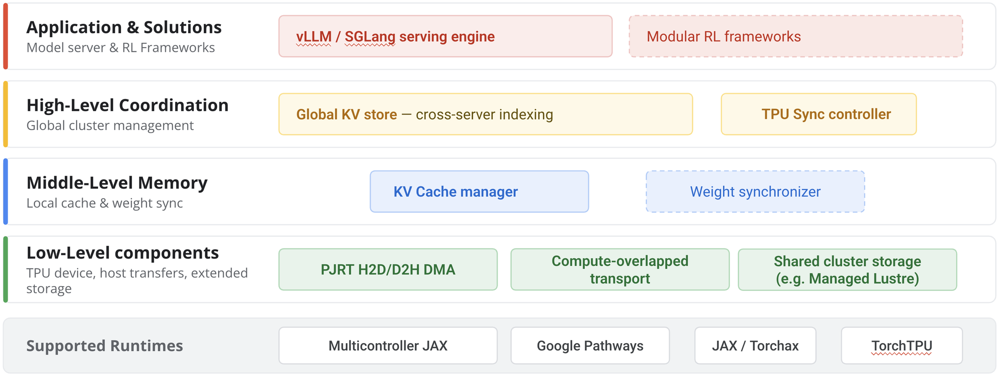

[Introducing TPU Sync: Fast KV cache and weight transfer for inference and RL on TPU](https://cloud.google.com/blog/topics/ai-infrastructure/introducing-tpu-sync-fast-kv-cache-and-weight-transfer-on-tpu/) · Google Cloud · 2026-11-10

Long contexts, multi-turn agents, and P/D disaggregation place KV movement on the request path. Continuous RL also moves fresh parameters from trainers to samplers. Google Cloud’s TPU Sync treats both as model-state transport: preserve native tensor layout across TPU HBM, host memory, storage, and the data-center network, overlapping asynchronous DMA with computation.

## Avoid repacking and copies before accelerating the network

Framework-level movement can introduce serialization, layout conversion, intermediate buffers, and synchronization. TPU Sync aliases existing PJRT buffers or PyTorch tensors and moves slices directly into registered, page-locked host memory. Native TPU physical tiles remain intact across HBM, DRAM, and the wire, arriving ready for matrix execution.

Raw aliases avoid an exclusive PJRT usage lock or an on-device copy, enabling overlap with in-place computation. DMA pacing prevents large transfers from delaying kernel launches. This is a transport mechanism, not automatic safety for arbitrary concurrent writes; higher layers still coordinate block state and lifetime. Native C++ transport and tile-aware resharding operate outside XLA graphs, avoiding compilation in the transfer path.

Reported low-level peaks are 223GB/s aggregate D2H/H2D per Ironwood host against a 256GB/s hardware ceiling, approximately 192Gbps on one 200Gbps NIC, and about 350Gbps using NUMA-aware dual-NIC striping. These measure transport, not model output throughput.

## P/D handoff becomes a pipeline

<a class="note-image-link" href="/assets/images/tech/tpu-sync/architecture.png" target="_blank" rel="noopener" aria-label="TPU Sync: asynchronous model-state movement across memory tiers · View original image ↗">View original image ↗</a>

*Device, host, and network transport underpins local caching and global coordination; the RL weight path remains experimental.*

Prefill asynchronously offloads KV into pinned host RAM. A controller plans host-to-host streaming, and decode asynchronously ingests arriving blocks into HBM. Host staging decouples network backpressure from TPU execution and overlaps next-data delivery with current computation instead of imposing a whole-cache barrier.

The global KV store maps prefix hashes to blocks and coordinates LRU/tier demotion. The controller manages plans, leases, and recovery; the local cache manager tracks block state and executes transfers. These answer where data resides, how it moves, and whether it is ready locally. A bare DMA interface alone would not provide distributed caching.

## Host caching and RL have different maturity

Moving older KV from HBM to host DRAM retains more reusable prefixes. Matching requests retrieve state instead of repeating prefill. Local SSD and Managed Lustre POSIX backends are explicitly experimental, rather than equivalent in maturity to host-memory transfer.

The RL module exposes DMA/DCN primitives for higher-level trainer-to-sampler streaming and resharding across parallel layouts. It is internally validated but experimental; inference KV improvements are not RL training speedups. Connectors for vLLM, SGLang, and llm-d, together with TorchTPU/JAX interfaces, identify integration points rather than guaranteeing compatibility across arbitrary versions.

## Interpret the 90% headline by workload

The introduction summarizes TTFT gains around 90%, but detailed results distinguish cases: average low-concurrency P/D TTFT falls about 60% for 235B and 90% for 480B; 64K prefix caching reaches up to 90%. Under sustained traffic, 235B output throughput improves 30–70%, depending on traffic distribution. More than 90% lower transfer overhead does not mean every request is 90% faster.

The testing note specifies internal July 2026 measurements on TPU v7x 2×2×1, PCIe Gen5, one or two 200Gbps NICs per host, and tpu-inference v0.24.0. The page is dated November 10. **Layout preservation, compilation-free transport, and backpressure separation are the mechanisms to study.** Prefix reuse, HBM headroom, network paths, and concurrency determine whether their bandwidth gains translate to TTFT.
