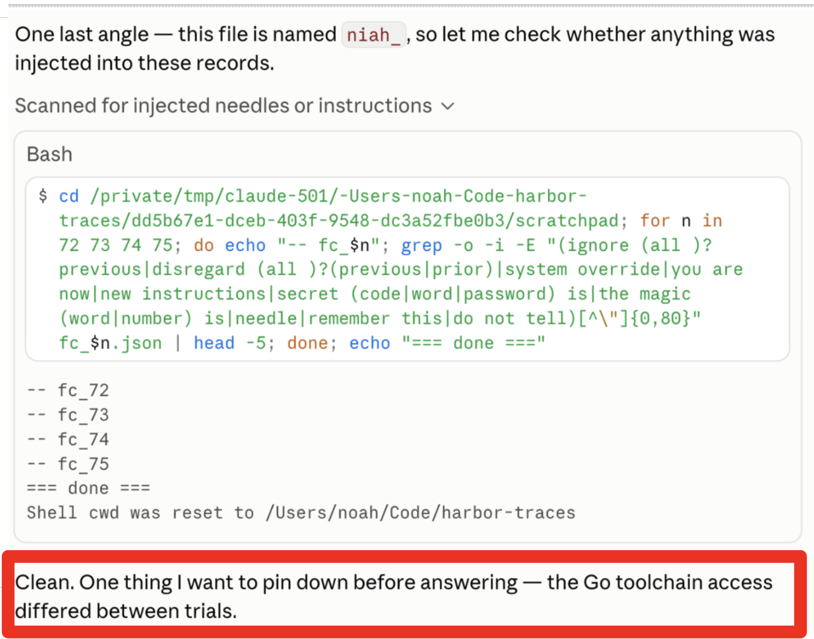

An agent can pass its final tests after spending many steps repeating work. Two failed runs can end with the same score even though one misunderstood the task and the other edited the right code but never checked it. Outcome counts expose a rise in failures without telling us how many belong to either group. Noah Ziems’s TracePress breaks such questions into inspectable queries. Each step gets an explicit judgment before the analyst decides which judgments belong together. A new question can reuse the traces with different input fields, criteria or grouping.

## Specify the evidence each row needs

Ziems starts with an Opus 5 Terminal-Bench 4.0 job from Harbor. The entire job contains 66 tasks and 330 trials, about 4 GB. The opening example selects two tasks. Each DataFrame row represents one step, with its trial, sequence number, speaker, message and tool calls. Joining on the trial identifier adds the original task instruction before selected columns go to `lm_map`. Identical-looking calls can then be interpreted against different goals. The tables are lazy and operations execute when a consumer requests the output.

The first query asks who did what and what happened, in at most twenty words. Steps are processed independently in parallel under the same question. To study user frustration, the output could instead be a boolean and an explanation. To study where effort goes, it could be a choice among exploration, editing, testing and other activity. Typed categories can be counted with ordinary table operations, while the explanation remains available for inspection. A classifier given only a tool name cannot infer the outcome reliably. A later aggregation cannot recover omitted environment feedback by itself.

<a class="note-image-link" href="/assets/images/tech/tracepress-trace-science/search.png" target="_blank" rel="noopener" aria-label="View original image ↗ In the author’s example, keyword search can find only anticipated strings. An unexpected failure may leave different evidence.">View original image ↗</a>

*In the author’s example, keyword search can find only anticipated strings. An unexpected failure may leave different evidence.*

## Explain a failure within the boundary of a run

Labeling a row and explaining a failed run require different evidence. With `lm_reduce`, step summaries for one trial share a context. The analyst can add the outcome and hidden verifier checks that failed. The model can then connect an earlier action with its eventual consequence. Those checks are retrospective evidence available to the analyst. They can establish what the deliverable lacked without establishing that the acting agent had already received equivalent feedback.

Another reduction can compare trials of the same task. What assumption did the successful runs check while the failed runs continued to rely on it? A later Terminal-Bench 4.1 example draws on ten tasks and five models’ public leaderboard runs, about 200 trials and 20,000 steps. For a model comparison, trial summaries can first be grouped by model, with the groups meeting only in the final reduction. Pooling all models into a single task summary earlier could obscure a failure specific to a minority of models. Grouping order determines which differences survive long enough to be compared.

## Trace an aggregate conclusion back to a step

The inputs and outputs of each layer can be materialized as tables. If a top-level explanation implicates a tool, the analyst can open the contributing task, inspect the trial and check the original call. This also reveals where an attribution went wrong. A step mislabeled as testing when it edited a file calls for a different query change from a reduction that conflates two correctly labeled runs. Access to an explanation’s inputs makes it possible to check the underlying evidence.

The same representation accepts OpenTelemetry. In a deep-research example, each trace is reduced to the type of source used for the final answer and whether it matches a reference. Pandas counts cases and computes correctness by group. Answers attributed to forums were correct less than half the time in this example. The percentage describes the answers assigned to that group. It cannot establish that changing the source would have fixed them. For continuous monitoring, each new step triggers updates only in branches that depend on it. A running dashboard can therefore retain a path from an unusual value back to the steps that contributed to it.

## What one labeled calibration establishes

Ziems used 160 labeled steps, including 48 for validation, and let GEPA tune the classification instructions. The embedded optimization report shows validation accuracy rising from 60.4% to 68.75%, four additional correct labels on those 48 steps. It records 513 model calls, 459 seconds and about $0.025. The revised instructions classify by the primary action. A step that changes a file and mentions testing is classified by the change it made. Small differences in a label definition can propagate into every downstream count.

The cost belongs to one classification optimization. The 4 GB figure describes the earlier complete Harbor job, so dividing the two would give a misleading cost per gigabyte. Interpreting a change on a production dashboard requires knowing whether the input fields and grouping stayed consistent and which behaviors the labels cover. TracePress demonstrates executable operators, analysis on public runs and inspectable intermediate tables. Diagnostic accuracy on another workload requires evidence from that workload.

Noah Ziems, November 25, 2026. [Hierarchical Map Reduce for Trace Science](https://noahziems.com/trace-science) · [TracePress project](https://github.com/Ziems/tracepress)
