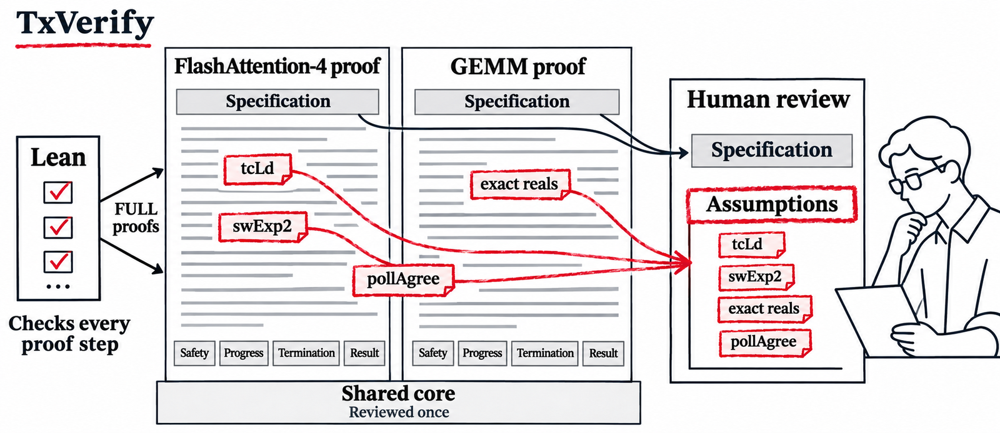

On a B200, the authors compared an attention decode kernel with a synchronization fix against the original. Across 15 runs on five shapes, the outputs matched bit for bit, and the fix cost 0.3–1% in timing tests. Why keep it? An asynchronous operation’s completion still has to be observed according to the barrier rules, even in an iteration that leaves the accumulator unchanged. Numerical comparisons can miss that obligation. TxVerify starts from actual PTX, checks the allowed executions in Lean and discloses the additional conditions the proof needs.

## What correctness means for one PTX program

A thread issues instructions in order, but asynchronous copies, matrix operations and accesses by other threads can complete in different orders. TxVerify’s shared core uses program order, barriers and fences to order memory accesses. It tracks the order of operations on objects such as barriers and the dependency between a successful wait and the completion it observed. It rejects instruction forms for which it has no rule. A proof applies to the specified handwritten or compiler-emitted PTX and inputs satisfying its launch preconditions.

Each theorem answers four questions. Safety rules out modeled errors such as invalid memory accesses, races and barrier misuse. Progress requires any execution that cannot add a counted event to be complete, with threads finished and outstanding work drained. Termination bounds counted events per launch, excluding failed polls on certain barrier waits. Combined with progress, that bound implies completion under fair scheduling. Finally, memory at completion must satisfy the postcondition. A result property alone would miss a kernel that waits forever.

## Which judgments remain with the reviewer?

The shared core records interpretations alongside the manual rules they implement. Where a particular kernel needs another value guarantee, ordering or exemption from a safety check, the authors identify the affected instructions, justify the condition and list it in the theorem. Lean checks the deduction from those premises. Reviewers assess whether the shared rules describe the machine, whether the specification asks the right question and whether the device satisfies the local assumptions.

<a class="note-image-link" href="/assets/images/tech/txverify-ptx/proof.png" target="_blank" rel="noopener" aria-label="View original image">View original image ↗</a>

*Both proofs use the execution rules at the bottom. The red paths trace extra conditions that a reviewer must assess for each kernel.*

In FlashAttention-4, lanes independently poll the same barrier before a branch that requires a uniform predicate. Polling one object does not ensure that all lanes observe the same result. The theorem lists a narrowly scoped exemption at 37 branches. The authors note that a plain branch could remove this dependency. An assumption can cover many instructions or a particular numerical approximation, so counting assumptions alone gives little indication of kernel reliability.

## How proof obligations led to fixes

In the Inkling 2 Small decode kernel, the original code put a barrier wait and an accumulator rescaling operation inside the same conditional. Rescaling is necessary only when a value changes. The barrier phase still advances even when no lane needs to rescale. The team moved the wait outside the conditional so every iteration after the first observes completion of the preceding phase. The opening B200 comparison measured this first fix. A second issue concerned a split with no key blocks. The loop runs zero times, yet the epilogue still has an outstanding asynchronous arrival to wait for before exit. The proof covers compiler output containing both fixes.

The team also fixed an input-barrier drain in TIRx FP16 GEMM. Across the evaluation, all 13 Blackwell kernels received conditional proofs of the four properties. These include small prototypes as well as production kernels. FlashAttention-4 lists eight additional assumptions and FlashMLA eleven. They locate concrete review targets, including the ordering of a Tensor Memory read against a later overwrite. That information gives a maintainer a place to change code or revisit a hardware dependency.

## Two limits that affect the conclusion

The core treats all thread blocks as resident from launch. A physical GPU has finite residency. Waiting consumers can fill every slot and keep their producer from ever being scheduled. The modeled producer always has a seat, so the fairness premise cannot resolve this mismatch with hardware. Some theorems also interpret specified floating-point operations as exact real arithmetic. They establish the postcondition under that interpretation. Rounding error and bitwise agreement on a device require separate evidence.

Bohan Hou and Tianqi Chen (MLC Community) · 2026-11-24 · [What Must We Trust? How TxVerify Uses a Core/Assumption Split to Formally Verify Production GPU Kernels at the PTX Level](https://blog.mlc.ai/2026/11/24/what-must-we-trust-verifying-production-gpu-kernels-with-a-core-assumption-split)
