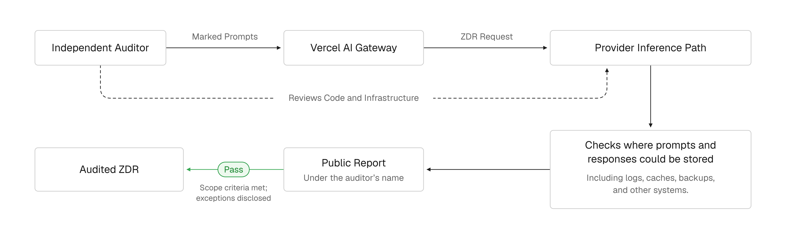

An inference gateway can retry another endpoint when a provider rate-limits it. For a zero data retention (ZDR) request, that step changes the systems handling the data. Even if the primary deletes a prompt, a fallback endpoint’s tracing pipeline, crash dumps or support tools may retain a copy. Vercel’s Audited ZDR links independent inspection of the serving path to the destinations eligible for retries.

## Following a marked prompt through the serving path

An independent auditor reviews the provider’s serving code and infrastructure configuration, sends marked prompts through AI Gateway and searches the provider’s logging, caching and storage systems for traces. The scope covers models, endpoints, features and tools handling gateway traffic. It includes completions, system prompts, embeddings, files, images, audio, tool payloads and identifiable derivatives. Metrics, backups, abuse monitoring and training or evaluation datasets are possible destinations too.

Caching has a specific constraint. A provider using KV caching must disclose the behavior, keep the cache in volatile storage only during the request and delete the content when the response is returned. Ordinary inference deployments can move KV to disk to extend reuse. Persistent storage would violate the condition being audited here. Subprocessors handling the data must meet the same requirements.

<a class="note-image-link" href="/assets/images/tech/vercel-audited-zdr-ai-gateway/overview.png" target="_blank" rel="noopener" aria-label="Auditors trace a marked request through provider systems before a report qualifies the route">View original image ↗</a>

*Auditors trace a marked request through provider systems before a report qualifies the route*

## Translating an audit scope into a routing boundary

A passing provider publishes a report under the auditor’s name covering scope, methods, dates, findings, remediation status and exceptions. With the team policy enabled, both initial routing and failover select only providers with qualifying published reports. A rate limit that would otherwise send a request to an ordinary endpoint becomes a checkable property of the retry path. Downstream tools and features must also satisfy the retention requirement.

The rollout has a verifiable milestone. On November 23, Vercel said Baseten, Modal and Wafer had begun audits, with reports expected by December 8. Each enters the tier after its report is published. The announcement describes the tests and admission rule. Findings about individual partners depend on their reports.

## What a canary can see between audits

Code and configuration reviews capture a point in time. Vercel also sends prompts containing unique, unindexed URLs and privately maps them to provider, model and run. An access to one of those URLs gives investigators a specific provider and model to examine. A prompt silently written to disk and never read or opened produces no such event. A hit warrants investigation, and an uneventful interval cannot establish absence of stored copies. Continuous monitoring supplies a signal after production changes. The retention boundary still depends on serving-path inspection, public scope and constrained failover.

Harpreet Arora, Talha Tariq · 2026-11-23 · [Introducing Audited ZDR on AI Gateway](https://vercel.com/blog/introducing-audited-zdr-on-ai-gateway)
