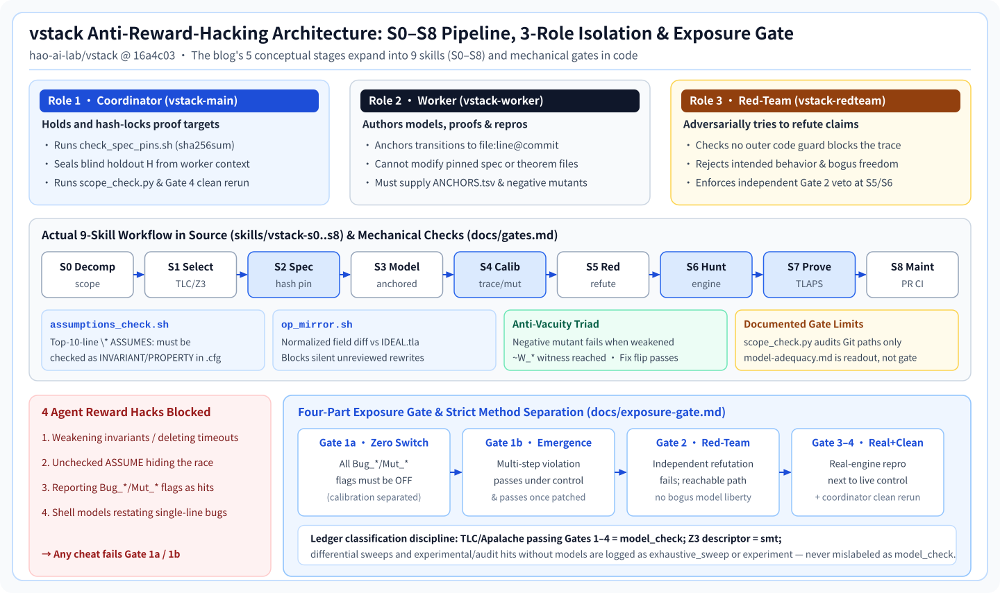
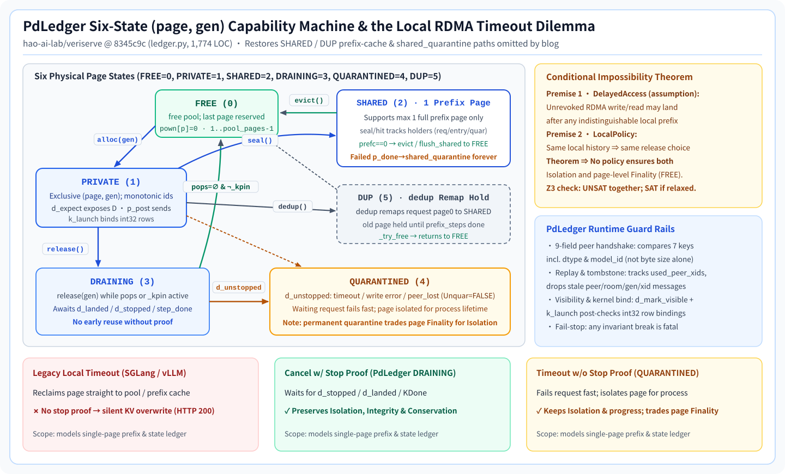
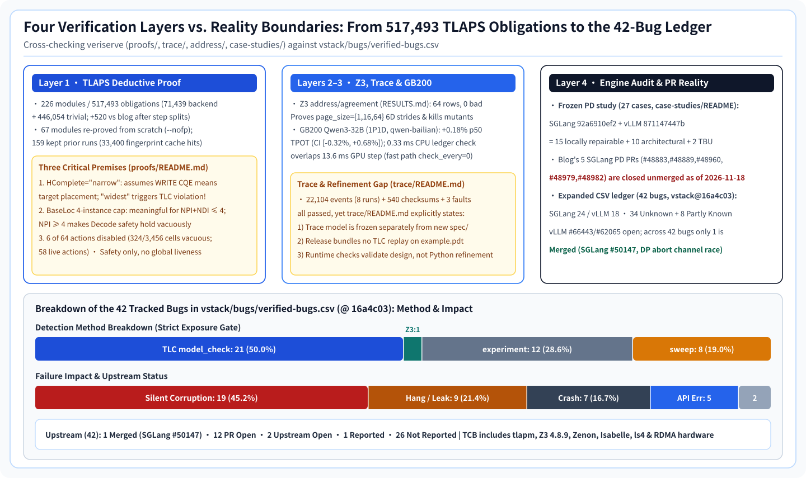

> Prepared with AI assistance from the [Hao AI Lab technical report](https://haoailab.com/blogs/verifiable-llm-infra/) (November 10, 2026) and pinned source inspection of [`hao-ai-lab/vstack@16a4c03`](https://github.com/hao-ai-lab/vstack/tree/16a4c0351b058130ae4a4ff6d520625c0da22b1d) and [`hao-ai-lab/veriserve@8345c9c`](https://github.com/hao-ai-lab/veriserve/tree/8345c9c9da1e45b4988599e488c8566130a2fc19). An earlier [2026-11-12 daily Tech Note brief](/tech/en/haoailab-vstack-verifiable-llm-infra/) summarized the blog post; this standalone close reading audits the underlying state machines, TLAPS proof premises, trace decoupling, and the 42-bug ledger directly from source. Local TLC, TLAPS, and GB200 benchmarks were not executed.

**Once coding agents can write LLM inference schedulers, KV allocators, and custom kernels, the bottleneck moves from raw generation capability to verification.** Hao AI Lab tackles this "second half" problem with two tightly coupled artifacts: **[`vstack`](https://github.com/hao-ai-lab/vstack)**, an anti-reward-hacking verification workflow for coding agents, and **[`VeriServe`](https://github.com/hao-ai-lab/veriserve)**, a Prefill-Decode (PD) disaggregated serving prototype built around a formally checked KV-page capability ledger.

A surface reading of the blog highlights two headline numbers—516,973 TLAPS obligations passed and +0.18% mean p50 TPOT overhead on NVIDIA GB200. Cross-checking `gates.md`, `proofs/README.md`, `trace/README.md`, `case-studies/README.md`, `verified-bugs.csv`, and the 1,774-line `ledger.py` reveals a sharper engineering picture: what the proofs actually establish, where hardware assumptions and four-instance topology caps sit, and how carefully the authors fence off model-checking hits from experimental findings.

<h2 id="section-a">Problem root: why disaggregated PD serving suffers silent HTTP 200 KV corruption</h2>

Modern serving engines have evolved from single-node executors into asynchronous distributed systems that layer paged KV memory, shared prefix caching, and one-sided **GPUDirect RDMA** over the exact same pool of physical GPU KV pages.

When a request aborts or hits a local deadline, cleanup races simultaneously across **NIC DMA queues, CPU prefix trees, and GPU attention kernels**. Because one-sided GPUDirect RDMA writes straight into target GPU memory without target-CPU involvement, lifecycle races frequently leave the HTTP path intact: the server returns **`HTTP 200 OK`** while silently blending one user's KV cache into another user's output. Citing recent LMSYS and Cloudflare production disclosures (including a rejected-request KV handoff defect impacting `155` user responses), the report emphasizes why multi-GPU RDMA timing races routinely slip past single-machine CI.

To bound this subsystem, the authors specify four targets:

| Formal target | Original specification | Close-reading observation: how production engines break it |
|---|---|---|
| `Isolation` | In-flight RDMA or late control messages from an old request never read/overwrite a new request's memory or state | Bare integer `page_id` handles plus local-deadline reclamation allow late DMA writes to hit freshly reassigned pages |
| `Integrity` | Every KV page read by Decode attention or published to the prefix cache holds complete data from the right generation | Publishing KV pages into shared prefix caches without checking mid-flight generation invalidation poisons later prefix hits |
| `Finality` | Every active request and draining page reaches a terminal state in finite steps rather than hanging forever | **Crucial distinction**: `VeriServe` fails timed-out requests promptly, yet permanent `QUARANTINED` still does *not* satisfy page-level reclamation to `FREE` |
| `Conservation` | Every physical page stays strictly accounted for: returns to `FREE` only with stop evidence, otherwise isolated in `QUARANTINED` | Unrenewed transfer leases or dropped abort notifications leave Decode waiting indefinitely while leaking KV capacity |

**Analysis**: The root vulnerability is not merely a forgotten lock in one file—it happens because transport workers, prefix caches, and schedulers maintain separate local counters over bare integers without sharing a single atomic, versioned ownership token.

Source: [Hao AI Lab blog post](https://haoailab.com/blogs/verifiable-llm-infra/), [VeriServe README](https://github.com/hao-ai-lab/veriserve/blob/8345c9c9da1e45b4988599e488c8566130a2fc19/README.md).

<h2 id="section-b">vstack anti-reward-hacking architecture: from 5 conceptual stages to S0–S8 and the 4-part Exposure Gate</h2>

Asking a capable coding agent to "model this engine in TLA+ and make TLC/TLAPS pass" invites classic verifier reward-hacking: when the checker flags an interleaving race, naive agents weaken the invariant, delete the timeout path, or insert an unjustified `ASSUME` to reach zero errors—closely paralleling the failure modes analyzed in [Verified but Vacuous](/digest/en/daily/2026-11-06/#paper-arxiv-2611.05590).

<figure>
<a class="note-image-link" href="/assets/images/tech/verifiable-llm-infra-close-reading/vstack-gates-en.svg" target="_blank" rel="noopener" aria-label="vstack anti-reward-hacking workflow mapping S0 to S8 skills, 3-role isolation, and the 4-part Exposure Gate (based on hao-ai-lab/vstack@16a4c03).">Enlarge diagram ↗</a>
<figcaption>Figure 1 · <code>vstack</code> source-level workflow (commit <code>16a4c03</code>): 3-role separation, the 9 skills (<code>S0–S8</code>), mechanical checks, and the 4-part Exposure Gate. Explanatory diagram from pinned repository docs and scripts.</figcaption>
</figure>

**First divergence between blog and repository**: While the post outlines five conceptual stages (`Specification → Abstraction → Validation → Verification → Continuous Checking`), [`hao-ai-lab/vstack@16a4c03`](https://github.com/hao-ai-lab/vstack/tree/16a4c0351b058130ae4a4ff6d520625c0da22b1d) actually implements **9 skill stages (`s0-decompose` through `s8-package-maintain`)** across **3 role-isolated agents** (`vstack-main` coordinator, `vstack-worker`, `vstack-redteam`).

Inspecting `scripts/` and `docs/gates.md` surfaces four concrete enforcement mechanisms—along with their documented limits:

| Mechanism | Repository implementation | What it stops / documented limit |
|---|---|---|
| Spec hash pinning | [`check_spec_pins.sh`](https://github.com/hao-ai-lab/vstack/blob/16a4c0351b058130ae4a4ff6d520625c0da22b1d/scripts/check_spec_pins.sh) runs `sha256sum --check --strict` against `SPEC_PINS` | Blocks workers from silently rewriting coordinator-locked goals or theorems; cannot detect missing specification coverage on its own |
| Mandatory assumption promotion | [`assumptions_check.sh`](https://github.com/hao-ai-lab/vstack/blob/16a4c0351b058130ae4a4ff6d520625c0da22b1d/scripts/assumptions_check.sh) enforces `\* ASSUMES:` headers and verifies every name in `.cfg` | Forces every stated model assumption to be checked as an `INVARIANT` or `PROPERTY`; lexical format check, not a full semantic TLA+ parser |
| Operator mirror & anti-vacuity | `op_mirror.sh` normalizes diffs vs. `IDEAL.tla`; anti-vacuity requires Negative mutants, `~W_*` witnesses, and Fix flips | Rejects unapproved rule rewrites and vacuously satisfied invariants (`W_*` never reached); `op_mirror` assumes constrained `CASE`/record syntax |
| 4-part Exposure Gate | [`exposure-gate.md`](https://github.com/hao-ai-lab/vstack/blob/16a4c0351b058130ae4a4ff6d520625c0da22b1d/docs/exposure-gate.md): zero `Bug_*/Mut_*` flags (1a), multi-step emergence with passing control (1b), Red-Team survival (2), real-engine control repro (3), clean coordinator rerun (4) | **Strong epistemic hygiene**: only findings clearing Gates 1–4 count as `model_check` or `smt`; differential sweeps (`exhaustive_sweep`) and code audits/repros (`experiment`) stay strictly separated |

Three candid disclosures inside `docs/` rarely appear in high-level summaries:
1. **`scope_check.py` is not an OS sandbox**: [`docs/gates.md`](https://github.com/hao-ai-lab/vstack/blob/16a4c0351b058130ae4a4ff6d520625c0da22b1d/docs/gates.md) states plainly that auditing Git changed paths against role globs cannot identify which process wrote a file and does not replace OS isolation.
2. **The Model Adequacy Readout sets no pass thresholds**: [`docs/model-adequacy.md`](https://github.com/hao-ai-lab/vstack/blob/16a4c0351b058130ae4a4ff6d520625c0da22b1d/docs/model-adequacy.md) computes Trace Acceptance Rate (`TAR`), historical fix emergence (`Cov_emergent`), and blind detection recall (`BDR`) with 95% Clopper–Pearson intervals, explicitly noting that small sample sizes (`N = 10`) leave good and poor models overlapping—so it reports diagnostics rather than acting as a pass/fail gate.
3. **Five mathematical gates for TLAPS**: Calling a module "machine proved" requires bytecode-pinned closure integrity, zero new module-level `AXIOM/ASSUME`, full 3,456-cell dependency closure, zero `OMITTED` lines or truncated logs, and either strict whole-module passes or source-location **multiset reconciliation** against native `tlapm -N` obligation inventories.

<h2 id="section-c">Empirical audit of SGLang and vLLM: 27 PD cases, the 42-bug ledger, and upstream PR reality</h2>

Separating the repository's two bug datasets sharpens what `vstack` actually caught and what upstream communities have merged so far.

First, [`veriserve/verification/pd-disagg/case-studies/README.md`](https://github.com/hao-ai-lab/veriserve/blob/8345c9c9da1e45b4988599e488c8566130a2fc19/verification/pd-disagg/case-studies/README.md) documents a frozen PD-disaggregation study of SGLang (`92a6910ef2`, Mooncake) and vLLM (`871147447b`, NIXL) totaling **`27` frozen cases** across five root causes (note: counts include model-only and scenario variants rather than 27 distinct root bugs, and exclude 3 out-of-scope SGLang HiCache host-cache cases):

| Root cause | Engine | Cases | Observed evidence & classification |
|---|---|---:|---|
| Treating timeout or error as stopped access | SGLang (Mooncake) | 4 | GB200 deadline release & failed write outliving deadline; architectural tradeoff |
| Prefill room reuse losing lifetime identity | SGLang (Mooncake) | 10 | Queued chunk generation mismatch, stale `TransferInfo`, lost abort poison; mostly locally repairable |
| Decode room reuse losing lifetime identity | SGLang (Mooncake) | 3 | `CommonKVReceiver._clear()` idempotency on early alloc & ack overwrite; partial GB200 repro |
| Treating lease expiry or error as quiescence | vLLM (NIXL) | 7 | GB200 repro: reading after source lease expiry and publishing corrupt KV to global prefix cache |
| Push-side decode wait lacking completion path | vLLM (NIXL) | 3 (+1 trigger) | Mismatched heartbeat key skipping lease renewal + missing receive timeout causing KV leak/hang |

Overall, the frozen classification marks **`15` locally repairable**, **`10` architectural** (reclamation vs. hardware quiescence), and **`2` undecided**.

Second, [`vstack/bugs/verified-bugs.csv`](https://github.com/hao-ai-lab/vstack/blob/16a4c0351b058130ae4a4ff6d520625c0da22b1d/bugs/verified-bugs.csv) (`16a4c03`, `VS-001`–`VS-042`) tracks **`42` verified bugs** (`24` SGLang, `18` vLLM; `34` net-new `Unknown`, `8` `Partly Known`):

- **Strict Exposure-Gate method split**: **`21` `model_check` (TLC)** + **`1` `smt` (Z3)** = **`22` formal hits (52.4%)**, alongside **`12` `experiment` (28.6%)** and **`8` `exhaustive_sweep` (19.0%)**. Notably, `exposure-gate.md` explicitly stipulates that shell models (such as a CUDA-graph padding-row constant restating a defect) remain code-reading leads rather than `model_check`, and classifies model-free audits or engine repros (like `VS-014`, where `Engine.shutdown()` SIGKILLs unrelated host child processes) strictly as `experiment`.
- **Failure impact**: **`19` (`45.2%`) cause Silent Corruption**, vs. `9` Hang/Leak, `7` Crash, `5` API Error, `1` Non-Determinism, and `1` Request Error—underscoring how frequently concurrency defects return corrupt results with no error signal (e.g., DP-attention unordered abort channel losing `33/204` aborts on 4× GB200 in `VS-002`, overlap weight updates overwriting active `forward_stream` weights in `VS-003`, or shared-batch logprob scaling under deterministic inference in `VS-010`).
- **Upstream PR check as of November 18, 2026**: All **five initial SGLang PD PRs** cited in the blog ([`#48883`](https://github.com/sgl-project/sglang/pull/48883), [`#48889`](https://github.com/sgl-project/sglang/pull/48889), [`#48960`](https://github.com/sgl-project/sglang/pull/48960), [`#48979`](https://github.com/sgl-project/sglang/pull/48979), [`#48982`](https://github.com/sgl-project/sglang/pull/48982)) are currently **closed unmerged** (`#48883`, for instance, failed CI PR-title lint), while [`vLLM #66443`](https://github.com/vllm-project/vllm/pull/66443) and [`#62065`](https://github.com/vllm-project/vllm/pull/62065) remain **open**. Across all `42` tracked bugs, **`1` PR is merged** ([`SGLang #50147`](https://github.com/sgl-project/sglang/pull/50147) for `VS-002`), with `12` open PRs, `2` upstream issues, `1` reported, and `26` not yet reported. Formal discovery still runs well ahead of upstream merge velocity.

<h2 id="section-d">The local-timeout impossibility theorem and PdLedger's six-state (page, gen) capability machine</h2>

Why can't tighter CPU timeouts or callback retries fix the architectural PD races? In [`verification/pd-disagg/case-studies/impossibility/`](https://github.com/hao-ai-lab/veriserve/blob/8345c9c9da1e45b4988599e488c8566130a2fc19/verification/pd-disagg/case-studies/impossibility/README.md), TLAPS (`53/53` and `27/27` obligations) and Z3 prove a crisp conditional trade-off.

<figure>
<a class="note-image-link" href="/assets/images/tech/verifiable-llm-infra-close-reading/pdledger-lifecycle-en.svg" target="_blank" rel="noopener" aria-label="PdLedger six-state (page, gen) capability state machine and RDMA timeout dilemma (based on hao-ai-lab/veriserve@8345c9c ledger.py).">Enlarge diagram ↗</a>
<figcaption>Figure 2 · Complete six-state capability lifecycle in <code>PdLedger</code> (<code>ledger.py</code>, 1,774 lines) and the conditional impossibility trade-off: restoring the <code>SHARED</code> and <code>DUP</code> prefix-cache paths plus <code>shared_quarantine</code> omitted from the blog's simplified 4-state figure.</figcaption>
</figure>

**Examine the theorem's two premises carefully**:
1. **`DelayedAccess`**: Assumes a stale physical DMA write—or unrevoked remote READ—can arrive after any finite locally indistinguishable history prefix. The repository notes explicitly that **unbounded delay is a worst-case modeling assumption, not an empirical measurement** (and residual access after a failed READ plus handle release stays an unverified premise).
2. **`LocalPolicy`**: Identical local observation histories must yield identical page-release decisions.

Under `DelayedAccess ∧ LocalPolicy`, no causal local policy satisfies both `Isolation` and page-level `Finality` (eventual return to `FREE`). Z3 confirms the legacy premises are `UNSAT`, flip to `SAT` when either `DelayedAccess` or `LocalPolicy` is dropped, yet remain `UNSAT` even if end-to-end generation checks (`NoGenerationValidation`) are added—because software version checks cannot block an already-posted NIC DMA write to raw memory.

**Vital nuance**: Contrary to a casual reading of the blog, `VeriServe` does **not** escape this impossibility by proving page-level `Finality`. As `impossibility/README.md` states directly, *"permanent quarantine still does not satisfy eventual `Free`."* Instead, `PdLedger` decouples **request termination** from **page reclamation**: on a `d_unstopped` timeout without stop evidence, the waiting request fails cleanly (preserving request liveness), while the exposed physical page stays in `QUARANTINED` for the process lifetime (or retains a permanent `(eid, page)` lock in `shared_quarantine` when an outgoing transfer on a `SHARED` prefix page fails), spending bounded capacity to enforce strict `Isolation` and `Integrity`.

Reading [`python/minisgl/disagg/ledger.py`](https://github.com/hao-ai-lab/veriserve/blob/8345c9c9da1e45b4988599e488c8566130a2fc19/python/minisgl/disagg/ledger.py) line by line surfaces critical implementation guard rails beyond the blog summary:
- **Six explicit states and one-page prefix boundary**: `FREE=0, PRIVATE=1, SHARED=2, DRAINING=3, QUARANTINED=4, DUP=5`. Docstring lines 23–25 specify that **prefix sharing supports only a single complete Prefill prefix page** (declared upfront via `prefix_tokens`; multi-page prefix trees are outside `veriserve`). When `dedup()` remaps a request's duplicate page to an existing `SHARED` entry, the replaced page moves to `DUP` until its last in-flight kernel snapshot (`prefix_steps`) finishes and `_try_free()` returns it to `FREE`.
- **9-field peer layout handshake**: Peer validation (`LAYOUT_COMPARED`) matches **`(num_layers, page_size, kv_heads, head_dim, itemsize, dtype, model_id)`** across peers while keeping `pool_pages` and `base_ptr` per-instance—explicitly catching `bf16` vs. `fp16` or `fp8_e4m3fn` vs. `fp8_e5m2` mismatches that share equal byte size (`itemsize`).
- **Dummy padding reservation & post-checked kernel args**: Monotonic `gen`/`xid`/`eid` never wrap or reuse; the final pool page stays permanently outside ledger allocation (`1..pool_pages - 1`) for CUDA-graph padding; `k_launch()` builds FlashInfer int32 indices (`K_LIM = 0x7FFF_FFFF`), checks row bindings (`bind_row`), and verifies generated arrays against raw internal state via `_kargs_post()` before committing the step—raising a fatal `LedgerViolation` on any invariant break.

<h2 id="section-e">What is proved vs. unproved? Auditing four hidden boundaries behind 517,493 TLAPS obligations</h2>

`VeriServe` packages its full TLAPS closure, Z3 results, and trace scripts openly in the repository. Inspecting `proofs/README.md`, `address/RESULTS.md`, and `trace/README.md` reveals four essential boundaries governing what the proof guarantees—and what remains unproved:

<figure>
<a class="note-image-link" href="/assets/images/tech/verifiable-llm-infra-close-reading/verification-boundaries-en.svg" target="_blank" rel="noopener" aria-label="Four-layer verification vs. reality audit matrix reconciling TLAPS premises, Z3/Trace decoupling, GB200 overhead, and the 42-bug ledger.">Enlarge diagram ↗</a>
<figcaption>Figure 3 · Cross-checking the four evidence layers (<code>TLAPS</code>, <code>Z3</code> address arithmetic, <code>PdTrace</code>, and the <code>42</code>-bug SGLang/vLLM ledger) against explicit premises and upstream merge status.</figcaption>
</figure>

| Audit dimension | Blog headline impression | Exact reality in pinned repository READMEs |
|---|---|---|
| Obligation counts & cache origin | 226 modules · `516,973` obligations | [`proofs/README.md`](https://github.com/hao-ai-lab/veriserve/blob/8345c9c9da1e45b4988599e488c8566130a2fc19/verification/pd-disagg/proofs/README.md) records **`517,493` obligations** (`71,439` backend-proved, `446,054` trivial; +520 after splitting 40 slow proof steps). Only **`67` modules (`153,417` obligations)** were re-proved from scratch (`--strict --nofp`) for release, while **`159` modules (`364,076` obligations, incl. `33,400` `--safefp` cache hits)** retain prior runs; solver outputs were not re-checked by an independent checker. |
| Hardware completion premise (`HComplete`) | Proved RDMA safety unconditionally | `PdPinnedBridge.tla` assumes **`HComplete = "narrow"`**, meaning an initiator RDMA WRITE CQE implies data placement in target GPU memory (paired with `cudaDeviceFlushGPUDirectRDMAWrites`). Crucially, the README confirms: **under `HComplete = "widest"`, TLC finds a `Safety` violation.** |
| Four-instance cap & disabled actions | Universal proof over all 64 actions | ① `BaseLoc` maps only 4 locations, so the theorem is non-vacuous only for **`NPI + NDI ≤ 4`**; for `NPI ≥ 4`, Decode owns zero pages and Decode properties hold **vacuously**. ② **Six of 64 actions** (`RecvHello`, `Teardown`, `Unquarantine`, `DInband`, `KLaunchWG`, `DrainDone`) cannot fire under `Design` (`Unquar = FALSE`), leaving `324 / 3,456` induction cells vacuous (`58` live actions). ③ Safety only (`Spec => []Safety`), with **no liveness theorem**. |
| Trace decoupling & refinement gap | `22,104` events bridge Python to `PdCore` | [`trace/README.md`](https://github.com/hao-ai-lab/veriserve/blob/8345c9c9da1e45b4988599e488c8566130a2fc19/verification/pd-disagg/trace/README.md) notes that **`PdTrace`/`PdReject` is frozen separately from the newer `spec/` proof target**, packaging includes **no TLC trace run on `example.pdt`** (`memmove` CPU fixture returns `INCONCLUSIVE` under `--require-engine`), and neither runtime checks nor Z3 (`64 rows, 0 bad` in [`address/RESULTS.md`](https://github.com/hao-ai-lab/veriserve/blob/8345c9c9da1e45b4988599e488c8566130a2fc19/verification/pd-disagg/address/RESULTS.md)) constitute a full refinement proof from Python bytecode to TLA+. |

**Analysis**: Making every trusted premise explicit—from `tlapm efe4f2d-dirty` and `Z3 4.8.9` to `HComplete = "narrow"` and `Unquar = FALSE`—does not diminish `VeriServe`; it turns formal assurance into an actionable engineering contract. Future maintainers know immediately which assumptions break if they enable software unquarantine, scale beyond four PD instances, or relax hardware completion ordering.

<h2 id="section-f">GB200 overhead breakdown and takeaways for verifiable AI infrastructure</h2>

End-to-end GPUDirect RDMA benchmarks on a 4-GPU NVIDIA GB200 node (`1P1D` over Mooncake with `Qwen3-0.6B` and `Qwen3-32B` on Alibaba `qwen-bailian` traces) report:
- Median Decode-side `PdLedger` CPU check time is **`0.33 ms`** per step, overlapping cleanly with **`13.6 ms`** median HTTP TPOT; across six paired runs against an unchecked bypass baseline, overhead averages **`+0.18%` mean p50 TPOT** (`95% CI [-0.32%, +0.68%]`).
- Code inspection of `ledger.py:268-280` explains the fast path: **`check_every=0`** disables full $O(\text{pool})$ global-invariant scans on every mutation while **always enforcing local preconditions, `QuarNoReg`, touched-`SHARED` checks, and `k_launch` post-checks** (`check()` still exposes full scans for tests/sampling).
- Eight single-page prefix-sharing and eviction tests verify **`540` KV checksums** with zero mismatches and catch all **three injected glue faults**.

### Cross-comparison with durable agent runtimes

Placed beside our earlier [`Pi Durable` close reading](/tech/en/pi-durable-runtime/), a unified engineering blueprint emerges for building high-reliability LLM infrastructure—whether written by humans or coding agents:

1. **Replace bare resource integers with versioned capabilities**: Whenever asynchronous hardware DMA or external tool effects outlive local deadlines, `FREE / PRIVATE / SHARED / DRAINING / QUARANTINED / DUP` keyed by monotonic `(resource, gen)` outperforms timeout heuristics that invite silent `HTTP 200` corruption.
2. **Use mechanical gates against agent shortcuts**: Pinning `SPEC_PINS`, forcing `\* ASSUMES:` names into checked invariants, requiring negative mutants + `~W_*` witnesses, and strictly isolating `model_check` from `experiment` (`Exposure Gate`) gives multi-agent verification loops real teeth without relying on rubber-stamp "agent code review."
3. **Publish TCB boundaries alongside proof counts**: Explicitly documenting `HComplete = "narrow"`, the `NPI + NDI ≤ 4` ceiling, the 1-page prefix cap, trace-model decoupling, and upstream PR merge status turns a flashy proof metric into durable systems engineering.

Source: [VeriServe README](https://github.com/hao-ai-lab/veriserve/blob/8345c9c9da1e45b4988599e488c8566130a2fc19/README.md), [PdLedger implementation](https://github.com/hao-ai-lab/veriserve/blob/8345c9c9da1e45b4988599e488c8566130a2fc19/python/minisgl/disagg/ledger.py), [vstack mechanical gates](https://github.com/hao-ai-lab/vstack/blob/16a4c0351b058130ae4a4ff6d520625c0da22b1d/docs/gates.md).

[2026-11-12 Daily Brief](/tech/en/haoailab-vstack-verifiable-llm-infra/) · [Pi Durable Close Reading](/tech/en/pi-durable-runtime/) · [Verified but Vacuous](/digest/en/daily/2026-11-06/#paper-arxiv-2611.05590)
