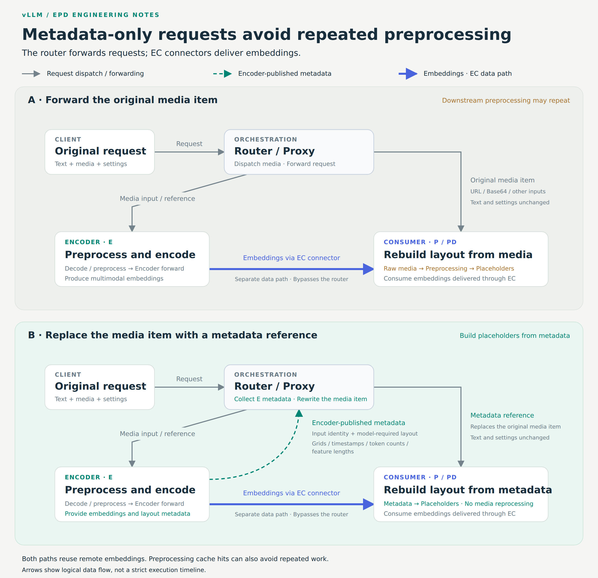

[Encoder Disaggregation in vLLM: Scaling Multimodal Serving with EPD](https://vllm.ai/blog/2026-11-11-encoder-disaggregation-epd)  
Inferact, InferMatrix, and IBM · 2026-11-11

Multimodal requests convert media into embeddings before language-model prefill and decode. Encoding demand changes with media size and modality independently of generation demand. vLLM's EPD work separates these stages while addressing a less visible cost: consumers may still download and preprocess media after encoding has moved elsewhere.

## Embeddings need a layout contract

E+PD separates encoding; E/P/D additionally separates prefill from decode. EC connectors carry embeddings, while KV connectors carry attention state from P to D.

Forwarding original media to P can repeat decoding and preprocessing merely to reconstruct placeholder lengths, grids, or feature shapes. In the metadata-only path, E returns that structural information and the router replaces downstream media items with references. Text and generation settings remain; embeddings still travel through a separate data channel.

<a class="note-image-link" href="/assets/images/tech/vllm-epd-encoder-disaggregation/handoff.png" target="_blank" rel="noopener" aria-label="The upper path forwards raw media to P; the lower substitutes encoder-produced layout metadata. Embeddings use the EC data channel in both.">View original image ↗</a>

*The upper path forwards raw media to P; the lower substitutes encoder-produced layout metadata. Embeddings use the EC data channel in both.*

The contract varies by model and modality: image grids, video timestamps, and audio token or feature lengths can all affect layout. Numeric JSON arrays avoid tensor serialization and base64 for small structural fields. The saving is repeated media processing, not necessarily a second encoder forward, which remote embeddings could already avoid.

## Separate execution must retain completion semantics

An encoder neither samples tokens nor maintains language-model KV. Model Runner V2 therefore supplies a dedicated MMEncoderModelRunner and GPU completion handling to prevent premature buffer reuse. Safe checkpoint classification can skip language-model-only shards, and encoder CUDA Graph capture retains eager fallback.

Transport includes NIXL transfers between CPU mmap regions and Mooncake TCP/RDMA. Output width cannot be inferred from the language-model hidden size alone: the tested Qwen3-Omni checkpoint produces visual width 8192 and audio width 2048. Producers measure modality-specific shapes at initialization and include them in the protocol. The NIXL protocol change requires coordinated producer/consumer upgrades.

Metadata-only consumers also lack raw media for local fallback. If remote encoding fails, the affected request must become unavailable rather than following an unsafe fallback that can terminate EngineCore. Optimization and failure isolation therefore depend on the same handoff contract.

## Shared reuse has explicit limits

On a local miss, an encoder checks Mooncake Store before computing and asynchronously publishing an embedding. Delivery to P remains P2P. Reuse validates input identity, model identity, and tensor contract. Initial support is restricted to images, the V2 runner, encoder TP=1, and no dynamic LoRA. Concurrent cold requests can still duplicate work before publication.

A six-H20 reassignment experiment moves all 512 images in 128 requests to another encoder. Repeated encoding falls from 512 to zero and p90 TTFT from 1.656 to 0.891 seconds. This single-run best case does not establish production reuse frequency or amortize Store memory and I/O costs.

## Count every GPU and preserve workload conditions

The DeepSeek V4.1 Flash comparison uses 512 MP-DocVQA questions with four to six pages each, averaging 4,905 input and 5.2 output tokens. The eight-GB200-GPU PD baseline is compared with EPD adding four encoder GPUs, with three runs per concurrency point.

At concurrency 64–128, input-plus-output throughput per GPU rises 6.6%–9.5% after counting all twelve GPUs, and p90 TTFT falls 44%–47%. At concurrency 16, per-GPU throughput is worse; at 32 it roughly breaks even. Short outputs and heavy document input limit transfer to long-generation workloads.

A separate audio comparison measures two paths within EPD: throughput rises from 62.21 to 73.13 requests/s, while accuracy changes from 75.90% to 75.65%, still requiring investigation. Video gains of 94%–115% combine GPU preprocessing and NVDEC, not disaggregation alone. The practical contribution is a measurable handoff architecture in which encoding, cache lookup, transport, and downstream queues can be tuned separately.
