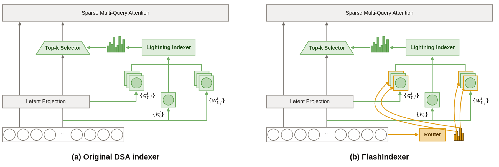

Sparse attention reads a small set of historical positions after paying to find them. Baidu ERNIE and the vLLM team describe three related choices for ERNIE 5.5 Flash Preview: use fewer index heads, match low-precision formats during training, and keep speculative drafts in step with a changing target.

Baidu ERNIE Team and vLLM Team · Source date 2026-11-24 · [vLLM Day-0 Support for ERNIE 5.5 Flash Preview: Plugin Deployment and E2E Inference Acceleration](https://vllm.ai/blog/2026-11-24-ernie-5-5-flash-preview)

## FlashIndexer selects heads before selecting tokens

The DSA indexer selects 2,048 tokens from a long history. A small router reads just the current query token's hidden state and chooses a few index heads. That routing decision costs the same as the context grows. A threshold filter then drops low-scoring positions early, shrinking the candidate pool for the final top-k. Downstream sparse attention still receives indices through the original interface.

<a class="note-image-link" href="/assets/images/tech/vllm-ernie-5-5-flash-preview/vllm-ernie-5-5-flash-preview.png" target="_blank" rel="noopener" aria-label="View original image">View original image ↗</a>

*The router on the right activates a subset of index heads before candidate filtering.*

Training targets are the positions chosen by the full-head indexer. The team freezes the backbone and original indexer and reports that about one billion tokens suffice to adapt the router. At one million context tokens, the reported indexing speedup is about 40%. Input processing also spends time in other layers, transfers and scheduling, so the reported gain applies specifically to indexing.

## Exposing training to deployment numerics

The default checkpoint uses MXFP4 weights and FP8 activations for routed experts, with FP8 elsewhere and an FP8 KV cache. Quantization-aware training matches deployment granularity, scales and rounding. The indexer cache can separately use MXFP4. Weights, KV and indexer cache are therefore distinct sites when tracing a quality regression. Fusing normalization, rotary embedding and cache writes also avoids intermediate traffic.

## Draft acceptance depends on the target and workload

The three-layer DSpark drafter can propose up to seven tokens per step. It first trains offline after the target's mid-training stage, follows target updates during post-training and undergoes on-policy distillation. A drafter left at an earlier checkpoint would spend computation on suffixes the updated target rejects. The team reports mean acceptance length above 4.0 on coding and agent workloads. Seven is the proposal limit and cannot be multiplied by baseline speed to obtain measured throughput.

The plugin lets model-specific execution evolve separately from vLLM releases. It supports data-parallel attention with expert parallelism, prefill/decode disaggregation with Mooncake KV transfer and CPU cache offloading. These layouts change communication and capacity constraints. The report explains the components but gives no matched-arrival tail-latency comparison across all combinations. Index speed alone cannot determine an optimal production layout.
