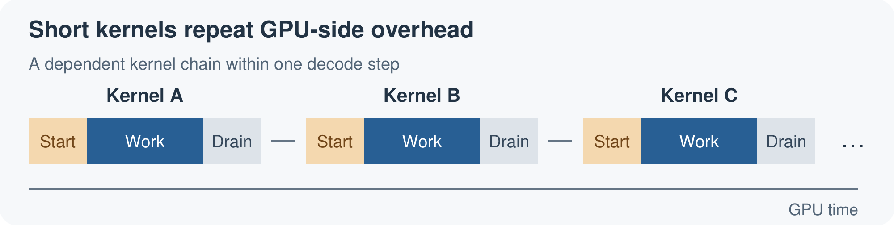

A coding agent must finish generating an action before its next tool call. At low concurrency, small waits in each layer accumulate into an observable gap between tokens. HIP graphs reduce repeated CPU submissions, but the GPU still starts successive short kernels, drains earlier work and loads the next weights. The vLLM team uses FlyDSL on AMD Instinct to reschedule those dependencies on the critical path of each request.

## What a readiness flag lets the consumer do

A MonoKernel places several dependent operator stages inside one persistent launch. A producer thread block writes a token or tile result and signals a tagged mailbox after the stores become visible. The consumer can issue its weight reads early and start once the flags for its own inputs are ready. Unrelated tiles need not finish first. Blocks can take on ready work across stages, and earlier computation can hide part of weight loading. The saving comes from narrowing what each consumer waits for while preserving its actual dependencies.

<a class="note-image-link" href="/assets/images/tech/vllm-flydsl-monokernels/overview.png" target="_blank" rel="noopener" aria-label="View original image ↗ — Each short kernel starts, computes and drains. Graph replay still leaves these device-side boundaries.">View original image ↗</a>

*Each short kernel starts, computes and drains. Graph replay still leaves these device-side boundaries.*

## Choosing boundaries for each model

FlyDSL exposes the division of work among waves and blocks, load issue points and synchronization. It compiles the schedule the author writes. A layer may use multiple MonoKernels. In DeepSeek-V4.1-Flash, standard layers put the attention front and subsequent work into K1 and K2, with different paths for other layers. A universal fusion boundary could lose the startup saving to resource pressure or communication. Prefill continues on its original path, so TTFT has a different sensitivity from decode speed.

## Reading speedup against concurrency

On the same TP2 MI355X node, DeepSeek-V4.1-Flash's concurrency-one p90 interactivity rose from 318.1 to 429.1 tokens/s/user. Across the sweep total throughput improved 1.04–1.16× and p90 TTFT moved by at most 0.1 seconds. Interactivity describes one user's generation rate. Aggregate throughput depends on how the whole device is occupied. In a separate configuration comparison at concurrency four, one TP8 server delivered 26% less throughput than two TP4 replicas. Layout and concurrency therefore matter when deciding how many GPUs to devote to a faster individual interaction.

[Keeping Agents Fast: High-Interactivity Decode with FlyDSL MonoKernels in vLLM](https://vllm.ai/blog/2026-11-18-flydsl-monokernels) · Felix Li, Lingpeng Jin, Hattie Wu, Carlus Huang, Fangzhou Ai, Zaidy Ali, Amanzhol Salykov, Hyukjoon Lee, Ziming Huang, Jun Chen, Yifeng Huang, Bin Ding, Xiaobing Zhang, Yi Gan, Vinayak Gokhale, Hongxia Yang, Doug Lehr, Richard Li, Andy Luo, Peng Sun, and Emad Barsoum · 2026-11-18
