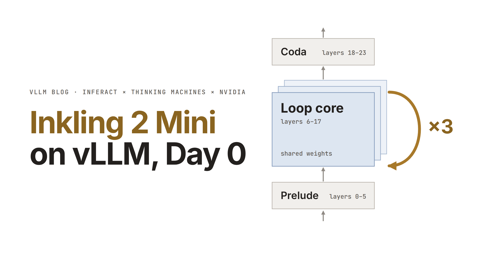

Inkling 2 Mini revisits its middle twelve layers. The weights have one identity, but each visit receives a different input. Indexing state solely by physical layer could let the next token read history produced on another pass. vLLM accounts for the visit when registering each cache layer.

Inferact, Thinking Machines and NVIDIA · 2026-11-20 · [Inkling 2 Mini on vLLM: Day-0 Support for a Looped Model](https://vllm.ai/blog/2026-11-20-inkling2-mini)

## Three passes start from the same input

Six prelude layers run once, layers 6–17 run three times by default, and six coda layers continue from the last pass. Each core pass starts from the prelude output. Later passes read messages from the previous pass’s two residual blocks. Q, K, V and MLP inputs have distinct learned queries, and a rank-64 controller mixes each message with its input per channel. Each later pass therefore performs 48 message reads. Identical projections need not produce identical keys for the same historical token.

<a class="note-image-link" href="/assets/images/tech/vllm-inkling2-mini-2026-11-20/figure.png" target="_blank" rel="noopener" aria-label="The prelude and coda run once around three visits to the shared twelve-layer core.">View original ↗</a>

*The prelude and coda run once around three visits to the shared twelve-layer core.*

## Registering logical visits with the existing manager

Six prelude visits, three sets of twelve core visits and six coda visits give 48 KV caches and 48 convolution states. Registering each extra core visit as an attention layer lets the existing page and prefix managers handle them. To limit kernel launches, vLLM combines four message reads per layer, stacks controller projections into batched matrix multiplies and fuses the gated merge with the following normalization. Message merging retains FP32 arithmetic. DSpark reads the prelude, passes two and three, and the final output, tying its draft inputs to specific visits.

## What sharing KV actually saves

A variable-loop research checkpoint allows pass count and KV sharing to change at startup. Shared KV overwrites the token’s keys and values on each pass, so later tokens read the last pass’s version. Convolution states stay separate. The fixed-loop Mini checkpoint rejects both overrides.

On one GB200 at TP1 with a 4K context, the report times forward execution. At batch 32, one, two and three passes took 3.81, 5.92 and 8.11 ms per decode step, with capacities of 352K, 233K and 175K tokens. Sharing KV across three passes raised capacity to 194K at 8.10 ms. Reducing depth changes computation and frees state. Sharing KV at unchanged depth mainly recovers capacity while changing which history subsequent tokens see.
