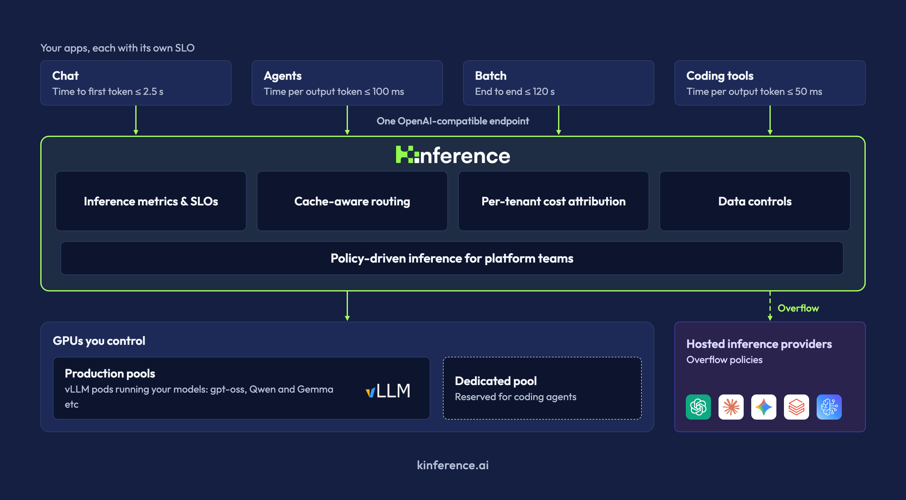

Scaling inference to multiple replicas makes cost request-specific. One GPU may already cache almost the entire system prompt while another must prefill it again; the warmest worker may also have the longest queue. Kinference places that decision in a Kubernetes control plane above vLLM, alongside tenant policies and token accounting.

Original: [Introducing Kinference: An Open Source Inference Control Plane for vLLM and Kubernetes](https://vllm.ai/blog/2026-11-04-introducing-kinference) · the Kinference Team · 2026-11-04

## Why a Service cannot express inference cost

A Kubernetes Service distributes connections without knowing which worker has a prompt's KV prefix. In Buoyant's benchmark, iptables-mode kube-proxy selects a pod for each new connection, and the load generator opens one for almost every request. The baseline therefore distributes approximately randomly across three replicas. Recomputing prefixes also competes with ongoing decoding.

Kinference predicts TTFT for each request against candidate workers using cache contents, queue state, and historical performance. It chooses the predicted fastest endpoint rather than always choosing the largest cache match: a colder worker can win if the warm worker is busy. The control plane reduces unnecessary work across replicas; vLLM still performs inference.

<a class="note-image-link" href="/assets/images/tech/vllm-kinference/kinference.webp" target="_blank" rel="noopener" aria-label="Cache-aware routing and policies connect clients to local pools and external providers, with metrics and tenant accounting. · View original image ↗">View original image ↗</a>

*Cache-aware routing and policies connect clients to local pools and external providers, with metrics and tenant accounting.*

## From the client endpoint to independently managed policies

OpenAI- or Anthropic-compatible HTTP traffic passes through a gateway and inference handler to local model pools or external providers. Declarative InferencePolicy rules use tenant, requested model, semantic tags, and cluster state, allowing review and rollback independently of model execution.

A simple-request policy can compare a cheaper model with the requested model by predicted TTFT. Moving a long conversation away from an expensive but warm worker may be slower than keeping it there. Another policy excludes local endpoints above a queue threshold before considering cloud providers. These encode candidate constraints and order, without proving that model substitution preserves answer quality.

The PII example constrains before optimizing: tagged requests exclude external providers and reject when no eligible endpoint remains. This fail-closed behavior assumes the tag was correctly generated; policy enforcement does not prove perfect sensitive-data classification. Its engineering value is separately reviewable routing authority, rather than treating a semantic classification as an unrestricted authorization.

## Conditions behind the 95% TTFT reduction

The [official benchmark](https://buoyant.io/blog/distributed-inference-benchmarks-kinference-vs-plain-kubernetes) uses two identical three-replica pools on AWS. Each worker has an L40S and runs vLLM 0.31.0 with Qwen-3.8-27B-FP8; GuideLLM runs on another node. Light-load latency uses low-rate Poisson arrivals and three trials per condition. Shared-prefix requests choose one of twenty-four 16,000-token prefixes, append 256 unique tokens, and generate 256 tokens.

Median shared-prefix TTFT falls from 6.88 to 0.31 seconds, approximately 95%, and median end-to-end latency from 20.5 to 11.3 seconds, approximately 45%. Eight-turn conversations improve median TTFT from 1.70 to 0.59 seconds, about 65%; their first turn has no reusable history. With independent prompts, median TTFT is 6.92 versus 6.83 seconds, without a significant difference. At fixed arrival rates, output throughput is approximately equal, so these latency gains are not equivalent throughput gains.

## Capacity gains and SLO attainment are different

The capacity experiment uses closed-loop concurrency of 4, 8, 16, 24, and 32 and counts requests meeting the latency threshold as goodput. Shared-prefix SLOs require 90% of requests to have TTFT at most eight seconds; multiturn requires four seconds. These hardware-derived targets are relatively loose and better suited to offline agent work than interactive chat.

Comparing each curve's own peak, shared-prefix goodput rises from 14.0 to 103.0 requests/minute, about 7.4×; multiturn rises from 23.8 to 82.7, about 3.5×. Peaks need not occur at identical concurrency. Kinference meets the overall shared-prefix SLO through concurrency 32 and multiturn through eight; the Service never reaches the 90% target at tested loads. Individual qualified requests do not establish overall SLO attainment.

## What the evidence transfers

The useful design combines queue state, cache placement, and governance in request routing. TTFT, ITL, end-to-end latency, cached/uncached tokens, and per-tenant usage support performance targets and cost estimates.

Evidence comes from vendor-maintained three-replica, single-model tests with repeated prefixes and plain Kubernetes distribution as the comparator. It does not establish the same gains over other cache-aware routers or validate business-level answer quality. Less sharing, frequent model changes, or strict interactive targets require new measurements. Cheaper-model routing can change semantics; routing efficiency cannot replace model-quality acceptance.
