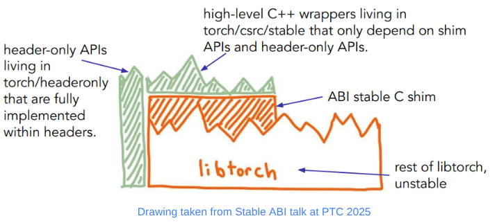

[Migrating vLLM to the LibTorch Stable ABI](https://vllm.ai/blog/2026-11-06-stable-abi-cuda)  
vLLM Team, Red Hat PyTorch Team, and Meta PyTorch Team · 2026-11-06

A PyTorch upgrade can prevent an inference extension from loading even when its source code has not changed. vLLM’s migration makes the relevant boundary auditable: the CUDA wheel and its compiled dependencies must reference stable LibTorch interfaces. The main benefit is less coupling between engine distribution and framework upgrades, rather than higher inference throughput.

<a class="note-image-link" href="/assets/images/tech/vllm-libtorch-stable-abi/official.png" target="_blank" rel="noopener" aria-label="LibTorch stable C interface, C++ wrappers, and header-only utilities · View original image ↗">View original image ↗</a>

*The stable C surface covers supported operations; wrappers depend on that surface, while the rest of LibTorch remains free to change.*

## How the stable boundary works

Source APIs and binary interfaces are different. A function can retain its apparent usage while compiled symbols, calling conventions, or layouts change. LibTorch Stable ABI provides a stable C shim, convenient C++ wrappers, and header-only utilities compiled into the extension without linking to unstable internals.

An extension can survive compatible runtime upgrades only if it stays within that supported surface. The article reports stable-ABI CUDA wheels starting with vLLM v0.33.0. Python APIs, minimum CUDA requirements, and other dependencies remain separate compatibility constraints.

## Migrating the complete dependency set

The team first inventoried PyTorch calls. Autograd machinery and stable SymInt were unavailable through the stable interface, so affected AutogradFunctions and meta functions moved to Python. A separate stable library allowed incremental migration across more than 175 C++/CUDA files and 120 headers. `TORCH_TARGET_VERSION` helps reject unstable headers at build time.

Operators use `STABLE_TORCH_LIBRARY` and `TORCH_BOX` to convert concrete C++ arguments into generic values that can cross the ABI. When a convenient wrapper is missing, `torch_call_dispatcher` can invoke ATen operations, as with `is_pinned()` during migration. Conversion, lookup, and boxing add host overhead. The authors report no noticeable runtime regression, while noting that eager execution of very fast kernels is more exposed to that overhead than warmed-up CUDA Graph execution.

Migrating vLLM alone is insufficient. Compiled dependencies such as FlashMLA, DeepGEMM, and FlashAttention can still import unstable symbols. The article’s audit outputs show the package remaining unstable after its core libraries became stable. The final wheel audit reports a minimum torch version of 2.13.0, illustrating that compatibility depends on the symbols actually used.

## What the DeepGEMM case required

DeepGEMM first moved operator registration from pybind11 to `TORCH_LIBRARY`, then to stable registration. One example originally accepted a tuple containing a tensor and optional tensor, plus a C++ `int`. The adapter splits the tuple into separate arguments and accepts the dispatcher integer as `int64_t`, converting internally. The Python interface still accepts the original tuple, preserving the user-facing API.

This is more than renaming types. Upstream version changes, the addition of DeepJIT, and a switch to a vLLM-maintained fork changed the migration surface. The article distinguishes completed fork migrations from ongoing upstream work; a stable distributed wheel does not imply every upstream dependency release has migrated.

## Evidence and limits

Correctness tests, performance checks, and line-by-line review protect behavior. CI uses `torch-abi-audit` to inspect shared-library symbols. A demonstration runs one vLLM build with PyTorch 2.14.1, then replaces torch with 2.15.0 and generates with a small model without rebuilding the engine. That verifies a concrete combination, not an entire model and hardware matrix.

CPU and ROCm builds remain future work. For inference-image maintainers, the dependency audit and DeepGEMM adaptation are the most useful sections: compatibility is a property of the complete binary dependency set, not merely a successful build of the main project.
